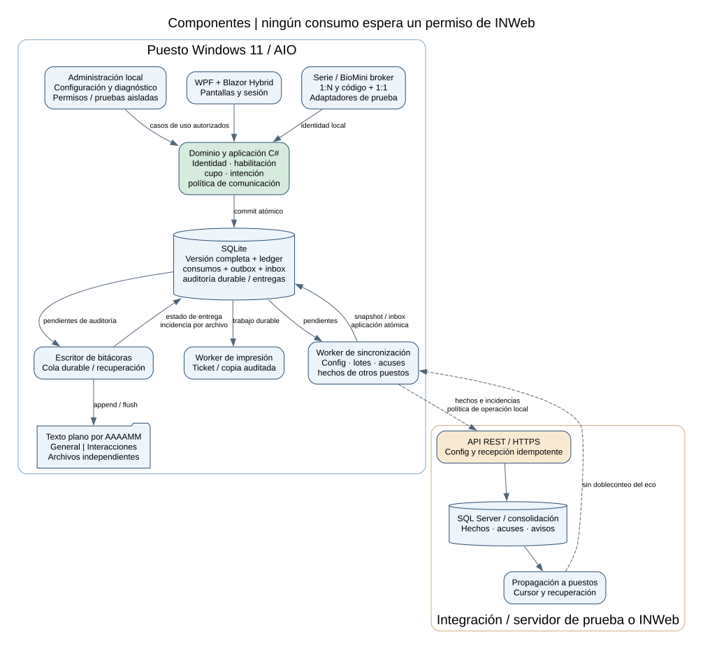

# Arquitectura de INComedor autónomo

Diseño técnico del MVP académico. C#/.NET 10, WPF + Blazor Hybrid, Microsoft.Data.Sqlite para persistencia local y ASP.NET Core para el receptor de prueba.

## Responsabilidades

El dominio del puesto resuelve identidad, habilitación, fecha de negocio, cupos y
consumo con datos locales. Una transacción SQLite registra intención, decisión,
consumo cuando corresponde, contador, Ticket, PrintJob original, evento de outbox y AuditRecord.
La impresión física ocurre después del commit. La recuperación retoma los registros
ya persistidos: no hay un intervalo en que un consumo confirmado carezca del trabajo
original. La restricción TicketId/número de copia impide crear otro original.

El puesto no espera un acuse remoto para mostrar éxito o imprimir. La sincronización
envía hechos ya ocurridos y recibe configuración para operaciones futuras. Un
certificado remoto vencido impide sincronizar, pero no convierte un consumo local
confirmado en pendiente de autorización.

INWeb administra el padrón, las habilitaciones y las reglas maestras. Cada puesto
aplica una versión completa y decide localmente. Los hechos conservan origen,
versión y hora. La consolidación deduplica transporte y expone conflictos sin
denegar retroactivamente una comida servida. Las correcciones de negocio son
eventos compensatorios autorizados, no sobrescrituras silenciosas.

## Provisión, configuración y biometría

El primer provisionamiento requiere datos válidos, recibidos por sincronización
o por un paquete local controlado. Con una base provisionada se inicia sin red;
se atiende con autonomía monopuesto o CONTINUE_LOCAL. En multipuesto auditado con
SUSPEND_NEW_CONSUMPTIONS se conservan diagnóstico y recuperación, suspendiendo
nuevas confirmaciones hasta recuperar intercambio y feed. Se usa la última configuración íntegra; no existe una caducidad arbitraria de
caché que obligue a conectarse. Sí rigen las fechas de validez que formen parte de
las reglas. Si esas reglas ya no habilitan servicios, el motivo es local y explícito.

Cada snapshot declara versión, esquema, origen y contenido. Se descarga a staging,
se validan referencias e integridad y se activa atómicamente. Una descarga parcial
conserva la versión anterior. Cada consumo registra la versión aplicada.

El padrón de BioMini incluye templates de personas habilitadas y mapeo estable a
PersonId. Se propone almacenamiento local protegido; el modelo/SDK determinará su
residencia física definitiva. No se supone almacenamiento persistente del padrón
completo dentro del lector. La distribución biométrica usa permisos y canal
separados de los eventos de consumo.

El flujo 1:N busca sobre el padrón habilitado. El 1:1 resuelve el código y luego
verifica la huella de ese candidato. Introducir un ID no equivale a autenticación
biométrica. El broker no decide cupos. Una baja conocida se aplica localmente;
una baja aún no sincronizada no puede conocerse durante el aislamiento.

## Consistencia, reloj y múltiples puestos

La intención local tiene ID estable, hash de contenido y resultado durable. Antes
de validar una sesión o reglas nuevas, el caso de uso busca IntentId y verifica
ámbito/contenido: si ya existe, devuelve su decisión original. Un cambio de regla,
una baja o el vencimiento posterior de sesión no cambia un consumo confirmado.
Sólo una intención nueva evalúa sesión, habilitaciones, vigencia y cupo actuales.
La sincronización usa EventId y BatchId estables. Igual ID con igual contenido
recupera el resultado; igual ID con otro contenido abre conflicto y conserva
el original. Un lote perdido se consulta/reenvía sin regenerar los IDs.

La fecha de negocio se calcula con hora de Windows, zona y corte configurados.
Ante saltos detectados, el puesto continúa usando esa hora y audita anomalía e
intervalo afectado (D-C17); acepta riesgo de fecha/cupo incorrectos, sin piso temporal
ni nueva suspensión por reloj. Conserva secuencia y BootId para reconstrucción.
El servidor agrega hora de recepción sin reescribir la fecha del hecho. La política
de comunicación D-A02 y la persistencia durable siguen aplicándose independientemente.
El detector y sus pruebas se describen en [SDD §7.3](especificacion-sdd.md#73-política-del-reloj-y-fecha-de-negocio).

La configuración habitual es un puesto autónomo. Para varios puestos donde se
requiere auditoría, el autor exige información en línea a INWeb y actualización
inmediata de los registros locales. Tras el commit se publica el hecho sin esperar
un proceso nocturno; el servidor lo consolida y lo propaga a los equipos del mismo
ámbito. Cada receptor incorpora consumo y cargos de cupo de manera atómica.

Los hechos recibidos no imprimen tickets ni se reenvían como nuevos consumos propios.
El eco del propio evento no incrementa otra vez el contador. EventId y ConsumptionId
de origen identifican el hecho, no el lote que lo transporta. Cursor, secuencia,
inbox durable y recuperación de huecos permiten ponerse al día tras una interrupción.
El feed de pares es un contrato complementario al OpenAPI académico de tres operaciones.

La propagación inmediata reduce, pero no elimina, una ventana concurrente: dos puestos
pueden autorizar antes de conocer el hecho del otro. Se conserva cada consumo y se
genera un aviso auditable agrupado por persona, ámbito, categoría y día, con referencias
a los consumos, estado y resolución del responsable. No se declara una garantía de
exclusión global instantánea. D-A02 quedó definida el 29/09: política configurable
por instalación, CONTINUE_LOCAL como valor inicial y SUSPEND_NEW_CONSUMPTIONS
como alternativa. OperationMode y MultiKioskOfflinePolicy pertenecen al snapshot
activo, se persisten y sobreviven al reinicio. La configuración cambia futuras
confirmaciones y no reinterpreta hechos previos.

El supervisor detecta falla de envío a INWeb o recepción del feed, incluyendo
autenticación, señal de vida y huecos de secuencia. Registra una incidencia y sus
transiciones durables. En continuidad, vincula consumos aislados con esa incidencia;
en suspensión, el dominio deniega sólo intenciones nuevas con motivo técnico.
Replay de decisiones previas e impresión de consumos confirmados siguen locales.
La recuperación exige intercambio autenticado, recepción durable de pendientes
hasta un punto de corte y actualización del ledger/feed sin huecos hasta el corte
acordado. Un ping no habilita por sí solo la reanudación. El contrato complementario
del feed fijará ese corte y la señal de vida; los umbrales técnicos se probarán antes
de implementar. No se espera resolver humanamente un aviso para reanudar.
Los eventos de apertura/cierre de incidencia viajan en los mismos lotes idempotentes;
no afectan cupos ni imprimen. Las carreras durante detección y recuperación se
conservan y auditan, sin prometer exclusión global.

## Decisiones de arquitectura

| ID | Propuesta | Razón | Costo o condición |
|---|---|---|---|
| ADR01 | C#/.NET 10; pantallas sólo Razor en Blazor Hybrid, con WPF como ventana host del BlazorWebView | Ecosistema C# y acceso Windows a periféricos; una sola tecnología de vistas, Razor, la misma del portal INWeb (ASP.NET Core MVC/Razor). | WebView2 y ensayo táctil. WPF XAML queda como contingencia si el host no cumple, no como segunda tecnología de pantallas (D-C24). |
| ADR02 | SQLite con Microsoft.Data.Sqlite local; SQL Server consolidado | SQL parametrizado y transacciones explícitas para las invariantes del puesto. | Migraciones SQL versionadas, backup y concurrencia; archivo independiente por equipo. |
| ADR03 | REST/HTTPS para configuración y hechos | Contrato explícito, adaptador INWeb desacoplado. | API y permisos todavía por implementar. |
| ADR04 | Commit local + outbox + deduplicación central | Integridad sin transacción distribuida ni servidor disponible. | Retener pendientes y tratar conflictos visibles. |
| ADR05 | Broker biométrico aislado | Separar fallas y arquitectura nativa del SDK. | Modelo, licencia, templates, x86/x64 y sesión por homologar. |
| ADR06 | Impresión desacoplada | Papel agotado no repite consumo ni cargo. | Resultado físico incierto y copia auditada. |
| ADR07 | Autonomía con últimas reglas | Requisito confirmado del autor. | Revocaciones tardías y límites entre equipos explícitos. |
| ADR08 | Administración y consolidación en INWeb | Evitar administración empresarial completa en cada pantalla. | Integración productiva posterior. |
| ADR09 | Interfaz administrativa local con roles y diagnóstico por adaptador | Configurar y probar el equipo sin INWeb en línea, aislando los periféricos de la sesión de atención. | Inventario de capacidades físicas por homologar; los permisos se comprueban en el caso de uso. |
| ADR10 | Dos archivos mensuales UTF-8/JSON Lines respaldados por cola SQLite | Bitácoras externas legibles, con IDs estables y conciliación tras fallos. | Espacio, retención y recuperación entre dos soportes. |
| ADR11 | Convención del ecosistema y adaptación explícita entre capas. | Tablas `tbComedor...`, columnas mnemónicas, negocio C# en español y raíz `Intelektron.INComedor`; DTO y adaptadores preservan el JSON y las identidades. | [Mapa de correspondencias](nomenclatura-integracion.md); detalle físico y pruebas en M0/implementación, sin acceso directo del puesto a maestros INWeb. |
| ADR12 | Credenciales por código y permisos locales dentro del snapshot de configuración | Vigencia, revocación recibida y padrón se activan juntos; roles sin herencia. Autenticación por código+1:1 o cuenta individual local de mantenimiento (D-C22); ésta no transporta contraseñas en el snapshot ni concede roles. | Demora offline aceptada. Códigos no reasignables; historial/provisión, protección de cuentas y recuperación pendientes de M0. Se conserva una sola activación de padrón y grants, sin canal alternativo de permisos. |

## Protección y despliegue

La instalación académica dispone del puesto Windows, receptor ASP.NET Core y SQL Server de prueba con EF Core para la persistencia central. Cada puesto mantiene su propio archivo SQLite, bitácoras y referencias protegidas. Las pruebas multipuesto usan dos instancias provisionadas con identidades distintas y almacenamiento separado.

App sin privilegios administrativos; base en disco local con ACL y backup consistente.
Microsoft.Data.Sqlite utiliza SQL parametrizado, claves externas activadas y transacciones explícitas. El acceso local se serializa mediante un worker/cola fuera del hilo de interfaz; una conexión pertenece a su unidad de trabajo. La API async del proveedor no convierte las operaciones SQLite en E/S asíncrona. Los conflictos de bloqueo se tratan con timeout acotado y reintento de la unidad completa, manteniendo idempotencia. Las migraciones se numeran y verifican antes de activar la versión. El motor nativo y el proveedor se fijan y registran al construir; WAL exige comprobar la versión efectiva cargada y sus correcciones. No se alojará la base en
carpetas sincronizadas o recursos de red compartidos.

Se propone mTLS para sincronización y ACL para el canal del broker. No se publicará
un HTTP local accesible a cualquier navegador. Templates, imágenes, secretos y
documentos completos quedan fuera de logs, tickets y diagnósticos. Cifrado, claves,
retención y permisos requieren aprobación productiva.

Desatendido comprende el circuito normal y recuperación automática de conexión o
proceso. No supone reposición automática de papel ni operación sin energía o con
disco agotado. Esas fallas se diagnostican sin descartar hechos para liberar espacio.

## Referencias técnicas

- [WPF con Blazor Hybrid](https://learn.microsoft.com/en-us/aspnet/core/blazor/hybrid/tutorials/wpf?view=aspnetcore-10.0).
- [Política de soporte .NET](https://dotnet.microsoft.com/en-us/platform/support/policy).
- [Microsoft.Data.Sqlite: acceso ADO.NET a SQLite](https://learn.microsoft.com/en-us/dotnet/standard/data/sqlite/).
- [Limitaciones de operaciones asíncronas SQLite](https://learn.microsoft.com/en-us/dotnet/standard/data/sqlite/async).
- [Bloqueos y errores SQLite](https://learn.microsoft.com/en-us/dotnet/standard/data/sqlite/database-errors).
- [Transacciones SQLite en .NET](https://learn.microsoft.com/en-us/dotnet/standard/data/sqlite/transactions).
- [SQLite WAL](https://www.sqlite.org/wal.html).
- [BioMini SDK](https://www.xperix.com/products/developer/sdks).

Referencias de diseño. Sustentan las elecciones; no certifican la combinación
concreta de hardware, templates y software del proyecto.

## Administración local y auditoría externa

La interfaz del Administrador del Sistema usa casos de uso con permisos para
configurar el equipo y diagnosticar API, táctil, SDK, serie, impresora, DB, red y
versiones. No sustituye la administración maestra en INWeb (ADR08). Los diagnósticos
que toman periféricos se aíslan de la sesión de atención y no crean consumos.

Se agrega un escritor serializado por bitácora general/interacciones y archivos
de texto independientes por mes. AuditRecord se persiste junto al hecho SQLite;
AuditFileDelivery respalda su entrega por destino. Si falla un archivo se continúa
con cola durable, incidencia y reconstrucción posterior (D-C14); no hay transacción
atómica SQLite/archivo. Si tampoco persiste SQLite, no se confirma una operación nueva.
Recuperar un append incierto requiere comprobar AuditId y líneas parciales, no
reinsertar consumos. [Contrato y límites](administracion-y-bitacoras.md).

ADR09 y ADR10 figuran en la tabla de decisiones de arquitectura. Los roles locales,
su autenticación sin red y la revocación por snapshot están en la
[SDD §7.4](especificacion-sdd.md#74-credenciales-y-control-de-acceso-local) y en ADR12.

## Nombres y límites entre capas

D-C18 y ADR11 adoptan el [perfil de integración](nomenclatura-integracion.md). Los proyectos bajo `Intelektron.INComedor` son los del [árbol único de la solución](../readme.md#23-descripción-de-alto-nivel-y-estructura-de-ficheros): `.Domain` contiene el negocio, `.Application` los casos de uso y permisos, `.Contracts` los DTO, `.Infrastructure.Sqlite` la persistencia local, `.Kiosk` la interfaz, `.Biometrics.Broker` el proceso del SDK, `.Devices` los adaptadores de periféricos, `.Sync.Api` el receptor y `.Integration.INWeb` el adaptador central. Un mapping explícito traduce `Consumo.CodigoConsumo` a `comconCodigo` y a `ConsumptionId`; el nombre físico no se filtra al dominio ni cambia la serialización. Las referencias nativas centrales y los UUID locales tienen tipos y ámbitos separados.
