# Modelo de datos propuesto

**INComedor es autónomo y totalmente desatendido**, con SQLite propia y las últimas reglas completas disponibles. Identificación, autorización, registro e impresión se resuelven localmente. INWeb nutre configuración y recibe hechos para consolidación eventual.

Estado: diseño lógico documental; no hay tablas, migraciones ni API implementadas por esta entrega. El MVP podrá usar adaptadores de prueba para desarrollar y demostrar los flujos. La [API seleccionada](../api/openapi.yaml) tiene tres operaciones de configuración y sincronización. El [diagrama ER](../diagrams/datos.mmd) separa entidades locales `L_`, configuración administrada centralmente `C_` y biometría protegida `B_`; los prefijos no son nombres físicos definitivos.

[ER de entidades y claves, ampliable en SVG](../diagrams/datos-er.svg). La fuente Mermaid también se incluye al final de este documento, con la lista de campos que por ahora sólo figuran en este diccionario.

## Autoridad y ubicación

| Información | Autoridad | Copia y tratamiento |
|---|---|---|
| Padrón, catálogo y reglas publicadas | INWeb como origen de configuración | Snapshot completo validado y activado en la SQLite local. La última versión completa rige hasta recibir otra. |
| Identidad del comensal en la operación | Broker y padrón local | BioMini Suprema 1:N, o código seguido de 1:1; ambos resuelven PersonId. El MVP puede usar adaptadores de prueba. |
| Intención, decisión, consumo y cupo utilizado | Transacción SQLite de esa terminal | Hechos inmutables replicados hacia INWeb. Un ACK central no autoriza ni deniega retroactivamente. |
| Ticket y estado de impresión | Cola durable local | Eventos posteriores de impresión se consolidan sin deshacer el consumo. |
| Recepción, deduplicación y revisión | INWeb | Inbox/ACK por evento; diferencias comerciales se concilian conservando el hecho local. |
| Plantillas biométricas | Fuente autorizada y broker local | Almacén separado y protegido; no viajan junto al catálogo ni se incluyen en consumos o logs. |

La primera provisión requiere configuración y material de identidad adecuados. Con base ya provisionada, el arranque y servicio del perfil habitual de un puesto autónomo no requieren acceso a INWeb. En ese perfil, la caída de red, un ACK pendiente o la credencial de sincronización vencida no bloquean la operación local. En modo multipuesto auditado se informa en línea y cada puesto incorpora inmediatamente consumos de los pares; la política al perder comunicación es configurable por instalación: `CONTINUE_LOCAL` (valor inicial) o `SUSPEND_NEW_CONSUMPTIONS`. Persiste en el snapshot activo, también tras reinicio. El modo suspendido conserva diagnóstico, reimpresión y replay; reanuda nuevas confirmaciones tras recuperar intercambio y feed, según la sección 7.1 de la SDD. No se impone un TTL arbitrario de caché. Una baja central todavía no recibida puede permanecer operativa localmente; ese límite deriva de la autonomía.

## Diccionario de la SQLite local

UUID identifica hechos y referencias; las claves externas se mantienen como texto para conservar ceros iniciales. `R` significa requerido, `O` opcional. PK = clave primaria; FK = clave foránea; UQ = unicidad. Tipos lógicos del ER: los instantes son `datetime` en UTC, los hashes son `bytes` de 32 bytes (SHA-256) y los contenidos estructurados, `json`. Los instantes UTC conservan la hora local declarada; BusinessDate se calcula localmente con zona y corte configurados. El servidor conserva además su hora de recepción sin reescribir el hecho.

| Entidad | Campos principales y tipos | Claves y restricciones |
|---|---|---|
| KioskConfiguration | `KioskId`, `SiteId`, `OrganizationId` UUID R; `TimeZoneId` texto R; `BusinessDayStartLocal` hora R; `ActiveSnapshotId` UUID R; `OperationMode`, `MultiKioskOfflinePolicy` enum R | PK KioskId; FK snapshot activo. SiteId representa la instalación académica. OperationMode: SINGLE_KIOSK o MULTI_KIOSK_AUDITED; MultiKioskOfflinePolicy: CONTINUE_LOCAL inicial o SUSPEND_NEW_CONSUMPTIONS. El publicador explicita ambos valores; la política por instalación se activa con el snapshot y no se reinicia al arrancar. Sitio y organización provienen del registro de provisión. |
| ConfigurationSnapshot | `SnapshotId` UUID R; `ConfigurationVersion`, `SchemaVersion`, `CatalogVersion`, `PolicyVersion`, `PeopleVersion` int R; `PublishedAtUtc`, `ActivatedAtUtc` UTC R; `PayloadHash` bytes(32) R; `Status` enum R | PK SnapshotId; UQ ConfigurationVersion en el equipo. Staging, validación integral y activación atómica. No mezclar filas de snapshots incompatibles. |
| PersonReference | `PersonId` UUID R; `SnapshotId` UUID R; `DisplayName` texto R; `Active` bool R; `IdentityMaterialVersion` int R | PK `(SnapshotId, PersonId)`; FK snapshot. Referencias históricas se conservan para consumos existentes; Activo no equivale a derecho a comedor. |
| PersonExternalKey | `ExternalKeyId`, `SnapshotId`, `PersonId` UUID R; `SourceSystem`, `ExternalKey` texto R | PK ExternalKeyId; FK compuesta a persona; UQ `(SnapshotId, SourceSystem, ExternalKey)`. Identificadores y códigos no se escriben en logs. El código de identificación se modela en PersonCredential; los templates, en el almacén biométrico. |
| PersonCredential | `SnapshotId`, `CredentialId`, `PersonId` UUID R; `Kind` enum R; `NormalizedValue` texto R; `ValidFromUtc`, `ValidToUtc`, `RevokedAtUtc` UTC O | PK `(SnapshotId, CredentialId)`; FK compuesta a persona del mismo snapshot. `NormalizedValue` conserva ceros iniciales. UQ `(SnapshotId, Kind, NormalizedValue)` sin filtro por revocación. No reasignar a otra persona ni reutilizar tras retirar la fila; validar titularidad histórica (D-C20) y estabilidad de CredentialId. Registro histórico y ámbito se especifican en M0. Vigencia inicio inclusive, fin exclusivo; RevokedAtUtc no puede superar PublishedAtUtc y su presencia revoca al activar el snapshot. Aplica RB25; no se escribe en logs, tickets ni eventos. |
| LocalOperatorGrant | `SnapshotId`, `GrantId`, `PersonId` UUID R; `Role` enum R (`OPERATOR`, `SYSTEM_ADMINISTRATOR`); `ValidFromUtc`, `ValidToUtc`, `RevokedAtUtc` UTC O | PK `(SnapshotId, GrantId)`; FK compuesta a persona del mismo snapshot; UQ `(SnapshotId, PersonId, Role)`. Permiso local distribuido en el snapshot; revocar es publicar `RevokedAtUtc` no posterior a PublishedAtUtc o retirar la fila. Se aplica al activar el snapshot, sin depender de alcanzar una fecha local. Aplica RB26. |
| PersonGroup y GroupMembership | Grupo: `SnapshotId`, `GroupId` UUID R. Membresía: `SnapshotId`, `GroupId`, `PersonId` UUID R | PK grupo `(SnapshotId, GroupId)`; PK membresía de los tres campos; FK a grupo/persona de la misma versión. |
| ServiceType | `SnapshotId`, `ServiceTypeId` UUID R; `Label` texto R | PK `(SnapshotId, ServiceTypeId)`; FK snapshot. Tipo de servicio no se confunde con variante del menú. |
| QuotaScope y QuotaBucket | `SnapshotId`, identificador UUID R; `Definition` o `Label` R | PK compuesta snapshot/identificador. Ámbito y categoría vienen de reglas; una variante no crea un cupo independiente accidental. |
| MenuItemVersion | `SnapshotId`, `MenuItemId`, `ServiceTypeId` UUID R; `MenuVersion` int R; `Label` texto R; `Currency` texto R; `Scale` int R; `EmployeeChargeMinor` int64 R | PK `(SnapshotId, MenuItemId)`; UQ versión del menú dentro de su publicación. FK al servicio de ese snapshot. Precios no negativos; ausencia no se interpreta como cero. VendorCostMinor no se copia al kiosco. |
| MenuQuotaCharge | `SnapshotId`, `MenuItemId`, `QuotaBucketId` UUID R; `Units` int R | PK de los tres UUID; FK menú/categoría; Units positiva. Un menú puede afectar varios cupos. |
| EntitlementRule | `SnapshotId`, `RuleId` UUID R; `PersonId` UUID O; `GroupId` UUID O; `ServiceTypeId`, `QuotaScopeId`, `QuotaBucketId` UUID R; `Limit`, `Priority` int R; `ValidFromUtc`, `ValidToUtc` UTC O | PK `(SnapshotId, RuleId)`; FK a referencias del mismo snapshot. Exactamente uno entre persona y grupo; límite no negativo. Vigencia inicio inclusive/fin exclusivo; límites ausentes no acotan ese extremo; fin posterior al inicio. Una regla vigente aplicable con Limit=0 deniega y prevalece sobre todo permiso del mismo servicio/ámbito/categoría. Sólo entre permisos positivos gana Priority mayor; empates incompatibles impiden publicar. Semántica propuesta, sin valores comerciales inventados. |
| IdentitySession | `IdentitySessionId` token opaco R; `SnapshotId`, `PersonId` UUID R; `CredentialId` UUID O; `Method` enum R; `Purpose` enum R (`CONSUMPTION`, `PRIVILEGED_ACTION`); `IssuedAtUtc`, `ExpiresAtUtc` UTC R; `ConsumedByIntentId` UUID O | PK token; FK persona versionada; FK compuesta a la credencial usada cuando el método empieza por código. Sesión local breve vinculada a la operación del puesto; no requiere resolución remota. Una sesión `PRIVILEGED_ACTION` no crea intenciones de consumo. Su vencimiento no es un TTL del padrón. |
| ConsumptionIntent | `IntentId` UUID R; `IdentitySessionId` token O; `PayloadHash` bytes(32) R; `HashSchema` texto R; `Status` enum R; `CreatedAtUtc` UTC R; `DecisionId` UUID O; `CommittedAtUtc` UTC O; `ResultPayload` JSON O | PK IntentId; FK sesión cuando existe; UQ DecisionId si existe. AUTHORIZED exige sesión. DENIED/IDENTITY_NOT_RESOLVED no la requiere. MULTI_KIOSK_COMMUNICATION_REQUIRED es una denegación técnica local sin consumo ni ticket; tras recuperar el intercambio se requiere una intención nueva. Estados PENDING/AUTHORIZED/DENIED. Campos finales presentes sólo al resolver. Mismo IntentId y payload en retry local; no crea doble efecto. |
| ConnectivityIncident | `IncidentId`, `KioskId` UUID R; `DetectedAtUtc` UTC R; `RecoveredAtUtc` UTC O; `ConfigurationVersion` int R; `MultiKioskOfflinePolicy`, `FailureKind` enum R; `FeedCursorAtDetection` int O | PK IncidentId. Apertura/cierre y evento de outbox se guardan juntos; una incidencia abierta se recupera tras reinicio. FailureKind: OUTBOUND, PEER_FEED o BOTH. Política/versión observadas se conservan; no crea cupo ni ticket. |
| Consumption | `ConsumptionId`, `IntentId`, `SnapshotId`, `PersonId`, `MenuItemId` UUID R; `Quantity`, `MenuVersion`, `PolicyVersion`, `CatalogVersion` int R; `BusinessDate` date R; `LocalCommittedAtUtc` UTC R; `ClientSequence` int64 R; `PriceSnapshot` JSON R; `ConnectivityIncidentId` UUID O | FK incidente si se confirma durante continuidad degradada; el evento conserva esa referencia. PK ConsumptionId; UQ IntentId; FK intención/persona/menú versionados. El ticket se referencia en una sola dirección, desde `Ticket.ConsumptionId` (UQ y FK); el evento `CONSUMPTION_RECORDED` toma `TicketId` de esa fila. Quantity=1 por elección como propuesta inicial, sin fijar cupo comercial. Snapshot monetario y versiones inmutables. |
| ObservedConsumption | `ConsumptionId`, `OriginKioskId`, `OriginEventId`, `PersonId` UUID R; `BusinessDate` date R; `ObservedAtUtc` UTC R; `Source` enum OWN/PEER R; `PayloadHash` bytes(32) R | PK global ConsumptionId; UQ OriginEventId. Ledger local de hechos propios y pares. Un eco de un consumo propio no vuelve a contarse; contenido incompatible abre conflicto. |
| ObservedQuotaCharge | `ConsumptionId`, `QuotaScopeId`, `QuotaBucketId` UUID R; `BusinessDate` date R; `Units` int R | PK consumo/ámbito/categoría/fecha; FK ObservedConsumption; Units positiva. Conserva cargas reales, sin inferirlas de MenuItemId. BusinessDate coincide con el hecho padre; el receptor comprueba esa igualdad por aplicación antes de proyectar. |
| QuotaUsage | `PersonId`, `QuotaScopeId`, `QuotaBucketId` UUID R; `BusinessDate` date R; `Used` int R; `Version` int R | PK persona/ámbito/categoría/fecha, la misma clave de cupo de RB03. Cada SQLite pertenece a un solo puesto, por eso el equipo no integra la clave: la fila cuenta los consumos propios y los de pares ya recibidos. Proyección atómica que agrega las ObservedQuotaCharge; no negativa y mantenida entre versiones de configuración. No certifica exclusión global durante la ventana de propagación. |
| PeerInbox y FeedCursor | Inbox: PK `FeedEventId`; FK `FeedId`; `OriginEventId`, `ConsumptionId`, `OriginKioskId`, `FeedSequence`, hash y payload. Cursor: PK `FeedId`; `LastCommittedSequence` int64 R | UQ `(FeedId, FeedSequence)`; deduplicación por EventId/ConsumptionId. Guardar recepción, ledger, contador y cursor en la misma transacción. Un hueco dispara resincronización. No crea PrintJob ni Outbox de reenvío. |
| Ticket | `TicketId`, `ConsumptionId` UUID R; `PrintData` JSON mínimo R; `CreatedAtUtc` UTC R | PK TicketId; UQ y FK ConsumptionId; un ticket lógico por consumo. Sin biometría ni costo del concesionario. |
| PrintJob | `JobId`, `TicketId` UUID R; `CopyNumber` int R; `Status` enum R; `SpoolerJobId` texto O; `LastErrorCode` texto O; `UpdatedAtUtc` UTC R | PK JobId; FK Ticket; UQ `(TicketId, CopyNumber)`. Primera copia 0; copias posteriores auditadas. Envío al spooler no prueba papel. |
| OutboxEvent | `EventId` UUID R; `IntentId` UUID O; `TicketId` UUID O; `IncidentId` UUID O; `EventType` enum R; `PayloadVersion` int R; `Payload` JSON R; `PayloadHash` bytes(32) R; `State` enum R | PK EventId; FK intención/ticket cuando corresponda; IncidentId opcional para transiciones de ConnectivityIncident. Consumptions y decisiones se graban con el hecho; eventos de impresión, con su transición. Mismo EventId/contenido en reenvíos. |
| SyncBatch y SyncBatchItem | Lote: `BatchId` UUID R; `BodyHash` bytes(32) R; `CreatedAtUtc` UTC R; `State` enum R; `AckPayload` JSON O. Ítem: `BatchId`, `EventId` UUID R | PK lote; PK ítem compuesta; FK lote/evento. Lote persistido antes de enviar; body inmutable en cada retry. Un evento puede reenviarse en otro lote sin duplicar incorporación. |

PersonId, QuotaScopeId y QuotaBucketId son identidades estables entre snapshots: las publicaciones mantienen esas referencias o incluyen una migración explícita. El contador de cuota no se reinicia al cambiar de versión. Las referencias históricas se conservan hasta el vencimiento de la retención aplicable, pendiente de definición; no se rompe una FK ni se borra un consumo para aplicar una baja.

## Datos centrales de configuración y consolidación

| Entidad | Campos y claves | Función |
|---|---|---|
| ConfigurationPublication | PK `SnapshotId`; `KioskId`, versión, esquema, hash y payload completo | Nutrir cada puesto con una versión compatible. Incluye reglas de habilitación, metadatos mínimos del padrón, credenciales por código y permisos locales; la biometría tiene provisión separada. |
| KioskRegistry | PK `KioskId`; `SiteId`, `OrganizationId`, identidad de certificado, estado de intercambio | Autenticar configuración/sincronización. Su indisponibilidad no es autoridad de consumo local. |
| SyncBatchReceipt | PK `(KioskId, BatchId)`; `PayloadHash`, estado, hora recepción y ACK durable | Recuperar exactamente el resultado de un lote después de timeout. Cambio de payload con la misma clave es conflicto. |
| InboxEvent | PK global `EventId`; `KioskId`, tipo, hash, payload original, hora recepción, `ProjectionState` y resultado | Recepción durable separada de proyección. Mismo EventId y otro contenido conserva evidencia conflictiva. Una recepción aún sin referencia conserva NEEDS_REVIEW/RELATED_EVENT_PENDING en replay, nunca DUPLICATE. El servidor retoma la proyección al llegar la referencia, sin depender de reenvío ciego. |
| ConsolidatedConsumption | PK `ConsumptionId`; UQ `OriginEventId`; `KioskId`, consumo original y `ReceivedAtUtc` | Proyección del hecho local; no vuelve a autorizar ni reescribe su fecha/decisión. Doble identidad de consumo incompatible abre revisión. |
| ReconciliationCase | PK `CaseId`; FK EventId cuando existe; tipo, evidencia y estado | Resolver conflictos técnicos o de política sin negar retroactivamente una comida servida. |
| CentralVendorCost | PK versión de precio; importe exacto, moneda y escala | Costo del concesionario conservado centralmente; no aparece en payload del kiosco. |
| ConsumptionFeed | PK `(FeedId, Sequence)`; `FeedEventId` UQ; `OriginKioskId`, `ConsumptionId`, `OriginEventId`, PersonId, cargas de cupo, payload y hash | Distribuir inmediatamente hechos incorporados a los puestos del ámbito. Cursor/replay, ACK durable y resincronización ante huecos. |
| CentralConnectivityIncident | PK `(KioskId, IncidentId)`; versión/política de apertura, FailureKind, tiempos y referencias EventId | Proyección de CONNECTIVITY_INCIDENT_RECORDED; cierre recibido antes de apertura queda en revisión recuperable hasta recibir la referencia. Replay deduplica; no agrega cupo ni impresión. |
| QuotaAuditAlert | PK `AlertId`; `PersonId`, `QuotaScopeId`, `QuotaBucketId`, BusinessDate, límite observado, consumo agregado, estado, resolución y actor/fecha O | Aviso posterior ante sobrecupo, incluyendo doble consumo aceptado por ventana de propagación. Relación AlertConsumption con los ConsumptionId involucrados. Conserva ambos hechos; no los anula ni cambia a DENIED. |

Una FK entre almacenes es sólo una referencia lógica de sincronización: no existe una transacción distribuida entre SQLite e INWeb. Cada lado persiste sus hechos y ACK; la entrega es al menos una vez con deduplicación, sin prometer exactamente una vez en la red.

El ACK original del lote conserva su estado de recepción; resolver una revisión no lo reescribe. La revisión central tiene estado y resolución propios, consultables por el contrato complementario de auditoría. DUPLICATE se usa sólo si el evento ya fue proyectado: la mera existencia en Inbox no autoriza a purgar la outbox local pendiente de revisión.

El feed de pares es un **contrato complementario** fuera de las tres operaciones OpenAPI seleccionadas: configuración no transporta esos hechos. Una emisión contiene `FeedId`, secuencia, `FeedEventId`, `OriginEventId`, `OriginKioskId`, `ConsumptionId`, `PersonId`, `BusinessDate` y cargas `(QuotaScopeId, QuotaBucketId, Units, BusinessDate)`. El kiosco acusa después de persistir; si pierde conexión o detecta un salto, retoma por cursor o recibe una reconstrucción coherente del ledger. El transporte concreto se especificará en M0. La llegada de un consumo par actualiza el cupo sin emitir otro ticket ni volver a publicar el hecho como propio.

## Persistencia pendiente para mantenimiento y titularidad

M0 debe definir dos estructuras locales todavía no representadas en el ER ni en los CSV: cuenta individual de mantenimiento (identificador, vínculo con PersonId, usuario normalizado, verificador protegido, estado, control de intentos y sesiones) e historial durable de titularidad de códigos (ámbito, tipo, valor protegido y titular estable, con procedencia). No son filas de PersonCredential de tipo contraseña ni grants nuevos: la autorización sigue en LocalOperatorGrant. Sus nombres físicos, tipos, índices, protección, provisión inicial y recuperación se diseñan antes de implementar U02/U08 y se incorporan juntos al diccionario, ER y mapas. No se incluyen en el conteo actual de 44 entidades/256 atributos ni en los 19 campos pendientes ya enumerados.

La autoridad de publicación impide reasignaciones usando su historial; el puesto valida contra el historial provisionado y conocido, incluso después de retirar una fila del snapshot. La retención del historial no se equipara a la de snapshots. M0 define el ámbito de unicidad y la evidencia para equipos nuevos/restaurados; no se afirma que comparar dos snapshots baste para garantizar toda la historia.

## Biometría y protección

`BiometricTemplateEnvelope` reside en un almacén protegido del broker en la PC, separado de consumo y catálogo. Campos propuestos: PK `TemplateId`; `PersonId`, `DeviceFamily`, `TemplateFormat`, `TemplateVersion`, estado habilitado/revocado, `KeyReference` y `Ciphertext`. La vinculación a PersonId se valida con el padrón permitido y el material autorizado de BioMini Suprema.

Los dos flujos son de primera clase: 1:N sobre templates habilitados, o código para seleccionar una persona y luego 1:1. Una coincidencia se convierte en sesión local de identidad; ninguna huella, imagen o template se agrega a la API de consumo/sincronización ni a logs. Los códigos ya tienen vigencia y revocación en PersonCredential, activadas con el padrón en el mismo snapshot; la revocación coordinada de templates se especificará en M0. El MVP puede demostrar el contrato con identidades sintéticas y adaptadores de prueba; eso no homologa el SDK ni el hardware.

SQLite estándar no cifra por defecto. ACL, protección del disco, cifrado de templates y protección/recuperación de claves son controles distintos. El mecanismo físico concreto, el formato/licencia del SDK y la retención permanecen pendientes de homologación. El esquema lógico no afirma que esa protección ya esté implementada.

## Invariantes y límites

1. La transacción local valida identidad/reglas, decide y graba intención, decisión, consumo, ObservedConsumption propio con sus ObservedQuotaCharge, contador QuotaUsage, ticket, PrintJob original, outbox y AuditRecord conforme a RB06 antes de comunicar éxito. Una decisión denegada conserva intención/decisión, outbox y AuditRecord en la misma transacción, sin Consumption, cargas, Ticket ni PrintJob. PENDING es un estado local de recuperación, nunca permiso de consumo. La recepción de pares actualiza ledger/contador de manera atómica sin crear un consumo propio.
2. La impresión ocurre después del commit local, sin esperar INWeb. Fallar al imprimir no borra el consumo. Recuperar el mismo IntentId y la clave única ticket/copia impide generar otro consumo. Un resultado físico ambiguo queda visible; no se promete una sola hoja ante cualquier falla.
3. Se descarga a staging y se activa sólo un snapshot completo válido. Un error conserva la versión anterior. La primera provisión sí es necesaria; con base existente no hay chequeo online obligatorio ni caducidad de caché inventada.
4. La sincronización conserva BatchId y EventId. Se propone SHA-256 y JSON canónico RFC 8785 versionado. Un ACK sólo permite marcar recepción; CONFLICT, REJECTED y NEEDS_REVIEW permanecen visibles con evidencia. No se purgan pendientes para liberar espacio sin una política de conservación aprobada.
5. El perfil habitual es un puesto autónomo. En multipuesto auditado, cada puesto informa en línea y todos actualizan inmediatamente el registro de consumos conocidos. El usuario acepta la ventana de doble consumo: INWeb debe generar **aviso de auditoría posterior** sobre los hechos conservados. El contador considera propios y pares recibidos, deduplicando ecos; no se promete exclusión global. La política por instalación está definida: CONTINUE_LOCAL inicial o SUSPEND_NEW_CONSUMPTIONS. Al reconectar se conservan y reconcilian los consumos aislados; un exceso genera aviso, sin anulación automática.
6. Dinero exacto: `importe = Minor / 10^Scale`. Ejemplo sintético: ARS, escala 2, 150000 unidades menores = 1500,00. Los enteros del contrato JSON se limitan a `9007199254740991` (2^53−1), aunque la base pueda usar int64, para preservar exactitud e interoperabilidad con canonicalización I-JSON/RFC 8785. Precio faltante no equivale a gratuidad. Escala/redondeo comerciales por aprobar. VendorCostMinor queda exclusivamente central.
7. Hora observada de Windows, hora de recepción central y BusinessDate son hechos distintos. El puesto sigue usando la hora de Windows y la zona/corte configurados ante un salto detectado; lo registra y señala para revisión. Se acepta el riesgo de fecha o cupo incorrectos, sin piso temporal ni suspensión por reloj. La falta de red por sí sola no demuestra que el reloj sea incorrecto; D-A02 conserva sus condiciones de comunicación y D-C14 conserva la exigencia de persistencia. Una corrección posterior no reescribe consumos, cargos o fechas confirmados.
8. Todas las cargas de cupo de un consumo tienen exactamente su BusinessDate. Productor y receptor validan la igualdad por aplicación antes de persistir/proyectar. En sincronización, una diferencia se informa como EventAck REJECTED/INVALID_EVENT; se conserva evidencia y el hecho local, sin corregirlo silenciosamente ni volverlo denegado. JSON Schema valida forma y formato, no esta igualdad entre campos (AT50).

Antes de implementar se precisarán valores productivos de cupo, catálogo, zona/corte y precios; umbrales y señal de vida de comunicación; provisión y revocación biométrica; mecanismo y sensibilidad de detección de saltos del reloj; recuperación de cola/feed, reimpresión, retención y resolución de avisos. La conducta frente al reloj ya está decidida; los parámetros instrumentales no cambian esa política. Los fixtures académicos permiten demostrar el diseño sin atribuirles validez comercial.

## Configuración técnica y respaldo de las bitácoras

Extensión del modelo local del MVP. Los archivos externos no son tablas y no
integran una transacción SQL; el ER representa sólo su respaldo y control de entrega.
R = requerido, O = opcional. [Formato externo y recuperación](administracion-y-bitacoras.md).

| Entidad local propuesta | Campos y claves | Restricciones |
|---|---|---|
| LocalSettingsRevision | PK RevisionId UUID; RevisionNumber entero R; Parameters JSON R sin secretos; ActorId UUID R, PersonId del administrador autenticado; CreatedAtUtc R; State R; PreviousRevisionId O | Revisión íntegra validada; una activa por puesto; no duplica reglas maestras ni cambia identidad del equipo por editar endpoint |
| AuditRecord | PK AuditId UUID; KioskId R; GenerationId R; Sequence int64 R; BootId R; OccurredAtUtc/RecordedAtUtc R; TimeZone/Offset/LogMonth R; EventType/Severity/Component R; SchemaVersion R; Context JSON R | UQ KioskId/GenerationId/Sequence; inmutable, identidad UUID usada para deduplicar; contexto contiene sólo campos aplicables y seguros. Negocio y auditoría en misma transacción; no sólo texto libre |
| AuditFileDelivery | PK/FK AuditId + PK Stream (GENERAL o INTERACTIONS); State PENDING/WRITTEN/UNCERTAIN R; ExportedAtUtc O; ContentHash bytes(32) O; DestinationRelativePath R | Una entrega por destino; ruta validada dentro de raíz autorizada, por generación/puesto/mes original. Marcar tras flush; verificar archivo tras caída; no tratar ACK INWeb como entrega a archivo |
| LogDeliveryIncident | PK IncidentId UUID; Stream R; OpenedAtUtc R; RecoveredAtUtc O; Cause R; FirstPendingAuditId O; RecoveryCutoffSequence O; GenerationId R | Conserva intervalo degradado y cierre tras comprobar entregas hasta corte; no reutiliza ConnectivityIncident de red |

DiagnosticRunId correlaciona inicio/fin/resultado en AuditRecord; no necesita una
tabla de diagnósticos para cumplir el alcance. Referencias de intención, consumo,
ticket y evento en Context son lógicas e incluyen origen; la retención no exige
borrar auditoría cuando cambia el padrón. ActorId es el PersonId del operador o
administrador autenticado (RB26), que puede no tener derecho a comedor; Context
registra RequestedRole y, sólo si existe un permiso evaluado, GrantId y GrantedRole en Context. PersonId puede faltar si la autenticación no resolvió actor; no se inventan referencias. No hay claves foráneas físicas a archivos.

Los cambios detectados de reloj se registran en AuditRecord con un identificador
de incidente de reloj en Context, BootId, secuencia, lectura anterior y actual,
diferencia observada, zona/corte aplicados y fuente de detección. Se conserva la
incertidumbre cuando no puede reconstruirse un intervalo, especialmente entre
reinicios. Los registros de decisiones/consumos incluyen ese identificador cuando
corresponde, IntentId/ConsumptionId y BusinessDate para reconstruir qué reloj
observó cada operación. No requiere una tabla nueva ni implica una fuente externa
de tiempo fiable. Los registros conservan sus tiempos y destino mensual originales;
los ejemplos OpenAPI no transportan este detalle de auditoría local.

El escritor entrega de forma continua ambos archivos mensuales independientes.
AuditRecord/Delivery son respaldo durable, no sustitución de la bitácora externa.
Retención, copia consistente DB/archivos y cambio de GenerationId tras restauración
deben probarse antes del piloto; no purgar lo pendiente. Una falla simultánea de
DB y archivos no permite inventar evidencia ni confirmar consumos nuevos.

## Extensión futura de emisión para terceros

Fuera del esquema implementable del MVP: modalidad SELF/ON_BEHALF, ActorId,
BeneficiaryId y BeneficiaryType INTERNAL/EXTERNAL, Observations obligatoria, instante,
servicio/cantidad, reglas y referencias de decisión/consumo/ticket. Requiere versionar
intención/payload idempotente y evento sincronizado antes de activarla. El actor no
reemplaza al beneficiario en el cupo; el externo debe mapearse a un sujeto estable
con derechos provisionados. D-C15 excluye bypass de cupo incluso para privilegios altos.

## Diagrama ER de entidades y claves

El diagrama muestra las 44 entidades, sus claves y los campos que transporta el
contrato de intercambio; se complementa con las restricciones del diccionario.
Una intención rechazada puede no tener identidad resuelta; un evento de outbox
sólo referencia una incidencia cuando corresponde. Las relaciones entre almacenes
son referencias lógicas, no claves foráneas distribuidas.
La [fuente Mermaid editable](../diagrams/datos.mmd) coincide con este bloque.

Los siguientes 19 campos por ahora sólo figuran en el diccionario y se agregan al diagrama y a
los mapas en M0: `ConfigurationSnapshot.ActivatedAtUtc`; `IdentitySession.IssuedAtUtc`
y `IdentitySession.ConsumedByIntentId`; `ConsumptionIntent.HashSchema` y `ConsumptionIntent.CreatedAtUtc`;
`ConnectivityIncident.FeedCursorAtDetection`; `ObservedConsumption.ObservedAtUtc`;
`PeerInbox.Payload`; `Ticket.CreatedAtUtc`; `PrintJob.LastErrorCode`;
`SyncBatch.CreatedAtUtc`; `LocalSettingsRevision.PreviousRevisionId`;
`AuditRecord.TimeZone`, `AuditRecord.Offset`, `AuditRecord.Severity`, `AuditRecord.Component` y `AuditRecord.SchemaVersion`;
`LogDeliveryIncident.FirstPendingAuditId`; y `BiometricTemplateEnvelope.DeviceFamily`.
Las entidades centrales se describen por función; sus campos adicionales (hora de
recepción, resultado, límite observado y actor de resolución) se detallan en M0
junto con el receptor.

```mermaid
erDiagram
    L_ConfigurationSnapshot ||--o{ L_PersonReference : contiene
    L_ConfigurationSnapshot ||--o{ L_PersonGroup : contiene
    L_ConfigurationSnapshot ||--o{ L_ServiceType : contiene
    L_ConfigurationSnapshot ||--o{ L_QuotaScope : contiene
    L_ConfigurationSnapshot ||--o{ L_QuotaBucket : contiene
    L_ConfigurationSnapshot ||--o| L_KioskConfiguration : activa
    L_PersonReference ||--o{ L_PersonExternalKey : vincula
    L_PersonReference ||--o{ L_PersonCredential : identifica_por_codigo
    L_PersonCredential o|--o{ L_IdentitySession : acredita_codigo
    L_PersonReference ||--o{ L_LocalOperatorGrant : autoriza_rol
    L_PersonReference ||--o{ L_GroupMembership : integra
    L_PersonGroup ||--o{ L_GroupMembership : contiene
    L_PersonReference o|--o{ L_EntitlementRule : sujeto
    L_PersonGroup o|--o{ L_EntitlementRule : grupo
    L_ServiceType ||--o{ L_EntitlementRule : habilita
    L_QuotaScope ||--o{ L_EntitlementRule : delimita
    L_QuotaBucket ||--o{ L_EntitlementRule : limita
    L_ServiceType ||--o{ L_MenuItemVersion : clasifica
    L_MenuItemVersion ||--|{ L_MenuQuotaCharge : afecta
    L_QuotaBucket ||--o{ L_MenuQuotaCharge : carga
    L_PersonReference ||--o{ L_IdentitySession : identifica
    L_IdentitySession o|--o{ L_ConsumptionIntent : acredita
    L_ConsumptionIntent ||--o| L_Consumption : autoriza_localmente
    L_PersonReference ||--o{ L_Consumption : conserva_identidad
    L_MenuItemVersion ||--o{ L_Consumption : conserva_menu
    L_Consumption ||--|| L_Ticket : emite
    L_ObservedConsumption ||--|{ L_ObservedQuotaCharge : carga_cupo
    L_QuotaUsage ||--o{ L_ObservedQuotaCharge : agrega
    L_FeedCursor ||--o{ L_PeerInbox : secuencia_recibida
    L_Consumption o|--|| L_ObservedConsumption : propio_o_par
    L_Ticket ||--|{ L_PrintJob : imprime
    L_ConsumptionIntent o|--o{ L_OutboxEvent : registra_decision
    L_Ticket o|--o{ L_OutboxEvent : registra_impresion
    L_SyncBatch ||--|{ L_SyncBatchItem : contiene
    L_OutboxEvent ||--o{ L_SyncBatchItem : reenvia
    C_KioskRegistry ||--o{ C_ConfigurationPublication : nutre
    C_KioskRegistry ||--o{ C_SyncBatchReceipt : recibe
    C_KioskRegistry ||--o{ C_InboxEvent : deduplica
    C_InboxEvent ||--o| C_ConsolidatedConsumption : consolida
    C_InboxEvent o|--o{ C_ReconciliationCase : revisa
    C_ConsolidatedConsumption ||--o{ C_ConsumptionFeed : distribuye
    C_QuotaAuditAlert ||--|{ C_AlertConsumption : documenta
    C_ConsolidatedConsumption ||--o{ C_AlertConsumption : involucra

    L_KioskConfiguration {
        uuid KioskId PK
        uuid SiteId
        uuid OrganizationId
        uuid ActiveSnapshotId FK
        string TimeZoneId
        string BusinessDayStartLocal
        string OperationMode
        string MultiKioskOfflinePolicy
    }
    L_ConnectivityIncident o|--o{ L_Consumption : vincula_aislamiento
    L_ConnectivityIncident o|--|{ L_OutboxEvent : registra_transicion
    L_ConnectivityIncident {
        uuid IncidentId PK
        uuid KioskId FK
        int ConfigurationVersion
        string MultiKioskOfflinePolicy
        string FailureKind
        datetime DetectedAtUtc
        datetime RecoveredAtUtc
    }
    L_ConfigurationSnapshot {
        uuid SnapshotId PK
        int ConfigurationVersion UK
        int PolicyVersion
        int CatalogVersion
        int PeopleVersion
        int SchemaVersion
        bytes PayloadHash
        string Status
        datetime PublishedAtUtc
    }
    L_PersonReference {
        uuid SnapshotId PK,FK
        uuid PersonId PK
        string DisplayName
        bool Active
        int IdentityMaterialVersion
    }
    L_PersonExternalKey {
        uuid ExternalKeyId PK
        uuid SnapshotId FK
        uuid PersonId FK
        string SourceSystem
        string ExternalKey
    }
    L_PersonCredential {
        uuid SnapshotId PK,FK
        uuid CredentialId PK
        uuid PersonId FK
        string Kind
        string NormalizedValue
        datetime ValidFromUtc
        datetime ValidToUtc
        datetime RevokedAtUtc
    }
    L_LocalOperatorGrant {
        uuid SnapshotId PK,FK
        uuid GrantId PK
        uuid PersonId FK
        string Role
        datetime ValidFromUtc
        datetime ValidToUtc
        datetime RevokedAtUtc
    }
    L_PersonGroup {
        uuid SnapshotId PK,FK
        uuid GroupId PK
    }
    L_GroupMembership {
        uuid SnapshotId PK,FK
        uuid GroupId PK,FK
        uuid PersonId PK,FK
    }
    L_ServiceType {
        uuid SnapshotId PK,FK
        uuid ServiceTypeId PK
        string Label
    }
    L_QuotaScope {
        uuid SnapshotId PK,FK
        uuid QuotaScopeId PK
        string Definition
    }
    L_QuotaBucket {
        uuid SnapshotId PK,FK
        uuid QuotaBucketId PK
        string Label
    }
    L_EntitlementRule {
        uuid SnapshotId PK,FK
        uuid RuleId PK
        uuid PersonId FK
        uuid GroupId FK
        uuid ServiceTypeId FK
        uuid QuotaScopeId FK
        uuid QuotaBucketId FK
        int Limit
        int Priority
        datetime ValidFromUtc
        datetime ValidToUtc
    }
    L_MenuItemVersion {
        uuid SnapshotId PK,FK
        uuid MenuItemId PK
        int MenuVersion
        uuid ServiceTypeId FK
        string Label
        string Currency
        int Scale
        int64 EmployeeChargeMinor
    }
    L_MenuQuotaCharge {
        uuid SnapshotId PK,FK
        uuid MenuItemId PK,FK
        uuid QuotaBucketId PK,FK
        int Units
    }
    L_IdentitySession {
        string IdentitySessionId PK
        uuid SnapshotId FK
        uuid PersonId FK
        uuid CredentialId FK
        string Method
        string Purpose
        datetime ExpiresAtUtc
    }
    L_ConsumptionIntent {
        uuid IntentId PK
        string IdentitySessionId FK
        bytes PayloadHash
        string Status
        uuid DecisionId UK
        datetime CommittedAtUtc
        json ResultPayload
    }
    L_Consumption {
        uuid ConsumptionId PK
        uuid IntentId FK,UK
        uuid SnapshotId FK
        uuid PersonId FK
        uuid MenuItemId FK
        uuid ConnectivityIncidentId FK
        date BusinessDate
        int Quantity
        int MenuVersion
        int PolicyVersion
        int CatalogVersion
        int64 ClientSequence
        datetime LocalCommittedAtUtc
        json PriceSnapshot
    }
    L_QuotaUsage {
        uuid PersonId PK
        uuid QuotaScopeId PK
        uuid QuotaBucketId PK
        date BusinessDate PK
        int Used
        int Version
    }
    L_ObservedConsumption {
        uuid ConsumptionId PK
        uuid OriginKioskId
        uuid OriginEventId UK
        uuid PersonId
        date BusinessDate
        string Source
        bytes PayloadHash
    }
    L_ObservedQuotaCharge {
        uuid ConsumptionId PK,FK
        uuid QuotaScopeId PK
        uuid QuotaBucketId PK
        date BusinessDate PK
        int Units
    }
    L_PeerInbox {
        uuid FeedEventId PK
        uuid FeedId FK
        uuid OriginEventId
        uuid ConsumptionId
        uuid OriginKioskId
        int64 FeedSequence
        bytes PayloadHash
    }
    L_FeedCursor {
        uuid FeedId PK
        int64 LastCommittedSequence
    }
    L_Ticket {
        uuid TicketId PK
        uuid ConsumptionId FK,UK
        json PrintData
    }
    L_PrintJob {
        uuid JobId PK
        uuid TicketId FK
        int CopyNumber
        string Status
        string SpoolerJobId
        datetime UpdatedAtUtc
    }
    L_OutboxEvent {
        uuid EventId PK
        uuid IntentId FK
        uuid TicketId FK
        uuid IncidentId FK
        string EventType
        int PayloadVersion
        json Payload
        bytes PayloadHash
        string State
    }
    L_SyncBatch {
        uuid BatchId PK
        bytes BodyHash
        string State
        json AckPayload
    }
    L_SyncBatchItem {
        uuid BatchId PK,FK
        uuid EventId PK,FK
    }
    B_BiometricTemplateEnvelope {
        uuid TemplateId PK
        uuid PersonId
        string TemplateFormat
        int TemplateVersion
        string KeyReference
        bytes Ciphertext
        bool Enabled
    }
    C_KioskRegistry ||--o{ C_CentralConnectivityIncident : registra_incidencia
    C_CentralConnectivityIncident {
        uuid KioskId PK,FK
        uuid IncidentId PK
        int ConfigurationVersion
        string MultiKioskOfflinePolicy
        string FailureKind
        datetime DetectedAtUtc
        datetime RecoveredAtUtc
    }
    C_KioskRegistry {
        uuid KioskId PK
        uuid SiteId
        uuid OrganizationId
        string CertificateIdentity UK
    }
    C_ConfigurationPublication {
        uuid SnapshotId PK
        uuid KioskId FK
        int ConfigurationVersion
        bytes PayloadHash
        json Payload
    }
    C_SyncBatchReceipt {
        uuid KioskId PK,FK
        uuid BatchId PK
        bytes PayloadHash
        string Status
        json AckPayload
    }
    C_InboxEvent {
        uuid EventId PK
        uuid KioskId FK
        bytes PayloadHash
        json Payload
        datetime ReceivedAtUtc
        string ProjectionState
    }
    C_ConsolidatedConsumption {
        uuid ConsumptionId PK
        uuid OriginEventId FK,UK
        uuid KioskId
        json OriginalConsumption
    }
    C_ReconciliationCase {
        uuid CaseId PK
        uuid EventId FK
        string Type
        string Status
    }
    C_CentralVendorCost {
        uuid PriceVersionId PK
        string Currency
        int Scale
        int64 VendorCostMinor
    }
    C_ConsumptionFeed {
        uuid FeedId PK
        int64 Sequence PK
        uuid FeedEventId UK
        uuid OriginKioskId
        uuid ConsumptionId FK
        uuid OriginEventId
        json QuotaCharges
    }
    C_QuotaAuditAlert {
        uuid AlertId PK
        uuid PersonId
        uuid QuotaScopeId
        uuid QuotaBucketId
        date BusinessDate
        string Status
        string Resolution
    }
    C_AlertConsumption {
        uuid AlertId PK,FK
        uuid ConsumptionId PK,FK
    }

%% Archivos externos: no son tablas. Estas entidades sólo respaldan su entrega.
    L_AuditRecord ||--|{ L_AuditFileDelivery : exporta_a_destinos
    L_AuditRecord {
        uuid AuditId PK
        uuid KioskId
        uuid GenerationId
        int64 Sequence
        uuid BootId
        datetime OccurredAtUtc
        datetime RecordedAtUtc
        string LogMonth
        string EventType
        json Context
    }
    L_AuditFileDelivery {
        uuid AuditId PK,FK
        string Stream PK
        string State
        datetime ExportedAtUtc
        string DestinationRelativePath
        bytes ContentHash
    }
    L_LogDeliveryIncident {
        uuid IncidentId PK
        string Stream
        datetime OpenedAtUtc
        datetime RecoveredAtUtc
        uuid GenerationId
        int64 RecoveryCutoffSequence
        string Cause
    }
    L_LocalSettingsRevision {
        uuid RevisionId PK
        int RevisionNumber
        uuid ActorId
        datetime CreatedAtUtc
        string State
        json Parameters
    }
```

## Correspondencia con el ecosistema INWeb

El [perfil de nomenclatura e integración](nomenclatura-integracion.md) (D-C18) relaciona este modelo lógico con tablas `tbComedor...`, columnas mnemónicas y clases C# de negocio en español. `L_`, `C_` y `B_` siguen indicando almacenes; no son nombres físicos. Los 44 nombres de entidad y los 256 atributos dibujados tienen un mapa explícito; los campos listados en la sección anterior y las restricciones del diccionario siguen vigentes.

`PersonId` conserva su UUID y se representa como `comperCodigo` / `PersonaComedor.CodigoPersona`; la referencia externa a `perCodigo` de INWeb es un entero distinto. `SourceSystem` y `ExternalKey` mantienen instancia y tipo de origen, sin equiparar persona con empleado. La clave de persona versionada sigue siendo `(comvcCodigo, comperCodigo)`; las FK a persona deben conservar ambas columnas. La incidencia central conserva `(compueCodigo, comicmCodigo)`. No se crean FK entre bases.

El diccionario físico completo, tipos SQLite, destinos y acciones de FK agrupadas y migraciones se completarán en M0 bajo TK03, con TK01 para las traducciones. Los DTO conservarán nombres, tipos y valores JSON actuales (RNF15; AT51).
