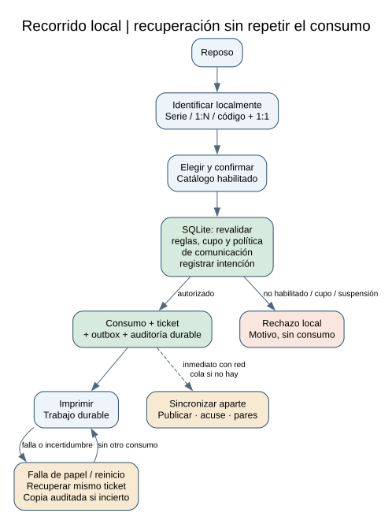
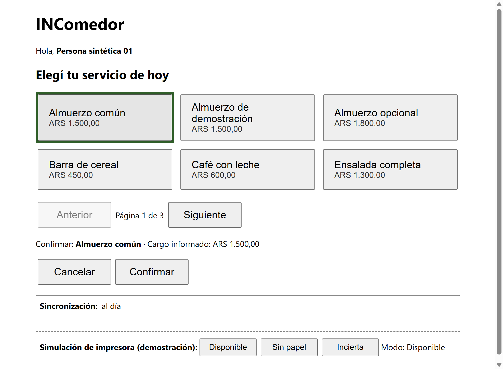
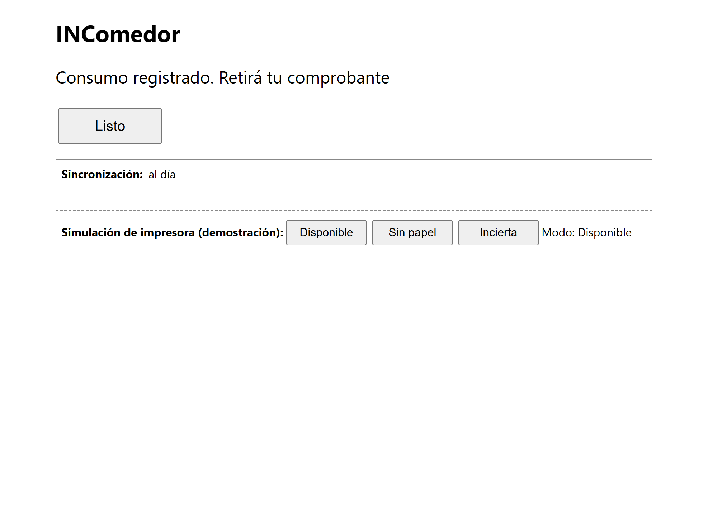
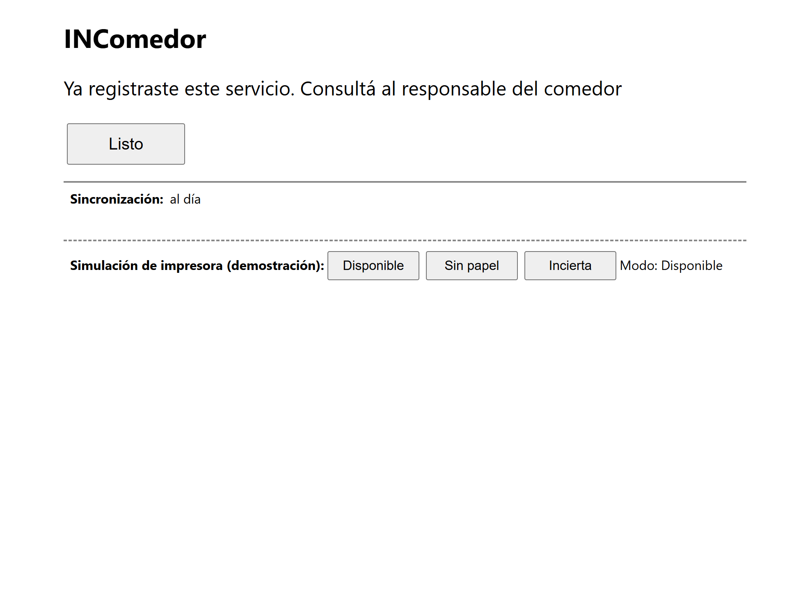
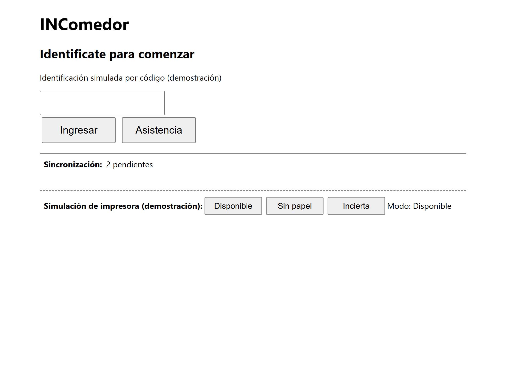
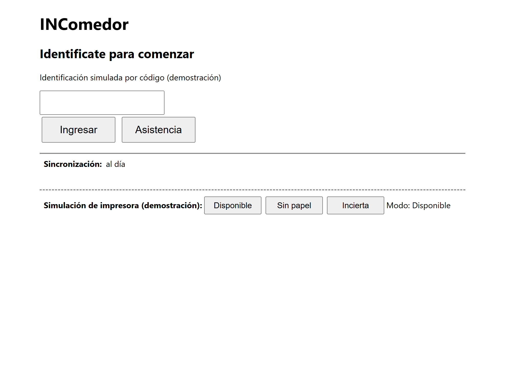
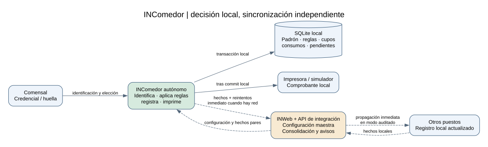
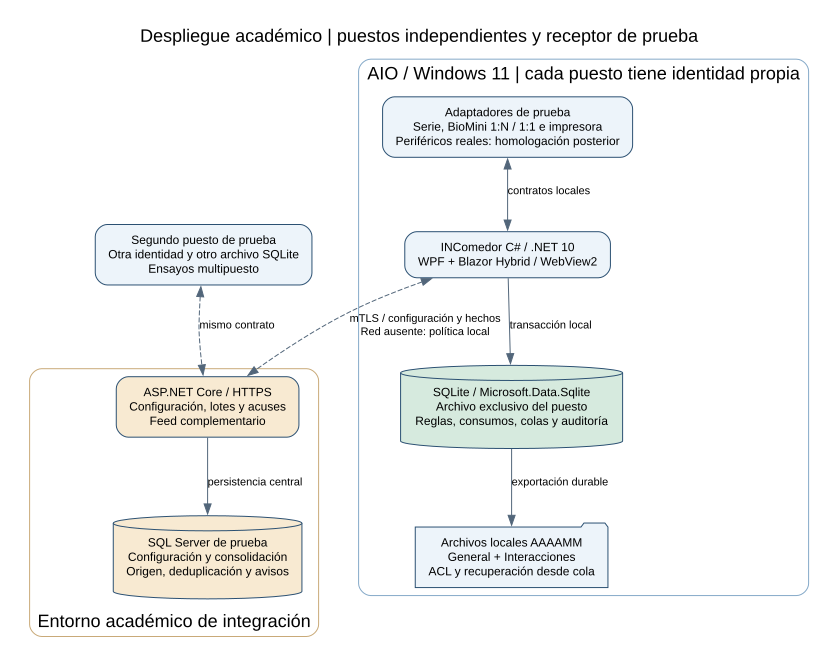
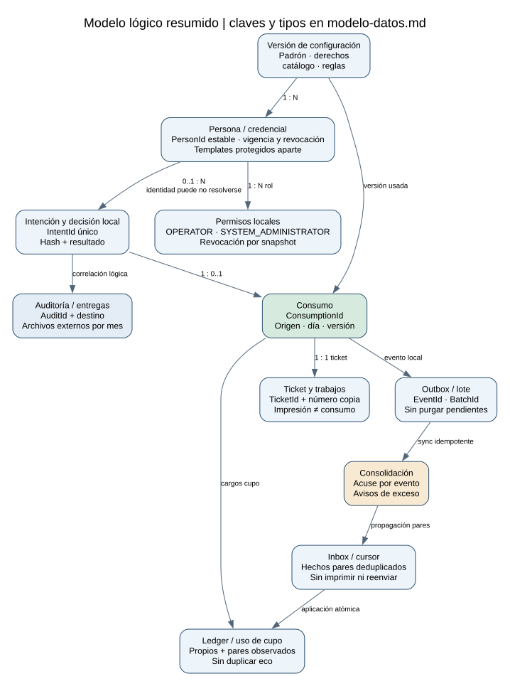

# INComedor

**Entrega final AI4DEVS en curso · Entrega 2 presentada el 29/10/2026 · Primera entrega: documentación técnica, 29/09/2026**

INComedor es un puesto autónomo de autoservicio de comedor empresarial para una
All-in-One táctil con Windows 11. Identifica, aplica habilitaciones y cupos,
registra consumos e imprime comprobantes con una base local propia. Funciona
de manera desatendida aunque INWeb esté fuera de línea en el perfil habitual y
con la política inicial. En multipuesto auditado puede configurarse suspensión
de nuevas confirmaciones durante la pérdida de comunicación. INWeb distribuye
información y consolida los hechos cuando se recupera la conexión.

**Estado:** entrega 2 presentada el 29/10; entrega final en curso. Hay un puesto de demostración que atiende
y confirma sobre SQLite con la transacción de RB06, y un receptor de lotes idempotente sobre SQL Server con
TLS mutuo, al que el puesto envía su outbox; 358 pruebas en verde, con un E2E del flujo principal (ver §2.6). El resto del documento describe
el diseño del producto. La demostración usa datos sintéticos y adaptadores de prueba para INWeb y dispositivos.

## Índice

0. [Ficha del proyecto](#0-ficha-del-proyecto)
1. [Descripción general del producto](#1-descripción-general-del-producto)
2. [Arquitectura del sistema](#2-arquitectura-del-sistema)
3. [Modelo de datos](#3-modelo-de-datos)
4. [Especificación de la API](#4-especificación-de-la-api)
5. [Historias de usuario](#5-historias-de-usuario)
6. [Tickets de trabajo](#6-tickets-de-trabajo)
7. [Pull requests](#7-pull-requests)
8. [Uso de IA y cobertura](#8-uso-de-ia-y-cobertura)

## 0. Ficha del proyecto

| Campo | Contenido |
|---|---|
| Autor | David Walfisch |
| Nombre | INComedor |
| Descripción breve | Kiosco autónomo de comedor, táctil, con identificación, reglas locales, ticket y sincronización. |
| Organización | INTELEKTRON. Caso empresarial con cliente anonimizado y datos sintéticos. |
| URL del proyecto | Aplicación de escritorio Windows con ejecución local; no corresponde una URL de aplicación en esta etapa. |
| URL o ZIP del repositorio | [DaveWalf/AI4Devs-finalproject](https://github.com/DaveWalf/AI4Devs-finalproject). Entrega 1: rama `feature/entrega-1-DW`. Entrega 2: rama `feature/entrega-2-DW`. La final irá en la rama `final-project-dw`. |
| Etapa | Entrega final en curso. Presentadas: la entrega 1, documentación técnica, y la entrega 2, scaffolds conectados (puesto, base SQLite y receptor). |
| Modalidad del MVP | Adaptadores de prueba para servicios y dispositivos; persistencia y reglas reales en la implementación académica. |

## 1. Descripción general del producto

### 1.1. Objetivo

Permitir que una persona habilitada elija y registre un servicio sin intervención
habitual del operador ni conexión obligatoria con el servidor. El operador
podrá recuperar comprobantes e identificar incidencias sin duplicar consumos.
Administración recibirá posteriormente los hechos consolidados.

Identificar no concede por sí solo permiso de consumo. Registrar y emitir un
ticket tampoco acredita el retiro físico de la comida: el canje en la línea es
una ampliación independiente.

### 1.2. Características y funcionalidades principales

Lo que se construye y se demuestra es el **primer corte** de
[D-C24](docs/decisiones.md), que recorta el alcance de la entrega 1 tras la
devolución de LIDR: un puesto, identificación simulada por código, selección,
cupo y fecha de negocio, confirmación atómica (RB06) con replay por IntentId,
comprobante con reimpresión, outbox y receptor idempotente. Cinco historias
must y una should; su secuencia y aceptación figuran en el
[plan académico](docs/plan-academico.md#prioridad-dentro-de-las-funcionalidades).

| ID | Funcionalidad | En el primer corte | Segunda ola, diseñada y no demostrada |
|---|---|---|---|
| F01 | Identificación y selección | Identificación simulada por código; catálogo, cancelación y reconfirmación (HU01.1). Should: rechazos de credencial (HU01.2-J). | Biometría 1:N y 1:1. |
| F02 | Autorización y registro local | Cupo y fecha de negocio en SQLite (HU01.3); un único consumo ante doble toque, retry o reinicio (HU01.1, HU02.1). | Auditoría de saltos del reloj. |
| F03 | Comprobante y recuperación | Ticket tras el commit local y reimpresión con permiso, sin registrar otra comida (HU03.1). | — |
| F04 | Sincronización y supervisión | Outbox y receptor idempotente de lotes (HU02.2). | Multipuesto, configuración por snapshot, administración, diagnóstico, cuenta de mantenimiento y bitácoras. |

La segunda ola no se recorta del producto: los párrafos siguientes describen el
producto completo, y su diseño se conserva en `docs/`.

El producto requiere serie virtual y BioMini Suprema USB. La biometría contempla
**1:N contra templates de personas habilitadas** y **código previo + verificación
1:1**. Ambos devuelven el ID estable de la persona. Los adaptadores de prueba del
MVP representan esos contratos, sin demostrar precisión biométrica ni integración
física real.

El caso habitual y la demostración inicial son de un puesto autónomo. En instalaciones
con varios puestos y auditoría, todos informan a INWeb en línea y actualizan
inmediatamente su registro con los consumos de sus pares. Puede haber una ventana
concurrente de exceso: debe generar un aviso auditable, sin prometer exclusión global.
La falla de conectividad de ese perfil se configura por instalación: continuar
localmente (valor inicial), registrando la incidencia, o suspender nuevas
confirmaciones hasta recuperar el intercambio y el feed. Al reconectar se
concilian hechos y se avisa de los excesos; los consumos previos permanecen intactos.
Quedan fuera del MVP liquidación de haberes, nómina productiva, conciliación económica
con concesionario, reservas, pagos, inventario, invitados automáticos, enrolamiento
productivo, emisión privilegiada para terceros y canje físico. F04 recupera y sincroniza hechos operativos, no completa
esos circuitos empresariales.

La supervisión incluye una interfaz de configuración y diagnóstico para el
Administrador del Sistema. Se requieren dos bitácoras externas de texto plano,
general e interacciones, mensuales con AAAAMM; ante fallo del archivo se continúa
con respaldo durable SQLite y se reconstruye señalando el período degradado.
[Configuración, diagnóstico y bitácoras](docs/administracion-y-bitacoras.md).

El puesto toma la hora de Windows y calcula el día de negocio con la zona y el
corte configurados. Si detecta un salto del reloj, continúa operando y registra
el cambio para auditoría; no aplica un piso temporal ni una suspensión adicional.
Una hora incorrecta puede afectar el día asignado y el cupo disponible. La
supervisión muestra la incidencia y la reconciliación conserva los hechos originales.
Esta política es independiente de la suspensión por conectividad de D-A02.

### 1.3. Diseño y experiencia de usuario

Recorrido: **reposo → identificación local → selección → confirmación → registro
local → ticket → reposo**. La sincronización ocurre aparte.



Los [bocetos de pantallas](docs/experiencia.md) son diseños, no capturas de software.
Incluyen cancelación, rechazo por cupo, huella no coincidente, falta de papel y
recuperación. Una nueva lectura no sustituye la identidad de una sesión ocupada.
Las capturas del puesto real, tomadas por el E2E en cada paso del flujo principal, están en
[«Capturas del flujo principal»](#capturas-del-flujo-principal).

### 1.4. Instrucciones de instalación

#### Cómo revisar

Hay tres caminos, y los tres usan sólo datos sintéticos. Las únicas credenciales son los
[códigos sintéticos](#cómo-ver-la-demostración) de la tabla de más abajo, y no hay contraseñas.

**1. El Release, sin instalar .NET.** En [Releases](https://github.com/DaveWalf/AI4Devs-finalproject/releases),
bajar `INComedor-Puesto-<versión>-win-x64.zip` y su `.sha256`, comprobar la suma y abrir el EXE:

```powershell
$zip = '.\INComedor-Puesto-<versión>-win-x64.zip'
(Get-FileHash $zip -Algorithm SHA256).Hash -eq (Get-Content "$zip.sha256").Split(' ')[0]   # True
Expand-Archive $zip -DestinationPath .\INComedor-Puesto
.\INComedor-Puesto\Intelektron.INComedor.Kiosk.exe
```

Requisito: Windows 11 x64 con el WebView2 Runtime, que Windows 11 ya trae. El paquete lleva el runtime de .NET
al lado del EXE y no trae datos: la base se crea y se siembra al abrirlo. El EXE no está firmado, así que
SmartScreen puede pedir «Más información» y «Ejecutar de todas formas». El Release trae sólo el puesto: el
receptor necesita SQL Server y se revisa desde el código. El primer Release sale después del SDK estable de
.NET 11, el 10/11. Hasta entonces, el mismo zip se arma en local con
`pwsh .github/scripts/publicar-puesto.ps1 -Version 0.0.0-local`, que antes de escribirlo corre el E2E contra
el EXE publicado y lo deja en `artifacts/`.

**2. El código.** Con el SDK que fija `global.json` (11.0.100-rc.2) o uno posterior de .NET 11, que
`global.json` acepta con `rollForward: latestFeature` (probado con la rc.3), desde la raíz de un clon:

```powershell
git clone https://github.com/DaveWalf/AI4Devs-finalproject.git
cd AI4Devs-finalproject
dotnet build INComedor.sln
dotnet test INComedor.sln
dotnet run --project src/Intelektron.INComedor.Kiosk
```

`dotnet test` necesita una instancia de SQL Server para las pruebas del receptor y el E2E (ver §2.6). Lo que
se puede recorrer en la ventana está en «Cómo ver la demostración», más abajo. Para no usar la carpeta de siempre,
antes de `dotnet run` se elige una propia: `$env:INCOMEDOR_DEMO_DIR = "$env:TEMP\incomedor-revision"`. Con una carpeta
propia, el puesto busca los certificados del receptor en ella: para la demostración conectada, en la terminal del
receptor va además `$env:Receptor__CarpetaDemostracion = "$env:TEMP\incomedor-revision\certificados"`, y si no, el
puesto atiende con «Sin receptor configurado».

**3. El E2E.**

```powershell
dotnet test tests/Intelektron.INComedor.E2E.Tests
```

Recorre el flujo principal del [plan de pruebas](docs/pruebas.md#pruebas-previstas) con el puesto y el
receptor compilados, como procesos, y la pantalla manejada por Playwright por CDP (el protocolo de depuración
del WebView2):
- `0001` confirma «Almuerzo común» con el receptor apagado y sale el comprobante;
- el segundo almuerzo choca con el cupo;
- la franja cuenta 2 pendientes;
- al volver el receptor, queda al día, con el consumo consolidado una sola vez.

Suma cinco pruebas de las costuras del puesto. Tarda cerca de 1 min 45 s, porque espera el ciclo real de envío,
de 30 s, y mientras corre abre la ventana del puesto. Necesita el WebView2 Runtime, SQL Server y una sesión con
escritorio: si falta algo, falla nombrándolo. Cada prueba usa su carpeta temporal, sus puertos y su base, y no
toca `%LOCALAPPDATA%\INComedor\demo\`. Las capturas de cada paso quedan en
`tests/Intelektron.INComedor.E2E.Tests/bin/Debug/net11.0-windows10.0.17763.0/TestResults/e2e/`.

**Datos sembrados.** La base del puesto se crea y se siembra al abrirlo: un catálogo sintético de ALMUERZO y
REFRIGERIO, cuatro personas y cuatro operadores, con los códigos de la tabla. El receptor de demostración genera
sus certificados sintéticos y su base al arrancar («Receptor de lotes y puesto conectados», más abajo).

**Variables de entorno.** [`.env.example`](.env.example) lista las cuatro, vacías y comentadas. Nada lo carga,
porque el puesto y el receptor leen el entorno del proceso: cada una se fija en la terminal, por ejemplo
`$env:INCOMEDOR_SQLSERVER = 'MI-SERVIDOR'`. Todas son opcionales. `INCOMEDOR_CDP_PORT` es sólo para pruebas: con
el puerto abierto, cualquier proceso del equipo puede manejar la pantalla. Aparte de las del puesto, un puesto que
corre sin elevar también obedece la variable propia de WebView2, `WEBVIEW2_ADDITIONAL_BROWSER_ARGUMENTS`: si alguien
la definió con `--remote-debugging-port`, abre el puerto aunque `INCOMEDOR_CDP_PORT` no esté.

**`docker-compose`: no aplica.** Es una app de escritorio con su base SQLite local, y el receptor usa la instancia
de SQL Server del equipo. Docker quedó fuera del corte ([lo que no se aplica](docs/aplicacion-del-curso.md#lo-que-no-se-aplica)).

**Recorrido de verificación.** Con el puesto abierto por el camino 1 o el 2 y la base recién creada, sin el
receptor, en la ventana:

1. `0001` e «Ingresar», «Almuerzo común» y «Confirmar»: «Consumo registrado. Retirá tu comprobante», y el
   comprobante queda como archivo de texto en `%LOCALAPPDATA%\INComedor\demo\comprobantes\`.
2. «Listo», y otra vez `0001` con «Almuerzo común»: «Ya registraste este servicio. Consultá al responsable del
   comedor». El cupo de ALMUERZO es 1 y no se registra otro consumo.
3. `0002` e «Ingresar»: «Esta credencial está vencida. Solicitá asistencia».
4. En la franja de la impresora, «Sin papel»; `0001` con «Café con leche», un REFRIGERIO: «Tu consumo está
   registrado. El comprobante queda pendiente».
5. La impresora en «Disponible», `9001` y «Asistencia»: los comprobantes del día. «Recuperar» saca el pendiente
   del paso 4 como el mismo trabajo, y «Reimprimir», con un motivo, saca una copia con la leyenda DUPLICADO.
6. `9002` y «Asistencia»: «Tu permiso de operador está vencido».

La sincronización con el receptor se ve en «Receptor de lotes y puesto conectados», más abajo, y el E2E la recorre
sola.

**Video.** Un recorrido de 2 a 3 minutos, con su [guion](docs/guion-video.md). Pendiente: va como archivo del
Release cuando se publique.

#### Capturas del flujo principal

Las tomó el E2E del camino 3 en este equipo el 30/10/2026, sobre los EXE compilados del puesto y del receptor, con
la base y los códigos sintéticos de la demostración. Siguen el escenario E2E del
[plan de pruebas](docs/pruebas.md#pruebas-previstas): el receptor arranca apagado y vuelve al final.

| 1. Selección de `0001` | 2. Consumo registrado | 3. Segundo almuerzo: cupo |
|---|---|---|
|  |  |  |

| 4. Receptor apagado: 2 pendientes | 5. Receptor de vuelta: al día |
|---|---|
|  |  |

En las dos primeras la franja todavía dice «al día»: se actualiza en cada ciclo de envío, de 30 s, y la cuarta
captura es la del primer ciclo con el receptor apagado.

#### Consultar el diseño

Para consultar el diseño, abrir este README y sus anexos. Las instrucciones ejecutables
están en «Cómo ver la demostración», más abajo: SDK fijado en `global.json`
(11.0.100-rc.2), paquetes con versión exacta en `Directory.Packages.props`, comandos
de build, test y run, y base creada y sembrada con datos sintéticos al abrir el puesto.

La demostración corre en Windows 11, .NET 11, WebView2 y almacenamiento local
y datos sintéticos. El primer provisionamiento podrá hacerse por sincronización
o paquete local validado. Con base provisionada, el arranque y la operación no
exigirán INWeb en el perfil autónomo y con continuidad local. El modo
multipuesto con suspensión conserva el arranque, diagnóstico y recuperación
locales, pero no admite nuevos consumos hasta recuperar la comunicación. Sin ninguna configuración inicial válida, el puesto informará
que requiere provisionamiento y mantendrá deshabilitadas las confirmaciones.

Ya existen las versiones exactas, los comandos probados, la carga del conjunto sintético y el paquete del
puesto (el EXE autocontenido en un zip, en «Cómo revisar»). Siguen pendientes la recuperación, un script de
verificación del entorno, el provisionamiento por sincronización o paquete local y un instalador.

#### Cómo ver la demostración

Requisitos: Windows 11 con WebView2 Runtime y el SDK de .NET que fija `global.json`
(11.0.100-rc.2, o uno posterior de .NET 11). Los comandos se corren desde la raíz del repositorio, porque
`global.json` se lee del directorio actual.

**Puesto: la atención.**

```powershell
dotnet run --project src/Intelektron.INComedor.Kiosk
```

La ventana abre la atención del comensal, sin red. La identificación es simulada por código: el código
solo abre la sesión, sin huella, porque la biometría es de la segunda ola (D-C24). Se tipea el código,
se elige una opción de un catálogo de 15 en páginas de 6 y se confirma con la transacción de RB06.
«Cancelar», o 30 s sin tocar nada antes de confirmar, vuelven a reposo sin escribir nada. El resultado
vuelve a reposo con «Listo» o a los 10 s. Si la opción cambió de precio antes de confirmar, la pantalla
muestra el valor vigente y pide reconfirmar.

Códigos sintéticos:

| Código | Para qué sirve |
|---|---|
| `0001` | «Persona sintética 01», vigente: límite 1 en ALMUERZO y 2 en REFRIGERIO. La segunda confirmación de ALMUERZO del día muestra el mensaje de cupo |
| `0002` | Credencial vencida: «Esta credencial está vencida» |
| `0003` | Credencial revocada: «Esta credencial ya no está habilitada» |
| `0004` | Credencial todavía no vigente: «No pudimos identificarte» |
| `9001` | Operador con permiso `OPERATOR` vigente, por «Asistencia» |
| `9002` | Operador con el permiso vencido: «Asistencia» se deniega |
| `9003` | Operador con el permiso revocado: «Asistencia» se deniega |
| `9004` | Administrador sin `OPERATOR`: «Asistencia» se deniega |

El comprobante sale después del commit hacia una impresora simulada, que escribe un archivo de texto por
copia en `%LOCALAPPDATA%\INComedor\demo\comprobantes\` (`<TicketId>-<copia>.txt`). La franja «Simulación de
impresora (demostración)», al pie, la pone en Disponible, Sin papel o Incierta. Con «Sin papel», el consumo
queda registrado y el comprobante, pendiente. Por «Asistencia», un operador con `9001` ve los comprobantes del
día. Puede recuperar el original que falló, que es el mismo trabajo y no una copia nueva. También puede
reimprimir con un motivo de una lista fija, y la copia sale con la leyenda DUPLICADO y su número.

**Pantalla de demostración anterior.**

```powershell
dotnet run --project src/Intelektron.INComedor.Kiosk -- --demostracion
```

Muestra una persona y una opción sintéticas fijas y el botón «Confirmar». Cada toque confirma una
intención nueva: el primero del día muestra `AUTHORIZED` con los identificadores de consumo y de
comprobante, y el segundo `DENIED` con `LOCAL_LIMIT_REACHED`.

Las dos pantallas comparten la base `%LOCALAPPDATA%\INComedor\demo\incomedor.db`, en la versión de esquema 3.
Se crea y se siembra con datos sintéticos al abrir la ventana por primera vez, y una base que ya tiene datos
no se vuelve a sembrar. Una base de la versión 1 o 2 se actualiza sin perder sus consumos. Para repetir la
demostración, cerrar la ventana y borrar la carpeta `%LOCALAPPDATA%\INComedor\demo\`.

**Receptor de lotes y puesto conectados.** En dos terminales, primero el receptor y después el puesto:

```powershell
dotnet run --project src/Intelektron.INComedor.Sync.Api -- --demostracion
dotnet run --project src/Intelektron.INComedor.Kiosk
```

El receptor escucha en `https://localhost:5001` con TLS mutuo. La primera vez genera tres certificados
sintéticos en `%LOCALAPPDATA%\INComedor\demo\certificados\`: la autoridad, el del receptor y el del puesto.
Además crea la base `INComedorReceptorDemo` en la instancia de SQL Server de la variable `INCOMEDOR_SQLSERVER`
(si no está, `(localdb)\MSSQLLocalDB`) y registra el puesto de la demostración. Al abrir la atención, el puesto
encuentra esos certificados y envía sus lotes cada 30 s, fuera de la confirmación. La franja «Sincronización», al
pie, dice «Sincronización: al día», cuántos eventos están pendientes o retenidos para revisión, «Error técnico:
credencial del equipo» o «Sin receptor configurado». Con el receptor detenido, la atención sigue y la franja cuenta
los pendientes; al volver, el puesto los envía sin duplicarlos, y un acuse perdido se recupera consultando el lote.

Los tres PFX no tienen contraseña. Son sintéticos, viven en el perfil del usuario, fuera del repo, y sólo
permiten mandar lotes sintéticos a un receptor local; no se usan fuera de la demostración. Para repetirla, cerrar
el puesto y el receptor, y borrar `%LOCALAPPDATA%\INComedor\demo\` y la base `INComedorReceptorDemo`.

Sin `--demostracion`, el receptor lee la cadena de conexión (`ConnectionStrings:Receptor`) y la autoridad de los
equipos (`Receptor:Autoridad`) de su configuración, sin valores por defecto; sin ellas responde `503`. No se
publica ni se despliega: la emisión, la renovación y la revocación reales de certificados quedan fuera del corte.

## 2. Arquitectura del sistema

### 2.1. Diagrama de arquitectura



El puesto tiene **autoridad operativa local** sobre identidad, reglas, contador,
consumo y ticket. INWeb administra padrón y políticas y mantiene la vista
consolidada. Se utiliza la última configuración íntegra, respetando sus vigencias
explícitas, sin caducidad arbitraria que obligue a conectarse.

La arquitectura por capas separa dominio, dispositivos y transporte. Favorece
pruebas y autonomía, a costa de mantener dependencias nativas y resolver
consistencia eventual. [Justificación y alternativas](docs/arquitectura.md).

### 2.2. Descripción de componentes principales

| Componente | Tecnología prevista | Responsabilidad |
|---|---|---|
| Kiosco táctil | C#/.NET 11; pantallas Razor en Blazor Hybrid, con WPF sólo como ventana host del BlazorWebView | Pantallas, accesibilidad y sesión. Razor es también la tecnología de vistas del portal INWeb; WPF XAML queda como contingencia, no como segunda tecnología. |
| Aplicación y dominio | Bibliotecas C# | Identidad operativa, habilitación, cupo e idempotencia local. |
| Administración y diagnóstico | UI local + casos de uso con permisos | Configuración de equipo, pruebas aisladas e inventario de versiones. |
| Bitácoras | Archivos UTF-8 mensuales + escritor recuperable | General e interacciones separadas, respaldo durable y reconstrucción. |
| Persistencia local | SQLite + Microsoft.Data.Sqlite directo | Configuración, contador, consumos, impresión y outbox. |
| Adaptadores | Serie, biometría, impresión y simuladores | Entradas y resultados independientes de reglas. |
| Broker BioMini | Proceso local y SDK homologado | Captura y matching 1:N/1:1 sobre padrón protegido. |
| Sincronizador | Worker C# | Configuración y envío de hechos con IDs estables. |
| API central | ASP.NET Core 10 REST/HTTPS | Configuración y recepción idempotente de lotes. |
| Consolidación | Adaptador INWeb, EF Core y SQL Server | Hechos centrales, acuses y conflictos. |

Las operaciones SQLite se ejecutarán en una cola de trabajo fuera de la interfaz;
la aplicación mantendrá la sesión estable mientras persiste la transacción.

### 2.3. Descripción de alto nivel y estructura de ficheros

Documentación de esta entrega:

```text
readme.md                       portada con las secciones de la plantilla
prompts.md                      registro de uso de IA
docs/
  especificacion-sdd.md         requisitos RF, reglas RB, aceptación AT y calidad RNF
  historias-y-tickets.md        épicas, historias de tamaño real y tickets de tarea
  plan-academico.md             prioridad, tallas, hitos y matriz de aceptación
  arquitectura.md               capas, decisiones ADR, protección y despliegue
  modelo-datos.md               diccionario de datos y ER de entidades y claves
  nomenclatura-integracion.md   convención de nombres compartida con INWeb
  nomenclatura-entidades.csv    mapa de entidades a tablas y clases
  nomenclatura-campos-er.csv    mapa de atributos a columnas y propiedades
  administracion-y-bitacoras.md administración local, diagnóstico y bitácoras
  experiencia.md                bocetos de pantallas y mensajes
  pruebas.md                    plan de pruebas por nivel
  decisiones.md                 decisiones del autor y condiciones del diseño
  cobertura-entrega.md          relación entre la consigna y cada artefacto
  aplicacion-del-curso.md       prácticas del curso, su evidencia y la respuesta a la devolución
  guion-video.md                recorrido del video de 2 a 3 minutos
.env.example                    las variables de entorno, vacías y comentadas
api/openapi.yaml                contrato de las tres operaciones de sincronización
diagrams/                       fuentes .dot y .mmd editables y sus SVG
```

Estructura prevista de la solución, la misma en todos los documentos. Existen hoy cinco
proyectos en `src/` (Domain, Contracts, Infrastructure.Sqlite, Kiosk y Sync.Api) y seis
en `tests/`: uno por cada proyecto de `src/` y el E2E. Application, Biometrics.Broker,
Devices e Integration.INWeb siguen previstos y no existen. Marcados con `[existe]` los que están:

```text
src/
  Intelektron.INComedor.Domain/                [existe] reglas, cupos, intención y consumo, sin dependencias externas
  Intelektron.INComedor.Application/           casos de uso y control de permisos locales
  Intelektron.INComedor.Contracts/             [existe] DTO del JSON versionado, con nombres explícitos
  Intelektron.INComedor.Infrastructure.Sqlite/ [existe] migraciones, transacción RB06, outbox y bitácoras
  Intelektron.INComedor.Kiosk/                 [existe] host WPF + Blazor Hybrid: atención, supervisión y administración
  Intelektron.INComedor.Biometrics.Broker/     proceso aparte que aísla el SDK de BioMini
  Intelektron.INComedor.Devices/               adaptadores de serie e impresora y dobles de prueba de dispositivos
  Intelektron.INComedor.Sync.Api/              [existe] receptor ASP.NET Core de configuración y lotes
  Intelektron.INComedor.Integration.INWeb/     adaptador a INWeb y consolidación con EF Core y SQL Server
tests/                                         [existe] un proyecto de pruebas por proyecto de src, más el E2E
```

De ese árbol, hoy el Kiosk implementa la atención con identificación simulada por código, la asistencia
con impresora simulada y la pantalla de demostración; `Infrastructure.Sqlite`, el primer corte de la
transacción, la identificación, la impresión, el outbox y la cola de lotes (sin bitácoras mensuales), y `Sync.Api`
la ingesta idempotente de lotes sobre SQL Server, sin el adaptador INWeb. Contracts hoy contiene los eventos de
outbox, el lote, el acuse y el JSON canónico RFC 8785, no todo el JSON versionado.

### 2.4. Infraestructura y despliegue



El puesto Windows ejecutará la interfaz, los casos de uso y los adaptadores.
SQLite residirá en disco local, con acceso exclusivo de la aplicación del puesto.
La API académica ASP.NET Core se ejecutará en un entorno de prueba y consolidará
en SQL Server; representará los contratos de integración con INWeb.

La puesta en marcha prevista comprende:

1. Instalar la aplicación, .NET y WebView2 y preparar directorios con permisos.
2. Crear la base y cargar el conjunto sintético y una configuración íntegra.
3. Activar los adaptadores de prueba y verificar diagnóstico, identidad y catálogo.
4. Ejecutar el flujo local con red ausente y comprobar persistencia y comprobante.
5. Habilitar la API de prueba y verificar sincronización, acuses y recuperación.

Cada puesto conserva su archivo SQLite; la sincronización intercambia hechos
por API. Actualizaciones, reinicios y restauración preservan eventos pendientes.
La integración física y el despliegue productivo requieren homologación.

La demostración final es la de un puesto, con el primer corte de D-C24. Multipuesto, cuenta local de mantenimiento y diagnóstico quedan en la segunda ola, diseñados y no demostrados. El [plan](docs/plan-academico.md#capacidad-y-reestimación) registra 6 h semanales y viabilidad todavía no demostrada.

### 2.5. Seguridad

Controles diseñados: identidad de terminal y HTTPS para sincronizar, credenciales
por código con vigencia y revocación, permisos locales por rol para operador y
administrador, separación de secretos y biometría, minimización, auditoría y
protección local. Credenciales y permisos llegan en el snapshot; el operador se
autentica sin red con código y verificación 1:1 o cuenta individual local de mantenimiento, y cada acción privilegiada se
comprueba y se audita ([SDD §7.4](docs/especificacion-sdd.md#74-credenciales-y-control-de-acceso-local)). Un fallo de autenticación con INWeb afecta la sincronización, no sustituye
las reglas de autorización locales.

Se proponen ACL y cifrado de disco más protección específica para templates.
SQLite estándar no se considera cifrada por defecto. No se guardarán imágenes de
huellas ni templates en logs. Retención, acceso, enrolamiento y revocación productivos
se definirán y verificarán antes de una instalación productiva.

**Protección en reposo del primer corte (D-C24):**

- El código de identificación no es un secreto: identifica, no prueba identidad. No se cifra, pero no se escribe en logs, tickets ni eventos.
- Si el corte usa mTLS con el receptor, la clave privada del certificado del puesto va al almacén de certificados de Windows, marcada como no exportable.
- La ACL de la base SQLite queda limitada a la cuenta que corre el puesto.
- El cifrado de disco (BitLocker) es requisito de instalación, no una función del producto.
- Los templates biométricos y el verificador de la cuenta de mantenimiento quedan fuera del corte: no existen en esta versión.

### 2.6. Tests

El [plan de pruebas](docs/pruebas.md) cubre dominio, SQLite real, sincronización,
contratos, E2E y dispositivos. Casos centrales: arranque offline, cupo local,
doble confirmación, caída tras commit, reimpresión, snapshot parcial, acuse perdido
y ambos modos biométricos. Incluye también saltos del reloj, cálculo del día de
negocio y vigencias. Hoy corren 358 pruebas, todas en verde, con
`dotnet test INComedor.sln` desde la raíz del repositorio: 68 de Domain, 117 de
Infrastructure.Sqlite sobre un archivo SQLite real temporal, 82 del Kiosk, 62 del receptor, 23 de Contracts y
6 del E2E. Las del receptor, las del envío integrado y el E2E necesitan una instancia de SQL Server:
`(localdb)\MSSQLLocalDB` por defecto, u otra en la variable `INCOMEDOR_SQLSERVER`; cada clase crea su base y la
borra al terminar. Cubren la confirmación atómica (RB06), el replay por `IntentId`, las caídas antes y después
del commit, la concurrencia por el último cupo, la atención y el comprobante, y el envío de lotes: el acuse
perdido, el reenvío idéntico, el TLS mutuo real y la deduplicación en el receptor (AT13, AT27 y AT50).

El E2E (`tests/Intelektron.INComedor.E2E.Tests`) recorre el escenario E2E del plan, monopuesto con el servidor
apagado y luego recuperado (AT01, AT02 y AT27), sobre los EXE compilados del puesto y del receptor. Lo maneja
Playwright por CDP, sin bajar navegadores: el navegador es el WebView2 del equipo. Suma las costuras del puesto
(`INCOMEDOR_DEMO_DIR`, `INCOMEDOR_RECEPTOR_URL` e `INCOMEDOR_CDP_PORT`): el puerto de depuración sólo abre con un
valor válido y sólo en loopback. Además de SQL Server, necesita el WebView2 Runtime y una sesión con escritorio,
y si falta algo falla con un mensaje que lo nombra, nunca con un salto. Con `INCOMEDOR_E2E_KIOSK_EXE`, corre
contra el EXE del paquete publicado, sin .NET a la vista: es lo que hace el script del Release antes de armar
el zip. El resto de los casos del plan sigue especificado, no ejecutado.

## 3. Modelo de datos

INComedor adopta las convenciones de datos y C# del ecosistema INWeb. El
[mapa lógico/físico/C#](docs/nomenclatura-integracion.md) define tablas
`tbComedor...`, columnas mnemónicas y negocio en español. Los DTO mantienen
el contrato JSON; las claves nativas de INWeb y los UUID del módulo conservan
su tipo y ámbito. Es diseño de implementación, sin afirmar tablas ya creadas.

### 3.1. Diagrama del modelo de datos



[Diagrama ER de entidades y claves (ampliable)](diagrams/datos-er.svg), [fuente editable](diagrams/datos.mmd) y [diccionario](docs/modelo-datos.md),
con tipos, claves, relaciones y restricciones. SQLite contiene la autoridad local
del consumo; la consolidación deduplica por identidad de origen sin volver a autorizar.

### 3.2. Descripción de entidades principales

El siguiente resumen conserva los nombres y restricciones del
[diccionario completo](docs/modelo-datos.md). UUID identifica entidades y hechos;
PK es clave primaria, FK clave foránea y UQ unicidad. Las referencias a padrón,
menú y reglas incluyen su snapshot para conservar la interpretación histórica.

| Entidad | Atributos esenciales y tipos | Claves y restricciones |
|---|---|---|
| PersonReference | SnapshotId, PersonId: UUID; DisplayName: texto; Active: booleano; IdentityMaterialVersion: entero | PK (SnapshotId, PersonId); FK snapshot; estado activo separado del derecho a consumir. |
| PersonCredential | SnapshotId, CredentialId, PersonId: UUID; Kind: enum; NormalizedValue: texto; ValidFromUtc, ValidToUtc, RevokedAtUtc: fecha-hora UTC opcionales | PK (SnapshotId, CredentialId); FK persona; código único por snapshot incluso revocado; no reasignable entre personas, con historial pendiente de concretar en M0; vencida y revocada tienen motivos propios. |
| ServiceType | SnapshotId, ServiceTypeId: UUID; Label: texto | PK (SnapshotId, ServiceTypeId); FK snapshot; un servicio puede tener distintas variantes de menú. |
| ConsumptionIntent | IntentId: UUID; IdentitySessionId: token opcional; PayloadHash: bytes(32); Status: enum; DecisionId: UUID opcional; ResultPayload: JSON opcional | PK IntentId; FK sesión cuando existe; UQ DecisionId cuando existe. Mismo ID y contenido recuperan el resultado durable. |
| Consumption | ConsumptionId, IntentId, SnapshotId, PersonId, MenuItemId: UUID; BusinessDate: fecha; Quantity, MenuVersion, PolicyVersion, CatalogVersion: enteros; ClientSequence: entero de 64 bits; PriceSnapshot: JSON | PK ConsumptionId; UQ IntentId; FK intención/persona/menú versionados; precio y versiones inmutables. El ticket lo referencia desde Ticket. |
| QuotaUsage | PersonId, QuotaScopeId, QuotaBucketId: UUID; BusinessDate: fecha; Used, Version: enteros | PK persona/ámbito/categoría/fecha, igual que la clave de cupo de RB03; Used no negativo; proyección de consumos propios y de pares ya recibidos. |
| Ticket | TicketId, ConsumptionId: UUID; PrintData: JSON; CreatedAtUtc: fecha-hora UTC | PK TicketId; UQ/FK ConsumptionId: un ticket lógico por consumo. |
| OutboxEvent | EventId: UUID; IntentId y TicketId: UUID opcionales; EventType, State: enum; PayloadVersion: entero; Payload, PayloadHash | PK EventId; referencias de intención/ticket cuando corresponda; mismo ID y contenido en reenvíos. |
| AuditRecord | AuditId, KioskId, GenerationId, BootId; Sequence: entero de 64 bits; OccurredAtUtc, RecordedAtUtc: fecha-hora; Context: JSON | PK AuditId; UQ (KioskId, GenerationId, Sequence); registro inmutable; decisión y auditoría comparten transacción. |

Los consumos observados de pares tienen deduplicación propia antes de afectar
QuotaUsage. Ticket y PrintJob separan el comprobante lógico de cada copia y del
resultado físico. Los templates se mantienen en el almacén protegido del broker,
fuera de consumos, payloads y bitácoras.

## 4. Especificación de la API

El [OpenAPI 3.1](api/openapi.yaml), versión 0.6.0-draft, define tres operaciones por construir:

| Operación | Propósito |
|---|---|
| `GET /api/incomedor/v1/configuration` | Configuración versionada completa, con credenciales y permisos locales, para activar localmente; 304 si no cambió y 404 si todavía no hay publicación. |
| `POST /api/incomedor/v1/sync-batches` | Lotes de hechos locales con acuses por evento. |
| `GET /api/incomedor/v1/sync-batches/{batchId}` | Recuperar el resultado del lote ante respuesta perdida. |

La autorización del consumo pertenece al puesto. Estas tres operaciones
seleccionadas cubren configuración y consolidación. El diccionario define además
los campos de la distribución biométrica y de la difusión de consumos entre
puestos; su transporte se especificará en M0. Administración y diagnóstico son
casos de uso locales.

## 5. Historias de usuario

Las tres épicas HU01–HU03 cubren F01–F04 y se descomponen en historias de tamaño
real. Estas son las tres historias principales; el
[backlog de historias hijas](docs/historias-y-tickets.md#backlog-de-historias-hijas)
completa los 35 escenarios con persona, talla y prioridad, y el
[plan académico](docs/plan-academico.md) ordena su ejecución.

| Épica | Objetivo | Personas | Historias hijas |
|---|---|---|---|
| HU01 | Identificarse y consumir de forma autónoma | Comensal | HU01.1–HU01.3 |
| HU02 | Recuperar y sincronizar consumos sin perder autonomía | Soporte técnico y Administrador de personal | HU02.1–HU02.6 |
| HU03 | Supervisar el puesto y recuperar un comprobante | Operador y Administrador del Sistema | HU03.1–HU03.5 |

### HU01.1 — Confirmar un servicio sin red y sin duplicarlo

**Épica:** HU01 · **Persona:** Comensal · **Prioridad:** must · **Talla:** M · **Tickets:** TK02.1 (interfaz), TK03.1 (datos) y TK01 (dominio, principal de AT01).

**Como** Comensal, **quiero** elegir un servicio del catálogo y confirmarlo en el puesto aunque no haya red, **para** recibir mi comprobante sin que un toque repetido, una cancelación o un cambio de precio alteren lo que consumí.

**Precondiciones:** base provisionada con el fixture sintético, sesión de identidad abierta por el adaptador de prueba (la identificación es HU01.2) y perfil monopuesto o `CONTINUE_LOCAL`.

| Escenario | Dado | Cuando | Entonces |
|---|---|---|---|
| HU01-A | Persona sintética habilitada, cupo local libre y red ausente | Confirma servicio | Una decisión autorizada, consumo/cupo/evento locales y ticket lógico |
| HU01-B | Catálogo de 15 opciones | Navega y cancela antes de confirmar | Navegación completa y cero consumo |
| HU01-D | Catálogo cambió entre mostrar y confirmar | Confirma valor anterior | Se informa el cambio y se solicita reconfirmación; no cambia el importe silenciosamente |
| HU01-G | Operación confirmándose | Se repite toque o llega otra lectura | Conserva persona/intención; no duplica consumo |

**Terminado:** una persona sintética confirma un servicio con la red desconectada y recibe su comprobante; cancelar no deja consumo, un segundo toque no crea otro y un cambio de precio obliga a reconfirmar.

### HU02.1 — Recuperar el resultado después de una caída

**Épica:** HU02 · **Persona:** Soporte técnico · **Prioridad:** must · **Talla:** S · **Tickets:** TK03.1 (datos) y TK01 (contrato de replay/conflicto, principal de AT25).

**Como** Soporte técnico, **quiero** que el puesto recupere tras un reinicio el resultado de una confirmación ya registrada, **para** resolver la caída sin cobrar dos veces ni perder el comprobante.

**Precondiciones:** base provisionada y una confirmación ya guardada por la transacción local.

| Escenario | Dado | Cuando | Entonces |
|---|---|---|---|
| HU02-B | Consumo confirmado localmente | El proceso cae antes de mostrar el resultado | Recupera mismos IDs y un solo trabajo original; no vuelve a consumir cupo |
| HU02-L | Decisión local durable y posterior vencimiento de sesión, baja o cambio de snapshot | Reintenta misma intención/ámbito/payload | Recupera resultado original sin repetir validación de negocio ni crear consumo/ticket/trabajo; una intención nueva sí usa reglas actuales |

**Terminado:** después de cortar el proceso en cada punto de la confirmación, el puesto vuelve a mostrar el mismo resultado con los mismos identificadores, sin un segundo consumo, y rechaza reutilizar la intención con otro contenido.

### HU02.2 — Reenviar lotes y consolidarlos sin duplicar

**Épica:** HU02 · **Persona:** Soporte técnico · **Prioridad:** must · **Talla:** M · **Tickets:** TK01.1 (receptor, principal de AT27) y TK01/TK03 (cliente sincronizador y cola local de U05).

**Como** Soporte técnico, **quiero** que un lote reenviado después de perder el acuse se reconozca como el mismo, **para** recuperar los pendientes sin duplicar consumos en la consolidación ni ocultar conflictos.

**Precondiciones:** receptor académico con su base de prueba y eventos pendientes en el puesto.

| Escenario | Dado | Cuando | Entonces |
|---|---|---|---|
| HU02-C | Hay eventos pendientes | Vuelve la conexión | Envía lote con IDs estables; el puesto sigue atendiendo durante sincronización |
| HU02-D | El servidor recibió el lote pero se perdió el ACK | Se reenvía o consulta el mismo lote | Deduplicación central; no se crea otro consumo ni se pierde el evento local |
| HU02-F | Servidor detecta discrepancia de cupo entre puestos | Concilia los hechos | Conserva ambos, informa conflicto y pide revisión; no niega retroactivamente una comida |
| HU02-G | Credencial de sincronización vencida | Se intenta enviar lote | Error técnico visible y evento retenido; en monopuesto sigue atención; nueva operación multi puesto aplica CONTINUE_LOCAL o SUSPEND_NEW_CONSUMPTIONS persistido |

**Terminado:** el receptor devuelve el mismo acuse ante reenvío/consulta, detecta contenido incompatible y rechaza hechos ajenos; el cliente mantiene atención según D-A02, retiene eventos ante error y avanza su cola sólo por acuse durable. Se conserva el consumo local.

## 6. Tickets de trabajo

Tres tickets de tamaño tarea, uno por capa, con dependencias disponibles al
iniciarlos, un responsable y sus propios criterios de aceptación. Pertenecen a las
épicas técnicas TK01 (backend), TK02 (interfaz) y TK03 (datos). El
[detalle completo](docs/historias-y-tickets.md#tickets-de-trabajo) incluye trabajo,
archivos previstos y exclusiones; la [matriz de aceptación](docs/plan-academico.md#matriz-de-aceptación)
asigna cada AT a un único responsable.

### TK03.1 — Datos: migración inicial y transacción de confirmación

**Unidad:** U02 · **Hito:** M1 · **Talla:** M · **Historias:** HU01.1, HU01.3 y HU02.1 · **Responsable:** DW

**Objetivo:** crear la primera migración SQLite y la unidad de trabajo que guarda una decisión en una sola transacción (RB06), para que la confirmación sea todo o nada y se recupere sin duplicarse.

**Trabajo incluido:** migración numerada `0001` con las tablas de la transacción y las de configuración que referencian; apertura con claves externas activas y versión de esquema comprobada; búsqueda previa por `IntentId` y hash; unidad de trabajo con `BEGIN IMMEDIATE` que reconsulta intención, snapshot y cupo, invoca al dominio y guarda su decisión dentro de la misma transacción; unicidades del modelo.

**Dependencias disponibles:** [diccionario](docs/modelo-datos.md) y mapa de nombres, fixture sintético del [OpenAPI](api/openapi.yaml) y contrato de intención cerrado en M0 (U01). Para cerrar AT03 se requiere el evaluador de dominio de TK01 integrado; TK03.1 conserva la responsabilidad de su evidencia.

**Aceptación:** AT03 (último cupo con dos confirmaciones simultáneas), AT05 (caída después del commit) y AT35 (repetición de una intención ya decidida).

**Terminado:** la migración crea una base vacía válida y los tres AT pasan contra un archivo SQLite real, con el comando y su salida registrados. El ensayo de caída de proceso no acredita resistencia a la pérdida física del disco.

### TK02.1 — Interfaz: selección y confirmación con sus estados

**Unidad:** U03 · **Hito:** M1 · **Talla:** M · **Historia:** HU01.1 · **Responsable:** DW

**Objetivo:** construir en WPF + Blazor Hybrid las pantallas de catálogo, confirmación y resultado sobre el caso de uso local, con estados que impidan confirmar dos veces o cambiar de persona durante la confirmación.

**Trabajo incluido:** estados reposo, selección, confirmando, resultado y regreso a reposo; catálogo paginado de 15 opciones por toque y teclado; cancelación y timeout de 30 s; un `IntentId` por confirmación; reconfirmación ante cambio de precio; mensajes por resultado.

**Dependencias disponibles:** para construir componentes, caso de uso con doble, fixture y mensajes de M0; para cerrar los AT y la demostración, TK01 y U02/TK03.1 integrados con SQLite real. M0 solo no basta para el cierre integral.

**Aceptación:** AT16 (catálogo y timeout sin consumo), AT26 (doble toque y lectura nueva) y AT47 (reconfirmación ante cambio de precio).

**Terminado:** los tres AT pasan en pruebas de componentes y en una demostración grabada sobre el equipo declarado, con persistencia local real del consumo.

### TK01.1 — Backend: receptor idempotente de lotes

**Unidad:** U05 · **Hito:** M1 · **Talla:** M · **Historia:** HU02.2 · **Responsable:** DW

**Objetivo:** implementar en el receptor académico ASP.NET Core `POST` y `GET` de lotes del [OpenAPI](api/openapi.yaml), sobre SQL Server de prueba, sin duplicar hechos ante reintentos.

**Trabajo incluido:** autenticación del equipo y lotes limitados a su ámbito; `Idempotency-Key` igual a `BatchId` y hash RFC 8785 del cuerpo; recibo del lote y eventos de entrada en una transacción, con un resultado por `EventId`; validación de la fecha de negocio de las cargas; caso de conciliación ante hechos incompatibles; consulta del acuse original.

**Dependencias disponibles:** OpenAPI 0.6.0-draft y certificados sintéticos de M0. El cierre integral de AT13/27 requiere cliente sincronizador y cola SQLite de U05, desarrollados por TK01/TK03; TK01.1 coordina la evidencia del receptor y del recorrido cliente-servidor.

**Aceptación:** AT12 (hechos incompatibles de dos terminales), AT13 (credencial inválida o lote ajeno), AT27 (acuse perdido y reenvío) y AT50 (cargas con otra fecha de negocio).

**Terminado:** pruebas de contrato del receptor contra SQL Server y ejemplos OpenAPI válidos; además AT13 y AT27 integran cliente y cola SQLite: error retiene eventos, ACK perdido permite reenvío y sólo el acuse durable avanza la cola. La prueba aislada del receptor no cierra HU02.2.

## 7. Pull requests

Los PR de changes de OpenSpec llevan la salida de `/openspec-verify-change`, y todos corren
el CI de `windows-latest`. Los tres primeros están apilados: la base de cada uno es la rama del
anterior, así cada diff muestra sólo lo suyo. Las ramas de las entregas 1 y 2 quedaron
congeladas tal como se enviaron, con el ruleset «Entregas congeladas» de GitHub: esos PR siguen
abiertos como evidencia y no se integran. La entrega final vive en `final-project-dw`, que recibe
cada trabajo por su propio PR, como el cuarto. La entrega 1 documentó el diseño, sin código,
en el [#1](https://github.com/DaveWalf/AI4Devs-finalproject/pull/1).

**Pull Request 1:** [#2 · registrar-consumo-atomico (TK03.1)](https://github.com/DaveWalf/AI4Devs-finalproject/pull/2).
Solución .NET 11, base SQLite con la migración `0001` y confirmación atómica con replay por
`IntentId` (RB06, RB07, RB17); 48 pruebas. Incluye la corrección de fin de línea que destapó
la primera corrida del CI ([roja](https://github.com/DaveWalf/AI4Devs-finalproject/actions/runs/40790002939),
[verde](https://github.com/DaveWalf/AI4Devs-finalproject/actions/runs/40794862257)).

**Pull Request 2:** [#3 · conectar-puesto-y-receptor (TK02.1, TK01.1)](https://github.com/DaveWalf/AI4Devs-finalproject/pull/3).
Puesto Kiosk WPF con la pantalla Razor de demostración sobre SQLite, contrato de eventos en
`Contracts` y receptor `Sync.Api` que responde `501`; 61 pruebas
([CI](https://github.com/DaveWalf/AI4Devs-finalproject/actions/runs/40795276016)).

**Pull Request 3:** [#4 · los seis changes de la final](https://github.com/DaveWalf/AI4Devs-finalproject/pull/4).
De `feature/demostrar-flujo-de-punta-a-punta-dw` hacia `feature/entrega-2-DW`: `mostrar-aplicacion-del-curso`,
`imponer-invariantes-en-codigo`, `evaluar-habilitacion-local`, `atender-seleccion-y-confirmacion` (TK02.1),
`recibir-lotes-idempotente` (TK01.1) y `demostrar-flujo-de-punta-a-punta`, archivados en el mismo PR, con el verify
del último completo; 358 pruebas, con el E2E. Queda abierto y bloqueado a propósito por el ruleset, como evidencia,
porque su base es la rama de la entrega 2; `final-project-dw` se creó desde su punta. Sus checks muestran
`build-test` en rojo sobre esa punta, `de24100`
([41141219430](https://github.com/DaveWalf/AI4Devs-finalproject/actions/runs/41141219430) y
[41141401980](https://github.com/DaveWalf/AI4Devs-finalproject/actions/runs/41141401980)), por dos pruebas
intermitentes que ya estaban: una prueba bUnit de la pantalla de atención que no esperaba cada toque, y el arranque
en frío de LocalDB en el runner. La misma rama había pasado en verde antes
([41130320995](https://github.com/DaveWalf/AI4Devs-finalproject/actions/runs/41130320995)). La corrección no podía
ir en el #4, congelado, y es el PR siguiente.

**Pull Request 4:** [#5 · CI estable](https://github.com/DaveWalf/AI4Devs-finalproject/pull/5).
De `feature/estabilizar-ci-dw` hacia `final-project-dw`, integrado el 30/10 en `22aef1a`. La prueba bUnit espera
cada toque: con una demora plantada, la clase original cayó en 10 de 10 corridas y la corregida en 0 de 20. `ci.yml`
y `release.yml` arrancan LocalDB antes de las pruebas, y `ci.yml` corre también en los push a `final-project-*` y
fija sus acciones por SHA. Sin cambios de producto. CI en verde en el push y en el PR
([41151732885](https://github.com/DaveWalf/AI4Devs-finalproject/actions/runs/41151732885),
[41151877862](https://github.com/DaveWalf/AI4Devs-finalproject/actions/runs/41151877862)) y en la punta de
`final-project-dw`, [41154943372](https://github.com/DaveWalf/AI4Devs-finalproject/actions/runs/41154943372), con
cuatro intentos en verde sobre el mismo commit.

## 8. Uso de IA y cobertura

[Registro de IA](prompts.md), en las cinco partes que pide el curso: herramientas por fase,
modelos y para qué, contexto avanzado, workflows clave y criterio humano. La IA está en el
proceso y no en el producto.

[Aplicación del curso](docs/aplicacion-del-curso.md): cada práctica del curso con su evidencia
en el repo, o lo que falta, o por qué no aplica, y la respuesta a la devolución de la entrega 1.

[Cobertura de la entrega final](docs/cobertura-entrega.md): cada requisito de la final y de la
plantilla, con su evidencia o con lo que falta. [Plan académico](docs/plan-academico.md):
prioridades, secuencia y evidencia prevista para las siguientes entregas.
[Especificación SDD](docs/especificacion-sdd.md): requisitos, reglas y aceptación.
