# INComedor

**Entrega final AI4DEVS en curso · Entrega 2 presentada el 29/10/2026 · Primera entrega: documentación técnica, 29/09/2026**

INComedor es un puesto autónomo de autoservicio de comedor empresarial para una
All-in-One táctil con Windows 11. Identifica, aplica habilitaciones y cupos,
registra consumos e imprime comprobantes con una base local propia. Funciona
de manera desatendida aunque INWeb esté fuera de línea en el perfil habitual y
con la política inicial. En multipuesto auditado puede configurarse suspensión
de nuevas confirmaciones durante la pérdida de comunicación. INWeb distribuye
información y consolida los hechos cuando se recupera la conexión.

**Estado:** entrega 2 presentada el 29/10; entrega final en curso. Hay un puesto de demostración que atiende
y confirma sobre SQLite con la transacción de RB06, y un receptor de lotes idempotente sobre SQL Server con
TLS mutuo, al que el puesto envía su outbox; todas sus pruebas en verde, con un E2E del flujo principal (cifras en §2.6). El resto del documento describe
el diseño del producto. La demostración usa datos sintéticos y adaptadores de prueba para INWeb y dispositivos.

## Índice

0. [Ficha del proyecto](#0-ficha-del-proyecto)
1. [Descripción general del producto](#1-descripción-general-del-producto)
2. [Arquitectura del sistema](#2-arquitectura-del-sistema)
3. [Modelo de datos](#3-modelo-de-datos)
4. [Especificación de la API](#4-especificación-de-la-api)
5. [Historias de usuario](#5-historias-de-usuario)
6. [Tickets de trabajo](#6-tickets-de-trabajo)
7. [Pull requests](#7-pull-requests)
8. [Uso de IA y cobertura](#8-uso-de-ia-y-cobertura)

## 0. Ficha del proyecto

| Campo | Contenido |
|---|---|
| Autor | David Walfisch |
| Nombre | INComedor |
| Descripción breve | Kiosco autónomo de comedor, táctil, con identificación, reglas locales, ticket y sincronización. |
| Organización | INTELEKTRON. Caso empresarial con cliente anonimizado y datos sintéticos. |
| URL del proyecto | Aplicación de escritorio Windows con ejecución local; no corresponde una URL de aplicación en esta etapa. |
| URL o ZIP del repositorio | [DaveWalf/AI4Devs-finalproject](https://github.com/DaveWalf/AI4Devs-finalproject). Entrega 1: rama `feature/entrega-1-DW`. Entrega 2: rama `feature/entrega-2-DW`. Final: rama [`final-project-dw`](https://github.com/DaveWalf/AI4Devs-finalproject/tree/final-project-dw); `main` tiene sólo las plantillas del curso. |
| Etapa | Entrega final en curso. Presentadas: la entrega 1, documentación técnica, y la entrega 2, scaffolds conectados (puesto, base SQLite y receptor). |
| Modalidad del MVP | Adaptadores de prueba para servicios y dispositivos; persistencia y reglas reales en la implementación académica. |

## 1. Descripción general del producto

### 1.1. Objetivo

Permitir que una persona habilitada elija y registre un servicio sin intervención
habitual del operador ni conexión obligatoria con el servidor. El operador
podrá recuperar comprobantes e identificar incidencias sin duplicar consumos.
Administración recibirá posteriormente los hechos consolidados.

Identificar no concede por sí solo permiso de consumo. Registrar y emitir un
ticket tampoco acredita el retiro físico de la comida: el canje en la línea es
una ampliación independiente.

### 1.2. Características y funcionalidades principales

Lo que se construye y se demuestra es el **primer corte** de
[D-C24](docs/decisiones.md), que recorta el alcance de la entrega 1 tras la
devolución de LIDR: un puesto, identificación simulada por código, selección,
cupo y fecha de negocio, confirmación atómica (RB06) con replay por IntentId,
comprobante con reimpresión, outbox y receptor idempotente. Cinco historias
must y una should; su secuencia y aceptación figuran en el
[plan académico](docs/plan-academico.md#prioridad-dentro-de-las-funcionalidades).

| ID | Funcionalidad | En el primer corte | Segunda ola, diseñada y no demostrada |
|---|---|---|---|
| F01 | Identificación y selección | Identificación simulada por código, o por un lector en puerto serie con su terminador y el relleno de dígitos (RF23, sin homologar equipos); catálogo, cancelación y reconfirmación (HU01.1). Should: rechazos de credencial (HU01.2-J). | Biometría 1:N y 1:1. |
| F02 | Autorización y registro local | Cupo y fecha de negocio en SQLite (HU01.3); un único consumo ante doble toque, retry o reinicio (HU01.1, HU02.1). | Auditoría de saltos del reloj. |
| F03 | Comprobante y recuperación | Ticket tras el commit local y reimpresión con permiso, sin registrar otra comida (HU03.1). | — |
| F04 | Sincronización y supervisión | Outbox y receptor idempotente de lotes (HU02.2). Bitácoras mensuales general e interacciones, fuera de SQLite (HU03.5, recortada). Personas, cupos, opciones y franjas editables en Configuración mientras no haya INWeb, con una versión local por guardado (HU03.3, recortada). Configuración por pestañas: Consumos con búsqueda, reimpresión y exportación, Pantalla, Red, Lector, el resguardo de la configuración, y la exportación automática y los avisos por correo con envío simulado; cada uno sale de la segunda ola por su change ([`AGENTS.md`](AGENTS.md)). | Multipuesto, configuración por snapshot, permisos de operador, importación de INWeb, diagnóstico, cuenta de mantenimiento y lo que los recortes de las bitácoras y de la administración dejan fuera. |

La segunda ola no se recorta del producto: los párrafos siguientes describen el
producto completo, y su diseño se conserva en `docs/`.

El producto requiere serie virtual y BioMini Suprema USB. La biometría contempla
**1:N contra templates de personas habilitadas** y **código previo + verificación
1:1**. Ambos devuelven el ID estable de la persona. Los adaptadores de prueba del
MVP representan esos contratos, sin demostrar precisión biométrica ni integración
física real.

El caso habitual y la demostración inicial son de un puesto autónomo. En instalaciones
con varios puestos y auditoría, todos informan a INWeb en línea y actualizan
inmediatamente su registro con los consumos de sus pares. Puede haber una ventana
concurrente de exceso: debe generar un aviso auditable, sin prometer exclusión global.
La falla de conectividad de ese perfil se configura por instalación: continuar
localmente (valor inicial), registrando la incidencia, o suspender nuevas
confirmaciones hasta recuperar el intercambio y el feed. Al reconectar se
concilian hechos y se avisa de los excesos; los consumos previos permanecen intactos.
Quedan fuera del MVP liquidación de haberes, nómina productiva, conciliación económica
con concesionario, reservas, pagos, inventario, invitados automáticos, enrolamiento
productivo, emisión privilegiada para terceros y canje físico. F04 recupera y sincroniza hechos operativos, no completa
esos circuitos empresariales.

La supervisión incluye una interfaz de configuración y diagnóstico para el
Administrador del Sistema. Se requieren dos bitácoras externas de texto plano,
general e interacciones, mensuales con AAAAMM; ante fallo del archivo se continúa
con respaldo durable SQLite y se reconstruye señalando el período degradado.
[Configuración, diagnóstico y bitácoras](docs/administracion-y-bitacoras.md).

El puesto toma la hora de Windows y calcula el día de negocio con la zona y el
corte configurados. Si detecta un salto del reloj, continúa operando y registra
el cambio para auditoría; no aplica un piso temporal ni una suspensión adicional.
Una hora incorrecta puede afectar el día asignado y el cupo disponible. La
supervisión muestra la incidencia y la reconciliación conserva los hechos originales.
Esta política es independiente de la suspensión por conectividad de D-A02.

### 1.3. Diseño y experiencia de usuario

Recorrido: **reposo → identificación local → selección → confirmación → registro
local → ticket → reposo**. La sincronización ocurre aparte.

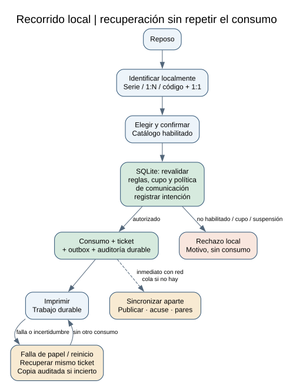

Los [bocetos de pantallas](docs/experiencia.md) son diseños, no capturas de software.
Incluyen cancelación, rechazo por cupo, huella no coincidente, falta de papel y
recuperación. Una nueva lectura no sustituye la identidad de una sesión ocupada.
Las capturas del puesto real, tomadas por CDP sobre el EXE publicado y siguiendo el escenario del E2E, están en
[«Capturas del flujo principal»](#capturas-del-flujo-principal).

### 1.4. Instrucciones de instalación

#### Cómo revisar

Hay tres caminos, y los tres usan sólo datos sintéticos. Las únicas credenciales son los
[códigos sintéticos](#cómo-ver-la-demostración) de la tabla de más abajo, y no hay contraseñas.

**1. El Release, sin instalar .NET.** En [Releases](https://github.com/DaveWalf/AI4Devs-finalproject/releases),
bajar `INComedor-Puesto-<versión>-win-x64.zip` y su `.sha256`, comprobar la suma y abrir el EXE:

```powershell
$zip = '.\INComedor-Puesto-<versión>-win-x64.zip'
(Get-FileHash $zip -Algorithm SHA256).Hash -eq (Get-Content "$zip.sha256").Split(' ')[0]   # True
Expand-Archive $zip -DestinationPath .\INComedor-Puesto
.\INComedor-Puesto\Intelektron.INComedor.Kiosk.exe
```

Requisito: Windows 11 x64 con el WebView2 Runtime, que Windows 11 ya trae. El paquete lleva el runtime de .NET
al lado del EXE y no trae datos: la base se crea y se siembra al abrirlo. El EXE no está firmado, así que
SmartScreen puede pedir «Más información» y «Ejecutar de todas formas». El Release trae sólo el puesto: el
receptor necesita SQL Server y se revisa desde el código. El primer Release real sale con .NET 11 estable, del 10/11/2026,
desde `final-project-dw` (D-C28). Hasta entonces, el mismo zip se arma en local con
`pwsh .github/scripts/publicar-puesto.ps1 -Version 0.0.0-local`, que antes de escribirlo corre el E2E contra
el EXE publicado y lo deja en `artifacts/`.

**La versión que corre.** En el centro del pie, entre la sincronización y la marca Intelektron, el puesto dice, más
chico y atenuado, la versión del paquete y el commit corto, como «v1.0.1 · 7b80d45»; la última sección de General, «Versión del programa», suma el
commit completo, la fecha y hora de compilación y la versión de .NET. El tag del Release llega al EXE porque
`publicar-puesto.ps1` lo pasa como la propiedad propia `VersionPuesto` (y la fecha como `FechaCompilacionPuesto`),
nunca como `Version`, y el E2E contra el EXE comprueba que el pie lo muestra. Un puesto compilado desde el código,
o en la CI, dice «desarrollo» en lugar de la versión, con el commit del que se compiló. El título de la cabecera,
«INComedor · tu pausa del día», va en Heebo Light, la letra con que INWeb escribe su nombre, desde un archivo del propio
puesto ([`heebo-latin.woff2`](src/Intelektron.INComedor.Kiosk/wwwroot/fonts/heebo-latin.woff2), con su licencia
[OFL 1.1](src/Intelektron.INComedor.Kiosk/wwwroot/fonts/OFL-Heebo.txt)): no pide nada a internet.

**2. El código.** Con el SDK que fija `global.json` (11.0.100) o uno posterior de .NET 11, que
`global.json` acepta con `rollForward: latestFeature`, desde la raíz de un clon de la rama
`final-project-dw` (la rama por defecto, `main`, tiene sólo las plantillas del curso):

```powershell
git clone --branch final-project-dw https://github.com/DaveWalf/AI4Devs-finalproject.git
cd AI4Devs-finalproject
dotnet build INComedor.sln
dotnet test INComedor.sln
dotnet run --project src/Intelektron.INComedor.Kiosk
```

`dotnet test` necesita una instancia de SQL Server para las pruebas del receptor y el E2E (ver §2.6). Lo que
se puede recorrer en la ventana está en «Cómo ver la demostración», más abajo. Para no usar la carpeta de siempre,
antes de `dotnet run` se elige una propia: `$env:INCOMEDOR_DEMO_DIR = "$env:TEMP\incomedor-revision"`. Con una carpeta
propia, el puesto busca los certificados del receptor en ella: para la demostración conectada, en la terminal del
receptor va además `$env:Receptor__CarpetaDemostracion = "$env:TEMP\incomedor-revision\certificados"`, y si no, el
puesto atiende con «Sin receptor configurado».

**3. El E2E.**

```powershell
dotnet test tests/Intelektron.INComedor.E2E.Tests
```

Recorre el flujo principal del [plan de pruebas](docs/pruebas.md#pruebas-previstas) con el puesto y el
receptor compilados, como procesos, y la pantalla manejada por Playwright por CDP (el protocolo de depuración
del WebView2):
- `0001` confirma «Almuerzo común» con el receptor apagado y sale el comprobante;
- con el almuerzo del día usado, `0001` ve sólo los refrigerios y «Hoy ya usaste: almuerzo 1 de 1»;
- la franja cuenta 1 pendiente;
- al volver el receptor, queda al día, con el consumo consolidado una sola vez.

Suma las cinco pruebas de las costuras del puesto y las E2E de los changes que tocan la pantalla: 52 en total. Con 44, en la CI tardaban cerca de 10 min (10 min 10 s en la [corrida 43076629063](https://github.com/DaveWalf/AI4Devs-finalproject/actions/runs/43076629063)), y las 52, en local, 4 min 28 s el 11/11, porque cada una abre la ventana del puesto y el flujo principal espera el ciclo real de envío, de 30 s. Necesita el WebView2 Runtime, SQL Server y una sesión con
escritorio: si falta algo, falla nombrándolo. Cada prueba usa su carpeta temporal, sus puertos y su base, y no
toca `%LOCALAPPDATA%\INComedor\demo\`. Las capturas de cada paso quedan en
`tests/Intelektron.INComedor.E2E.Tests/bin/Debug/net11.0-windows10.0.17763.0/TestResults/e2e/`.

**Datos sembrados.** La base del puesto se crea y se siembra al abrirlo: un catálogo sintético de ALMUERZO y
REFRIGERIO, cuatro personas y cuatro operadores, con los códigos de la tabla. El receptor de demostración genera
sus certificados sintéticos y su base al arrancar («Receptor de lotes y puesto conectados», más abajo).

**Variables de entorno.** [`.env.example`](.env.example) lista las cinco, vacías y comentadas. Nada lo carga,
porque el puesto y el receptor leen el entorno del proceso: cada una se fija en la terminal, por ejemplo
`$env:INCOMEDOR_SQLSERVER = 'MI-SERVIDOR'`. Todas son opcionales; `INCOMEDOR_CATALOGO=nueve` siembra una base nueva con nueve opciones. `INCOMEDOR_CDP_PORT` es sólo para pruebas: con
el puerto abierto, cualquier proceso del equipo puede manejar la pantalla. Aparte de las del puesto, un puesto que
corre sin elevar también obedece la variable propia de WebView2, `WEBVIEW2_ADDITIONAL_BROWSER_ARGUMENTS`: si alguien
la definió con `--remote-debugging-port`, abre el puerto aunque `INCOMEDOR_CDP_PORT` no esté.

**`docker-compose`: no aplica.** Es una app de escritorio con su base SQLite local, y el receptor usa la instancia
de SQL Server del equipo. Docker quedó fuera del corte ([lo que no se aplica](docs/aplicacion-del-curso.md#lo-que-no-se-aplica)).

**Recorrido de verificación.** Con el puesto abierto por el camino 1 o el 2 y la base recién creada, sin el
receptor, en la ventana:

1. `0001` e «Ingresar», y tocar «Almuerzo común»: se abre el cartel «¿Confirmás tu elección?» con la opción y su cargo
   («Elegir otra» o Escape lo cierran sin escribir nada). «Confirmar» en el cartel: «Consumo registrado. Retirá tu
   comprobante», y el comprobante queda como archivo de texto en `%LOCALAPPDATA%\INComedor\demo\comprobantes\`.
2. «Listo», y otra vez `0001`: la selección ya no ofrece ningún almuerzo, sólo los refrigerios, y dice «Hoy ya
   usaste: almuerzo 1 de 1». El cupo de ALMUERZO es 1 y no hay cómo registrar otro consumo.
3. `0002` e «Ingresar»: «Esta credencial está vencida. Solicitá asistencia».
4. El engranaje pide la clave del día: cualquier número de 1 a 12 dígitos en el teclado en pantalla y «ENTER», y
   Configuración avisa arriba que no se validó. En su pestaña Impresora, «Sin papel»; `0001` con «Café con leche», un
   REFRIGERIO: «Tu consumo está registrado. El comprobante queda pendiente».
5. La impresora en «Disponible» y, en Consumos, «Ver» en la fila del paso 4: el comprobante en pantalla, marcado COPIA
   EN PANTALLA, sin pedir un operador ni imprimir. «Recuperar» en esa fila lo saca como el mismo trabajo, sin pedir ningún
   código. «Reimprimir» avisa que la copia va a salir marcada «SIN VALIDEZ: PRUEBA DE FUNCIONALIDAD», porque se entró con
   la clave del día, y con un motivo saca una copia con la leyenda REIMPRESIÓN y esa marca en lugar de «Habilitó:».
6. En Consumos, «Buscar» con el número de una fila y «Consultar» dejan sólo esa; «Exportar CSV» pide la carpeta la primera
   vez y deja ahí el archivo. Cerrar Configuración y entrar por el engranaje con `9001` en lugar de la clave: «Reimprimir»
   pide sólo el motivo y la copia sale con «Habilitó:» y el nombre del operador; cerrar Configuración termina su sesión.
7. En reposo, el engranaje y «Personas habilitadas»: «Agregar persona», el nombre «Persona sintética 05», el código
   `0105` (no se vuelve a mostrar), el cupo ALMUERZO con «Agregar cupo» (límite 1) y «Guardar»: «Se guardó la versión
   2 de la configuración». Cerrar Configuración, `0105` e «Ingresar»: sólo opciones de ALMUERZO; `105`, sin el cero,
   no se reconoce. Con `9001` en lugar de la clave, Configuración abre sólo con Consumos, Personas e Impresora y
   «Operador: Operador sintético 01» arriba, sin General ni «Cerrar el puesto»; `9002` dice que su permiso está
   vencido. El otro camino del operador: en reposo, `9001` e «Ingresar» (o su nombre en el combo de la simulación) muestran
   «Configuración» junto a «Listo», y tocarlo abre la misma Configuración, sin pedir la clave ni el código otra vez; un
   operador con comidas lo ve junto a «Cancelar», arriba de sus opciones. La general distingue los dos caminos:
   `CONFIGURATION_OPENED` con `OPERATOR` por el engranaje y con `OPERATOR_IDENTIFICATION` desde la identificación.
8. La simulación viene encendida: desde el paso 1, la pantalla de identificación tiene, arriba del campo del código, el
   combo «Simulación: elegí a la persona», con los nombres y sin ningún código, de borde a borde con la fila del campo
   e «Ingresar», que queda a la derecha del campo. Su lista no es la nativa de Windows: la dibuja la página, dentro de
   la ventana, así que se abre en el monitor del puesto aunque no sea el principal. Elegir «Persona sintética 01» abre su selección sin «Ingresar»; elegir «Persona sintética 02» da el mismo
   aviso de credencial vencida del paso 3. Tipear `0001` y pulsar Enter hace lo mismo que «Ingresar». En General de
   Configuración dice «Simulación: encendida»: «Apagar la simulación» la apaga, el combo se va y sigue apagada al
   volver a abrir el puesto, y «Encender la simulación» la vuelve a encender. Con la simulación encendida, «Pasar a
   operativo»: en operativo el combo no aparece, y con «Pasar a mantenimiento» reaparece, porque el operativo no
   cambia lo guardado.
9. Cerrar la ventana y abrir `%LOCALAPPDATA%\INComedor\demo\bitacoras\<KioskId>\INComedor-interacciones-AAAAMM.log`
   con cualquier editor de texto: cada atención de los pasos 1 a 8 se lee, en orden y con la misma sesión, de
   `SESSION_OPENED` a `SESSION_CLOSED`, con la opción elegida, su importe y el mensaje que se mostró, y sin el código;
   las del combo dicen `"Origin":"SIMULATION_LIST"`. En `INComedor-general-AAAAMM.log` están el arranque y el cierre
   del puesto, lo hecho en Configuración (el alta del paso 7 y el apagado y el encendido del paso 8 como
   `CONFIGURATION_CHANGED`, con el antes y el después y sin el código) y la impresión.

La sincronización con el receptor se ve en «Receptor de lotes y puesto conectados», más abajo, y el E2E la recorre
sola.

**Video.** Un recorrido de 2 a 3 minutos, con su [guion](docs/guion-video.md). Pendiente: va como archivo del
Release cuando se publique.

#### Capturas del flujo principal

Las tomó el 11/11/2026 un recorrido por CDP sobre el EXE publicado desde `d50cb4d`, en un área de 1024 × 768, con una
carpeta de datos nueva, la base sembrada de quince opciones y los códigos sintéticos de la demostración. Siguen el
escenario E2E del [plan de pruebas](docs/pruebas.md#pruebas-previstas): el receptor arranca apagado y vuelve al final.

| Selección de `0001` | El cartel de la elección | Consumo registrado |
|---|---|---|
| 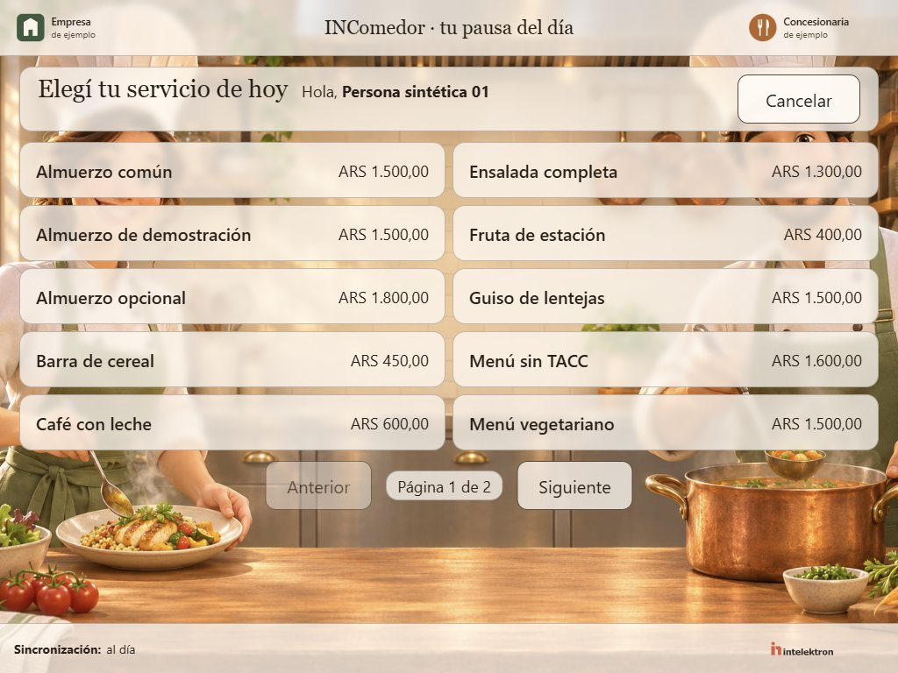 | 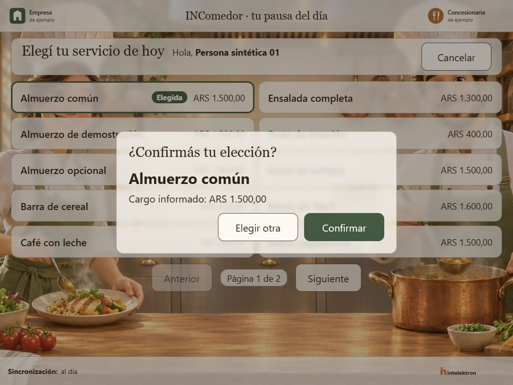 |  |

| Lo usado del día | Receptor apagado: 1 pendiente | Receptor de vuelta: al día |
|---|---|---|
| 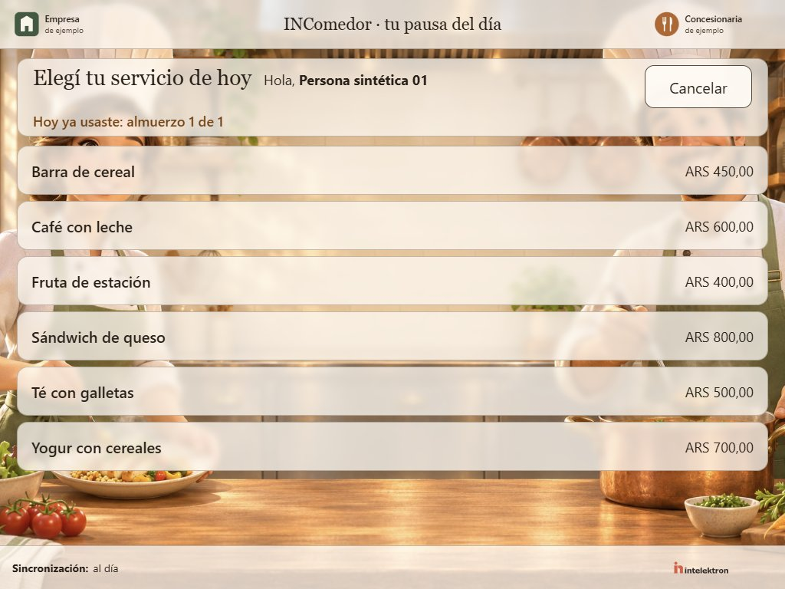 |  |  |

En las tres primeras la franja todavía dice «al día»: se actualiza en cada ciclo de envío, de 30 s, y la quinta es la
del primer ciclo con el receptor apagado. El segundo almuerzo ya no se ofrece, así que la franja cuenta un solo
pendiente, el consumo.

#### Consultar el diseño

Para consultar el diseño, abrir este README y sus anexos. Las instrucciones ejecutables
están en «Cómo ver la demostración», más abajo: SDK fijado en `global.json`
(11.0.100), paquetes con versión exacta en `Directory.Packages.props`, comandos
de build, test y run, y base creada y sembrada con datos sintéticos al abrir el puesto.

La demostración corre en Windows 11, .NET 11, WebView2 y almacenamiento local
y datos sintéticos. El primer provisionamiento podrá hacerse por sincronización
o paquete local validado. Con base provisionada, el arranque y la operación no
exigirán INWeb en el perfil autónomo y con continuidad local. El modo
multipuesto con suspensión conserva el arranque, diagnóstico y recuperación
locales, pero no admite nuevos consumos hasta recuperar la comunicación. Sin ninguna configuración inicial válida, el puesto informará
que requiere provisionamiento y mantendrá deshabilitadas las confirmaciones.

Ya existen las versiones exactas, los comandos probados, la carga del conjunto sintético y el paquete del
puesto (el EXE autocontenido en un zip, en «Cómo revisar»). Siguen pendientes la recuperación de un puesto entero (la configuración ya se resguarda y se recupera desde General, más abajo), un script de verificación del entorno, el provisionamiento por sincronización o paquete local y un instalador.

#### Cómo ver la demostración

Requisitos: Windows 11 con WebView2 Runtime y el SDK de .NET que fija `global.json`
(11.0.100, o uno posterior de .NET 11). Los comandos se corren desde la raíz del repositorio, porque
`global.json` se lee del directorio actual.

**Puesto: la atención.**

```powershell
dotnet run --project src/Intelektron.INComedor.Kiosk
```

La ventana abre a pantalla completa, sin bordes, con la atención del comensal, sin red. La identificación es simulada por código: el
código solo abre la sesión, sin huella, porque la biometría es de la segunda ola (D-C24). Se tipea el código,
se elige una opción y se confirma con la transacción de RB06. Hasta diez opciones van juntas, sin páginas: hasta
ocho en una columna y nueve o diez en dos columnas de hasta cinco; desde once, en páginas de diez. El catálogo
sintético tiene 15 (dos páginas, de diez y de cinco). Una opción sin cargo no muestra importe.
La selección ofrece sólo lo que esa persona puede consumir ahora: lo agotado no se muestra y una línea «Hoy ya
usaste: …» dice por qué; sin ninguna opción, la pantalla lo avisa y vuelve a reposo con «Listo» o a los 10 s.
«Cancelar», o 30 s sin tocar nada antes de confirmar, vuelven a reposo sin escribir nada. El resultado
vuelve a reposo con «Listo» o a los 10 s. Si la opción cambió de precio antes de confirmar, la pantalla
muestra el valor vigente y pide reconfirmar.

Códigos sintéticos:

| Código | Para qué sirve |
|---|---|
| `0001` | «Persona sintética 01», vigente: límite 1 en ALMUERZO y 2 en REFRIGERIO. Con un almuerzo ya consumido en el día, la selección ofrece sólo los refrigerios y dice «Hoy ya usaste: almuerzo 1 de 1»; con el almuerzo y los dos refrigerios usados, «No tenés opciones disponibles ahora» |
| `0002` | Credencial vencida: «Esta credencial está vencida» |
| `0003` | Credencial revocada: «Esta credencial ya no está habilitada» |
| `0004` | Credencial todavía no vigente: «No pudimos identificarte» |
| `9001` | Operador con permiso `OPERATOR` vigente: reimprime y recupera en Consumos. Tipeado en reposo, o elegido en el combo de la simulación, ve «No tenés opciones disponibles ahora.» con «Configuración» junto a «Listo», que abre Configuración como su código en el engranaje |
| `9002` | Operador con el permiso vencido: Consumos no lo deja reimprimir |
| `9003` | Operador con el permiso revocado: Consumos no lo deja reimprimir |
| `9004` | Administrador sin `OPERATOR`: Consumos no lo deja reimprimir |

El comprobante sale después del commit hacia una impresora simulada, que escribe un archivo de texto por
copia en `%LOCALAPPDATA%\INComedor\demo\comprobantes\` (`<TicketId>-<copia>.txt`). Cuando sale, la pantalla
muestra además una impresora de la que sale el comprobante, con el nombre del comensal, la opción, la fecha, el cargo y
una frase, nunca con el código; tocarlo equivale a «Listo», y con movimiento reducido aparece sin animación. Los modos de la impresora
(Disponible, Sin papel o Incierta) están en Configuración. Con «Sin papel», el consumo queda registrado y el
comprobante, pendiente, sin comprobante en pantalla. La pantalla de reposo ya no tiene «Asistencia»: en Consumos de
Configuración, cada fila tiene «Ver», que muestra el comprobante en pantalla marcado COPIA EN PANTALLA, sin imprimir ni
crear una copia, y «Reimprimir», que no pide ningún código: usa el acceso con que se entró a Configuración. Reimprime con
un motivo de una lista fija, y la copia sale con la leyenda REIMPRESIÓN y su número. Si se entró con el código de un
operador con `OPERATOR` vigente, la copia lleva «Habilitó:» con su nombre, y su permiso se comprueba en cada acción; si se
entró con la clave del día, que no identifica a nadie, lleva «SIN VALIDEZ: PRUEBA DE FUNCIONALIDAD» en su lugar, y la
pestaña lo avisa antes de elegir el motivo. Si el original falló, «Recuperar» lo saca otra vez como el mismo trabajo y no
como una copia nueva, sin pedir un código y sin marca, porque es el comprobante del consumo.

Todo lo que pasa en el puesto queda primero en la base y después, fuera de la atención, en dos bitácoras de texto
por mes en `%LOCALAPPDATA%\INComedor\demo\bitacoras\<KioskId>\`: `INComedor-interacciones-AAAAMM.log` (cada
atención, la asistencia y los comprobantes) e `INComedor-general-AAAAMM.log` (arranque y cierre, Configuración, la
sincronización y las propias bitácoras; la impresión va en las dos). Son JSON Lines en UTF-8, una línea por registro,
con el mes del hecho y nunca el código tipeado. Si un archivo no se puede escribir, la atención sigue, lo pendiente
espera en la base y se escribe al recuperarse con la marca `Recovered`; Configuración muestra si cada bitácora está
al día o degradada. Lo que el recorte deja fuera está en [`AGENTS.md`](AGENTS.md).

**Presentación táctil: catálogo de nueve, logos y Configuración.** Con `INCOMEDOR_CATALOGO=nueve` y una carpeta
nueva en `INCOMEDOR_DEMO_DIR`, la base se siembra con nueve opciones en lugar de quince (tres sin cargo), para ver
el caso de cinco más cuatro. La variable sólo cuenta al crear la base: una base ya sembrada no cambia.

```powershell
$env:INCOMEDOR_CATALOGO = 'nueve'
$env:INCOMEDOR_DEMO_DIR = 'C:\INComedor\demo-nueve'
dotnet run --project src/Intelektron.INComedor.Kiosk
```

Los logos del repo son de ejemplo, porque el cliente va anonimizado. Para ver los reales sin que entren al repo,
dejarlos en la carpeta de datos como `marcas\empresa.png` y `marcas\concesionaria.png` (también `.webp` o `.svg`,
de hasta 2 MB; con dos formatos gana el `.png`). Un archivo que no corresponde a su extensión, que pasa de 2 MB o
un SVG con DTD se ignora y queda el de ejemplo. Se leen al abrir la atención.
Sin tocar la carpeta, la pestaña Identidad visual de Configuración tiene «Logos»: se elige el archivo de cada uno, se
ve sobre una cuadrícula antes de guardarlo, con las mismas reglas (lo que no sirve dice por qué y deja el vigente), y
«Guardar los logos» lo escribe en `marcas\` y lo pone en la cabecera en el acto; «Volver al de ejemplo» y guardar lo
borra. Cada guardado queda en la general por la huella SHA-256 del archivo, su tamaño y su formato, nunca su contenido.

El engranaje del pie, en el borde inferior derecho al lado de la marca Intelektron y sólo en reposo, abre
**Configuración por pestañas**: Consumos, donde abre, Personas, Opciones, Identidad visual, Impresora,
Mails, Pantalla, Red, Lector, Exportación y, al final, General (el modo, el estado de las bitácoras, el resguardo y la versión del programa), en una fila de botones de 56 px que entra en
1024 × 768.
Todas quedan montadas, así que lo editado en una pestaña sobrevive al pasar a otra hasta cerrar. Cada «Guardar»
guarda sólo lo de su pestaña y deja Configuración abierta con el aviso de lo guardado; «Cerrar» o Escape la cierran
y descartan lo no guardado, también con un panel de edición abierto. Identidad visual tiene el «Estilo visual», con la
opacidad de las superficies (72 a 88 %, 76 % por defecto) y el desenfoque del fondo (0 a 12 px, 4 px por defecto) con
vista previa y su «Guardar» en `estilo-visual.json` de la carpeta de datos; Impresora, con la impresora simulada, sus
modos. En mantenimiento, cualquiera que toque el puesto en reposo puede cambiar el estilo o simular una impresora sin
papel.

**Resguardo de la configuración.** Al final de General, «Guardar resguardo» deja en la carpeta de la exportación
`INComedor-resguardo-AAAAMMDD-HHmmss.zip`, con un manifiesto (formato, esquema de la base y huella SHA-256 de cada
parte), la versión activa de la configuración tabla por tabla y los ajustes locales que la acompañan: el estilo visual,
los textos del comprobante, los logos propios y la presentación de las opciones con sus imágenes. No lleva certificados,
consumos ni lo que es del equipo (el monitor, el modo, la simulación y la carpeta de la exportación). **El archivo lleva
los códigos de identificación de las personas**, porque sin ellos no se puede recuperar: se guarda como un dato de la
empresa, y ni el resumen ni la bitácora los muestran. «Recuperar resguardo», sólo sin INWeb como dueño, pide el `.zip`
con el diálogo de archivos, lo revisa entero sin escribir (hasta 50 MB, sólo sus partes y de hasta 20 MB cada una, sus
huellas, el mismo formato y esquema, cada valor del tipo de su columna y con las reglas de un guardado a mano, cada
ajuste con las reglas de su almacén, un ensayo de la inserción que se deshace y ningún código que en este puesto sea de
otra persona) y muestra de qué versión y fecha es, cuántas personas activas, opciones y permisos de operador vigentes
trae y qué ajustes, con «Recuperar» y «Cancelar», éste destacado. «Recuperar» es todo o nada: escribe los ajustes,
crea una versión nueva (la anterior queda en la base) y la pantalla toma en el acto el estilo, los logos y los textos;
lo que el resguardo no trae vuelve al de ejemplo, y si algo falla, todo queda como estaba. Los ajustes locales de antes
no quedan guardados: para conservarlos, se guarda antes un resguardo. La huella del manifiesto detecta un archivo
dañado, no uno alterado a propósito: a ése lo frenan las validaciones. Un rechazo dice el motivo y no cambia nada. Queda en la general como `CONFIGURATION_BACKUP_CREATED`, `CONFIGURATION_RESTORED` o
`CONFIGURATION_RESTORE_REJECTED`, con la huella del archivo y sin códigos ni nombres.

**Modos, clave del día y cierre.** El puesto tiene dos modos, que atienden igual y sólo cambian el cierre. En los dos,
el engranaje pide la **clave del día**, con un teclado numérico en pantalla y «ENTER»; en este corte es la de
desarrollo, que acepta cualquier número de 1 a 12 dígitos, lo dice en el diálogo y, al entrar, Configuración avisa que
no se validó; nunca se guarda ni se registra. En **mantenimiento**, el de una carpeta nueva, Escape en reposo (o
«Cerrar el puesto» en General) cierra el puesto en orden; en **operativo**, el cierre también pide la clave. En el
mismo diálogo, el código de un operador con `OPERATOR` vigente abre Configuración sólo con Consumos, Personas e
Impresora, sin General ni cierre, y un código nunca vale como clave. Pasar a operativo, desde General, también la
pide; volver a mantenimiento, no. El modo queda en `modo-puesto.json` de la carpeta de datos. La ventana ocupa la
**pantalla completa sin bordes** en los dos modos, sin barra de título ni botón de cierre y tapando la barra de
tareas; en operativo, Alt+F4 o el pedido de cierre de otro programa muestran la clave en lugar de cerrar, y el apagado
de Windows nunca se frena. Cada clave pedida, cada entrada, cada cambio de modo y cada cierre quedan en la general con
cómo se entró (`MAINTENANCE_MODE` para el cierre directo, `DAILY_KEY` u `OPERATOR`) y el actor: nulo con
`NO_AUTHENTICATION`, o la persona del operador. Un piloto tiene que arrancar en operativo.

**Personas y opciones en Configuración.** Mientras no haya INWeb, el puesto es el dueño de sus datos: las pestañas
Personas y Opciones abren, con «Editar», «Personas habilitadas» y «Opciones del comedor», cada uno con su «Guardar» y
su «Cancelar», que vuelven a la pestaña. Personas es una **tabla**: una fila por persona y una columna por cada cupo
que usa el catálogo (en la semilla, ALMUERZO y REFRIGERIO), con lo usado hoy sobre su límite diario de 0 a 99 («1/2»)
o «—» sin cupo, el estado, la columna «Operador», con un escudo (texto accesible «Operador») en quien tiene el permiso
`OPERATOR` vigente, y la cantidad de opciones que esos cupos habilitan. En 1024 × 768 entran diez filas de 44 px,
el encabezado queda fijo y cada encabezado ordena la vista sin cambiar lo que se guarda. Tocar un cupo, o «Editar» en
el encabezado, la pasa a edición en el mismo lugar, con un teclado en pantalla que escribe en el campo elegido y que
«Ocultar teclado» esconde hasta cerrar Configuración: agregar una persona con su nombre, su código y sus cupos, cambiar su nombre o sus cupos (vaciar una celda
quita el cupo) y quitarla, que la da de baja y revoca su código sin borrar sus consumos. En edición, la celda «Operador»
se toca para marcar o desmarcar: guardar da el permiso desde ese momento y sin fin, o lo revoca en la versión nueva sin
borrarlo; un operador marca a otros pero no a sí mismo («No podés cambiar tu propio permiso.»), y una persona de baja no
se marca. Cada guardado deja en la
general los cupos cambiados de cada persona, con el límite antes y después, y el operador que entró con su código como
actor. «Exportar CSV» y «Exportar Excel», en el pie de Personas, guardan la tabla en la carpeta de la exportación de
Consumos, sin ningún código, y quedan en la general como `PEOPLE_EXPORTED`. «Planilla de ejemplo» deja ahí un `.xlsx`
para completar (Nombre, Código como texto, «Operador» con «Sí» o «No» y el límite de cada cupo, con una hoja de
instrucciones; la segunda fila de ejemplo es operador), y la exportación lleva «Operador» al final. «Importar Excel» lo
lee: cada fila se reconoce por su código, uno que ya está modifica a esa persona y uno nuevo la agrega. Antes de aplicar,
un resumen cuenta las nuevas, las modificadas y las que «Reemplazar» daría de baja por no estar en la planilla (nunca un
operador ni el administrador), avisa si quedan filas de ejemplo o códigos que Excel guardó como número (sin sus ceros),
y ofrece «Modificar y agregar», «Reemplazar» y «Cancelar»; una fila con error no deja aplicar nada y se lista con su
motivo. En la columna «Operador», «Sí» da el permiso, «No» lo quita y una celda vacía o la columna ausente lo deja como
estaba; otro valor, también una fórmula, es un error de su fila que no muestra lo escrito, y un operador no puede cambiar
el suyo por planilla. El resumen suma «1 permiso de operador dado y 1 quitado.» cuando hay alguno, y `PEOPLE_IMPORTED`
los cuenta en `OperatorGranted` y `OperatorRevoked`. Lo consumido hoy sigue contando contra los límites nuevos. Cada importación queda en la general con la huella
SHA-256 del archivo, como `PEOPLE_IMPORTED`, persona por persona sin nombres ni códigos, o `PEOPLE_IMPORT_REJECTED` con
sus errores por motivo. El código se tipea en un campo
enmascarado de sólo dígitos, conserva sus ceros iniciales, no se puede repetir aunque esté revocado, y nunca se
muestra ni se registra. El segundo muestra cada opción con su servicio, su importe, sus cargas de cupo y sus
**franjas horarias**, en la hora local del puesto, de inicio incluido a fin excluido (de 22:00 a 02:00 cruza la
medianoche); una opción sin franjas está disponible todo el día. Fuera de toda franja, la opción no se ofrece y, si
la franja cierra antes de confirmar, la confirmación la rechaza con «Esta opción no está disponible en este horario»;
si no queda ninguna, la atención dice «No hay opciones disponibles en este horario». Cambiar el nombre, el servicio,
el importe o las cargas de una opción pide reconfirmar a quien ya la tenía elegida; cambiar sus franjas, no. La pestaña
Opciones muestra el catálogo a la vista, cada opción con sus datos y una muestra de su tarjeta, con «Editar», que abre
esa edición en el mismo lugar, y «Personalizar»: un fondo de color de una paleta de ocho o una imagen PNG, WebP o SVG
con las reglas de los logos, la transparencia (0, 25, 50 o 75 %) y «Mostrar el precio». Esa presentación es local del
puesto, en `presentacion-opciones.json` y `opciones\` de la carpeta de datos: no crea versión y vale aunque INWeb
administre los datos; la atención dibuja cada tarjeta con su fondo y, con el precio oculto, la muestra como una sin
cargo, también en la reconfirmación por cambio de precio, mientras el comprobante conserva su importe. Cada guardado,
también uno fallido, queda en la general como `CONFIGURATION_CHANGED` del ajuste `OPTION_STYLE`, con el antes y el después
y la huella de la imagen, no su contenido. El pie de Opciones tiene «Exportar Excel» (el catálogo en el formato que se
importa: Nombre, Servicio, Importe, Franjas y las unidades de cada categoría), «Planilla base» (las mismas columnas con
dos filas de ejemplo e instrucciones) e «Importar Excel», que **reemplaza el catálogo**: cada fila se reconoce por su
nombre, la que coincide modifica su opción, la nueva se agrega y la que falta se quita sin tocar sus consumos; una columna
de categoría que falta deja esas cargas como estaban. Antes de aplicar, un resumen cuenta las nuevas y las modificadas,
nombra las que se quitan y avisa si quedan filas de ejemplo, con «Cancelar» destacado; una fila con error no deja aplicar
nada y se lista con su motivo. Queda
en la general como `MENU_OPTIONS_EXPORTED`, `MENU_OPTIONS_IMPORTED` (opción por opción, con la huella del archivo) o
`MENU_OPTIONS_IMPORT_REJECTED`.

Cada guardado es una **versión de configuración nueva** y completa, que se activa en la misma transacción y conserva
las anteriores; los consumos siguen apuntando a la versión en que se registraron. Un dato inválido no cambia nada y
queda señalado en el panel. Cada persona u opción cambiada queda en la bitácora general como `CONFIGURATION_CHANGED`,
con el antes, el después y las dos versiones, y un guardado rechazado también. Si la versión activa viniera de INWeb,
los dos paneles sólo muestran «Estos datos los administra INWeb» y el guardado se deniega; en este corte nada crea
esas versiones. Se entra con la clave del día o con el código de un operador, que queda como actor de lo que guarda.
Lo que el recorte deja fuera está en [`AGENTS.md`](AGENTS.md). La base pasa a la versión de esquema 4 al abrirse, y un
puesto anterior ya no la abre.

| Reposo | Nueve opciones: 5 + 4 | Quince: la segunda página |
|---|---|---|
|  | 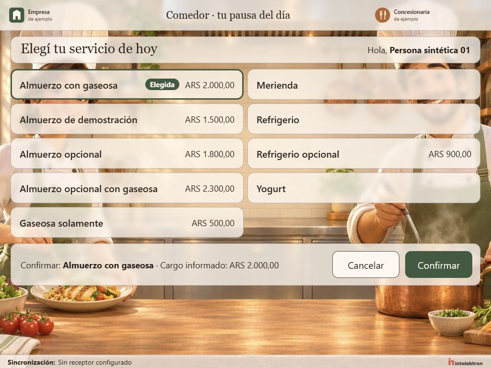 |  |

| Comprobante en pantalla | Configuración |
|---|---|
|  | 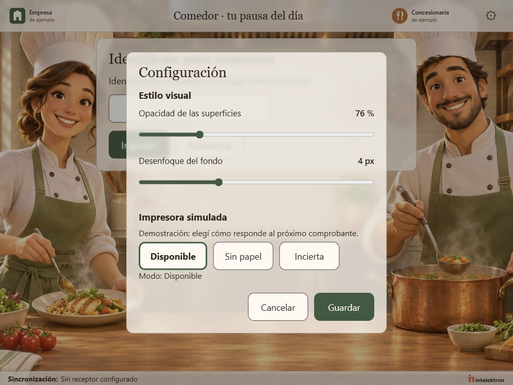 |

| Lo ya usado del día | Sin ninguna opción |
|---|---|
| 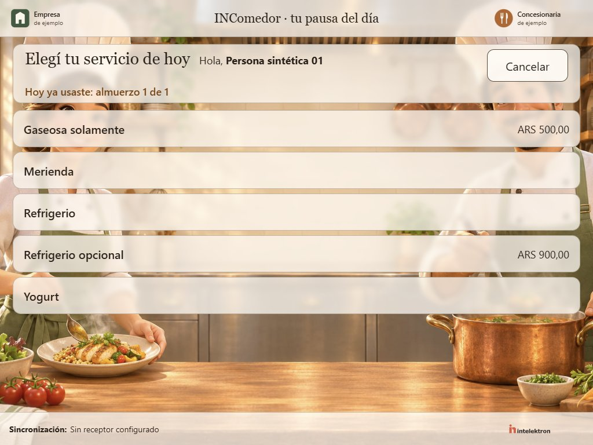 |  |

**Pantalla en Configuración.** La pestaña Pantalla lista los monitores conectados con su resolución y cuál es el
principal, y guarda el del puesto en `pantalla.json` por su identificador de interfaz, que sobrevive a un reinicio y a
un cambio de orden: la ventana pasa a pantalla completa en él y vuelve a él cada vez que el puesto abre. Si el monitor
guardado no está conectado, o lo guardado no se puede leer, el puesto abre en el principal y la pestaña lo avisa. Cada
guardado queda en la general como `DISPLAY_MONITOR`. Con un solo monitor lo cubren las pruebas; el cambio real entre
dos monitores lo prueba David en su equipo.

**Red en Configuración.** La pestaña Red muestra el nombre del equipo y cada adaptador activo con su IPv4, su máscara,
su puerta de enlace, sus DNS y si usa DHCP. En un adaptador elegido de la lista se puede fijar la IPv4 (dirección,
máscara, puerta opcional y hasta dos DNS) o volver a DHCP: cada valor se valida como IPv4, «Aplicar» pide confirmar y
avisa que el cambio puede cortar la conexión del puesto, y cada paso corre `netsh` con el permiso de administrador que
Windows pide en ese momento; el puesto no corre elevado. Cada aplicación queda en la general como `NETWORK_IPV4`, con el
adaptador, la IPv4 de antes y la pedida y en qué paso se cortó, si se cortó. Las pruebas sólo arman los argumentos y
nunca corren `netsh`; el cambio real lo prueba David en su monitor, con cuidado, porque puede dejar el equipo sin red.
«Probar conexión» prueba el receptor configurado por etapas (el nombre, la conexión, el TLS mutuo con los certificados
del puesto y la respuesta del receptor), dice en cuál falló y queda en la general como `CONNECTIVITY_TESTED`, sin enviar
ningún lote; sin certificados, la pestaña dice que el puesto atiende sin receptor y no prueba nada.

**Impresora en Configuración.** La pestaña Impresora tiene, con la impresora simulada, sus modos; «Imprimir una
prueba», que manda a la impresora del puesto un comprobante con la leyenda PRUEBA, sin persona ni importe, dice si
salió, si no tiene papel o si quedó incierto, y no crea ninguna fila en la base ni se confunde con el comprobante de
una atención; y los **textos del comprobante**: el encabezado (de 1 a 40 caracteres, «INComedor · comprobante» por
defecto) y el pie (hasta 60), en `impresora.json` de la carpeta de datos, que se aplican desde el próximo comprobante,
en la impresora y en pantalla, también a una copia. Debajo del pie, tres líneas se eligen con «Imprimir» o «No imprimir»:
«Nombre del comensal», «Aviso de reimpresión» y «Operador que habilitó», las tres en «Imprimir» por defecto y guardadas
con los textos; valen desde el próximo comprobante, en el papel y en el que sale en pantalla al confirmar, y «Ver» en
Consumos las muestra siempre. Una copia sin el aviso no lleva REIMPRESIÓN ni «ORIGINAL», pero conserva su «Copia: N». La
marca «SIN VALIDEZ: PRUEBA DE FUNCIONALIDAD» de una copia hecha con la clave del día no se apaga: quien configura con la
clave del día no puede sacar un comprobante que parezca válido. Cada prueba (`PRINTER_TESTED`) y cada guardado
(`TICKET_TEXTS`, con las tres elecciones antes y después) quedan en la general.

**El comprobante.** De arriba abajo: el encabezado; el número y el nombre del puesto, si se guardaron en «Datos del
comprobante» de Impresora; «ORIGINAL» o «REIMPRESIÓN · copia N» (si Impresora imprime el aviso) con el número del
comprobante; el nombre del comensal (si Impresora lo imprime), tomado al confirmar y guardado con el comprobante, así una
copia repite el de ese día; la opción, la fecha y el cargo; en una copia, «Habilitó:» con el nombre del operador que la
pidió (si Impresora lo imprime) o, si se pidió con la clave del día, siempre «SIN VALIDEZ: PRUEBA DE FUNCIONALIDAD»; una de 50 frases cálidas, siempre la misma para el
mismo comprobante; y el pie. Nunca el código de identificación. **El número del comprobante** se elige en «Datos del
comprobante»: «El código de siempre» o «Correlativo desde» un número de 1 a 999.999.999. El código de siempre sale así:
al confirmar, el puesto crea el identificador del comprobante con un GUID versión 4 (122 bits al azar) y el comprobante
muestra sus primeros ocho caracteres hexadecimales; no es correlativo, y la chance de que dos comprobantes muestren los
mismos ocho es de una en unos 4.300 millones por par, aunque el identificador completo, el que guarda la base, no se
repite. Con correlativo, cada confirmación toma, en su transacción, el mayor número ya emitido más uno, nunca menor que
el «desde»: dos confirmaciones no toman el mismo y bajar el «desde» no reusa números. Consumos muestra el número y lo
encuentra al buscar. El número y el nombre del puesto y la numeración son del equipo: viven en `puesto.json` de la
carpeta de datos, no viajan en un resguardo y cada guardado queda en la general como `TICKET_DATA`.

**Consumos en Configuración.** La pestaña Consumos muestra los consumos de las últimas 24 horas, del más reciente al
más antiguo, con la fecha y la hora, el número del comprobante, la persona y la opción como eran al consumir, el
servicio, el cargo y el estado del comprobante. Elegir fechas pasa a un rango de fechas de negocio de hasta 366 días, y
«Últimas 24 h» vuelve al de siempre. Filtra también por un texto, que busca sin distinguir mayúsculas ni acentos en la
persona, la opción, el servicio y el número; por el código de una persona, que se tipea enmascarado, se vacía al
consultar y no se registra; y por persona (también las dadas de baja), servicio y opción. Cada encabezado ordena la
consulta antes del tope de 500 filas, que avisa si hay más. La ve quien entra a Configuración con la clave del día o con
el código de un operador, que abre en ella; los rechazos no son consumos y no aparecen, y ningún código se muestra.
«Exportar CSV» y «Exportar Excel» guardan lo consultado, con su orden y hasta 10 000 filas, en una carpeta que se elige
la primera vez y se recuerda en `exportacion.json` de la carpeta de datos; «Cambiar carpeta» la vuelve a pedir. El CSV
va en UTF-8 con punto y coma, como lo abre Excel en español, y una celda que empieza como una fórmula lleva un apóstrofo
delante. Cada consulta queda en la general como `CONSUMPTIONS_QUERIED` y cada exportación como `CONSUMPTIONS_EXPORTED`,
con el nombre del archivo y sin nombres ni códigos.

**Exportación automática.** La pestaña Exportación, antes de General y sólo con la clave del día, lleva los consumos
solos a una carpeta y a un servidor SFTP simulado: «Activa», cada cuántos minutos (5 a 1.440, 15 por defecto), «Un
archivo que crece» (`INComedor-consumos.csv`, al que cada pasada le agrega los consumos nuevos) o «Un archivo por día»
(`INComedor-consumos-AAAAMMDD.csv` por fecha de negocio), la carpeta con «Elegir», y el SFTP simulado con su servidor,
puerto, usuario y carpeta remota. Las columnas son las de la exportación de Consumos, en CSV, sin ningún código.
Mientras el puesto está abierto, una pasada cada tantos minutos, o «Exportar ahora», escribe en cada destino lo que
todavía no le llegó: cada uno lleva su marca, el último consumo que recibió, que avanza recién después de escribir, y
cada escritura deja el archivo de antes o el completo. Si un destino falla, la pestaña dice cuándo y por qué, la
general lo registra como `CONSUMPTIONS_AUTO_EXPORT_FAILED`, el otro destino sigue, y la pasada siguiente reintenta desde
su marca, sin perder ni repetir consumos; cada pasada que escribe queda como `CONSUMPTIONS_AUTO_EXPORTED`. **El SFTP es
simulado** (decisión de David del 10/11/2026: «Todo, envíos simulados»): escribe en `sftp-simulado\<servidor>\<carpeta remota>` de la carpeta de
datos, y su modo «Caído» falla como un servidor que no responde, para ver la falla y la recuperación. **Queda pendiente
la conexión real**: un cliente SFTP con la clave guardada en el almacén de credenciales de Windows y su prueba de
conexión, detrás del mismo destino. La configuración vive en `exportacion-automatica.json` y las marcas en
`exportacion-estado.json`; son del equipo y no viajan en un resguardo.

**Avisos por correo.** La pestaña Mails, después de Impresora y sólo con la clave del día, configura los correos del
puesto: «Activos», el cliente que encabeza cada asunto, la casilla de origen (remitente, servidor, puerto, cifrado
STARTTLS o TLS directo y el segundo factor como método: contraseña de aplicación u OAuth 2.0), hasta cinco casillas de
operador, la del Administrador Principal y la hora de la señal de vida. Ninguna clave ni token se guarda. Con los
correos activos, los operadores reciben los avisos de gestión: una persona con una credencial conocida que no pudo comer
al marcar (vencida, revocada, sin habilitación, fuera de horario o sin cupo), con su nombre visible y nunca su código, y
un comprobante que no se imprimió (sin papel, una falla o un resultado incierto); el Administrador Principal recibe el
estado técnico (una exportación automática que falla y una bitácora que se degrada) y, una vez por día a la hora
elegida, la señal de vida con el resumen del día anterior. El asunto siempre es «Cliente · Puesto N Nombre · Situación»,
y un mismo aviso no se repite antes de 15 minutos. Cada correo pasa por una cola (`correo-pendiente\`, hasta 500) y un
reloj de cada minuto la envía en orden; la general registra `NOTIFICATION_QUEUED`, `NOTIFICATION_SENT` y
`NOTIFICATION_FAILED`, sin direcciones. **El envío es simulado** (decisión de David del 10/11/2026: «Todo, envíos simulados»): cada correo queda
como un `.eml` en `correo-simulado\` de la carpeta de datos, que se abre con cualquier cliente de correo, y el servidor
simulado «Caído» deja la cola esperando hasta que vuelve; «Enviar una prueba» manda un correo a todas las casillas.
**Queda pendiente el envío real**: un cliente SMTP con la clave o el token en el almacén de credenciales de Windows,
detrás de la misma cola. Queda pendiente también el aviso de un operador que habilita otro consumo, que este corte no
tiene. La configuración vive en `correo.json` y la fecha de la última señal en `correo-estado.json`; son del equipo y no
viajan en un resguardo.

**Medio de identificación.** La pestaña Lector, después de Red y sólo con la clave del día, elige cómo llega el código:
«Teclado» (como siempre, por defecto), «Simulador interno» o «Puerto serie», con el puerto (`COM3`; «Actualizar» lista los
que el equipo tiene), la velocidad, los bits de datos, la paridad y los bits de parada, el terminador de cada lectura (CR LF,
CR, LF o TAB) y el relleno de dígitos (un código de sólo dígitos más corto se completa con ceros a la izquierda: con el
relleno 4, una tarjeta que manda `1` identifica a `0001`). En la pantalla de identificación una lectura identifica igual
que tipear el código y tocar «Ingresar», con los mismos rechazos y mensajes; durante una atención o con un diálogo
abierto se descarta, sin cola. Las tramas partidas se arman, varias tramas juntas se separan, y el ruido, más de 32
caracteres o un resto de más de 2 segundos se descartan sin pegar identidades. El código leído no queda en ningún
registro: la identificación lleva su origen (`Origin`: `SERIAL_PORT` o `SIMULATED_READER`), y la general registra
`READER_STATE_CHANGED` y `READER_READING_DISCARDED` (a lo sumo uno por motivo y por minuto). Un puerto que falta, está
ocupado o se desconecta se reintenta cada 5 segundos y la atención sigue por el teclado. **El simulador interno** se ve
sólo en mantenimiento: la pantalla de reposo muestra «Lector simulado», con su campo y su botón alineados con los del
código, y lo tipeado recorre el mismo armado que el puerto real. **Para probar el puerto real**: con un lector USB-serie
(o dos adaptadores unidos por un cable null-modem), elegir su `COMx` y su formato en la pestaña Lector y guardar; la
pestaña dice si escucha. La configuración vive en `lector.json`; es del equipo y no viaja en un resguardo.

**Operar sólo con la pantalla.** Un puesto de autoservicio no tiene teclado físico: al tocar con el dedo un campo de
texto de Configuración o el código de la pantalla de reposo, aparece abajo un teclado en pantalla con números, letras
con la Ñ, «Mayús», espacio, borrar y los símbolos de las casillas, los servidores y las carpetas (`@ . - _ : / \`). Escribe
en el campo tocado como un teclado físico, sin sacarle el foco, y Configuración se acorta para que el campo quede arriba
del teclado. En Configuración, «Ocultar teclado» lo oculta hasta cerrarla (un técnico con un teclado físico sigue
escribiendo como siempre); al volver a abrirla, aparece otra vez. En la pantalla de reposo no se oculta. Con un mouse o
un teclado físico el teclado en pantalla no aparece: lo abre sólo un toque de la pantalla. La clave del día y Personas
conservan sus propios teclados.

| Personas habilitadas | Opciones del comedor con una franja |
|---|---|
| 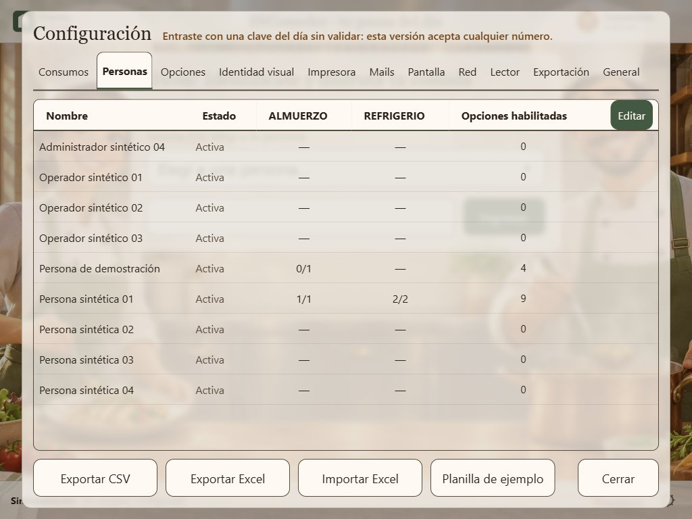 | 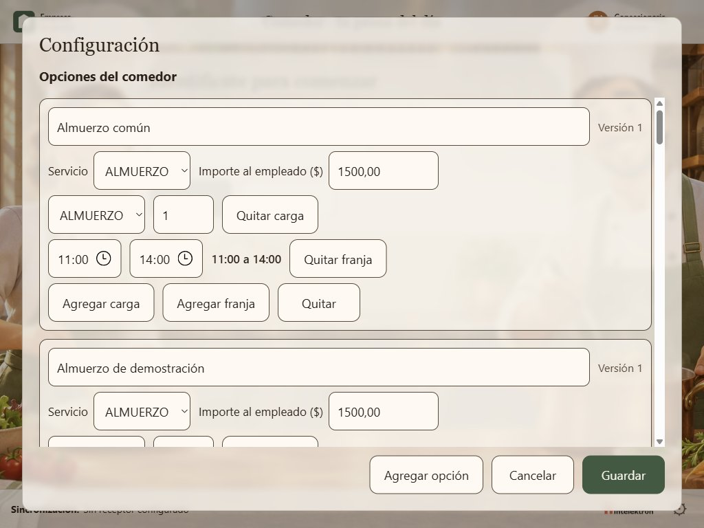 |

| Consumos del día | La clave del día con su teclado | Configuración de un operador |
|---|---|---|
| 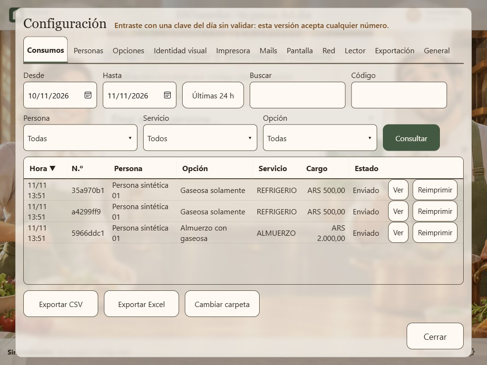 | 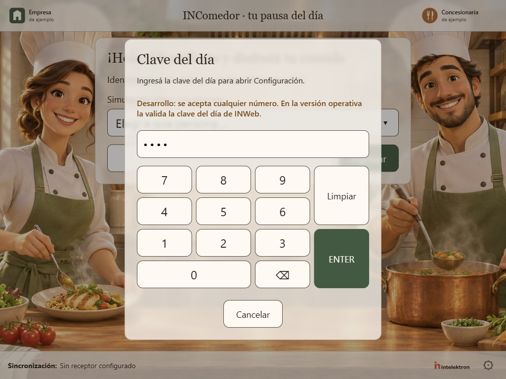 | 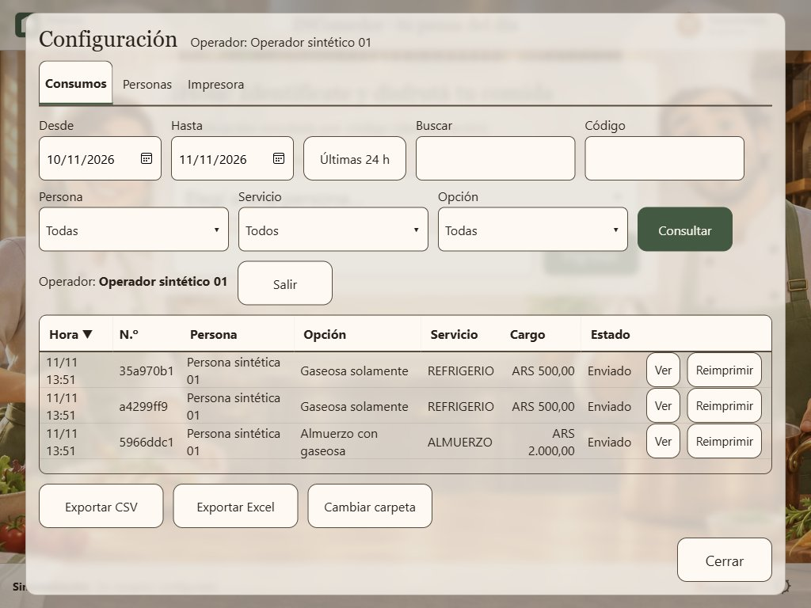 |

Las 18 las sacó el 11/11/2026 un recorrido por CDP sobre el EXE publicado desde `d50cb4d`, la punta con los nueve
changes del cierre, a 1024 × 768 y en JPEG a escala CSS con calidad 85, con una carpeta de datos nueva: las del flujo
principal y la 08 con la base de quince y el receptor, y las demás con `INCOMEDOR_CATALOGO=nueve`, por eso su franja
dice «Sin receptor configurado».

**Pantalla de demostración anterior.**

```powershell
dotnet run --project src/Intelektron.INComedor.Kiosk -- --demostracion
```

Muestra una persona y una opción sintéticas fijas y el botón «Confirmar». Cada toque confirma una
intención nueva: el primero del día muestra `AUTHORIZED` con los identificadores de consumo y de
comprobante, y el segundo `DENIED` con `LOCAL_LIMIT_REACHED`.

Las dos pantallas comparten la base `%LOCALAPPDATA%\INComedor\demo\incomedor.db`, en la versión de esquema 4.
Se crea y se siembra con datos sintéticos al abrir la ventana por primera vez, y una base que ya tiene datos
no se vuelve a sembrar. Una base de las versiones 1 a 3 se actualiza sin perder sus consumos. Para repetir la
demostración, cerrar la ventana y borrar la carpeta `%LOCALAPPDATA%\INComedor\demo\`.

**Receptor de lotes y puesto conectados.** En dos terminales, primero el receptor y después el puesto:

```powershell
dotnet run --project src/Intelektron.INComedor.Sync.Api -- --demostracion
dotnet run --project src/Intelektron.INComedor.Kiosk
```

El receptor escucha en `https://localhost:5001` con TLS mutuo. La primera vez genera tres certificados
sintéticos en `%LOCALAPPDATA%\INComedor\demo\certificados\`: la autoridad, el del receptor y el del puesto.
Además crea la base `INComedorReceptorDemo` en la instancia de SQL Server de la variable `INCOMEDOR_SQLSERVER`
(si no está, `(localdb)\MSSQLLocalDB`) y registra el puesto de la demostración. Al abrir la atención, el puesto
encuentra esos certificados y envía sus lotes cada 30 s, fuera de la confirmación. La franja «Sincronización», al
pie, dice «Sincronización: al día», cuántos eventos están pendientes o retenidos para revisión, «Error técnico:
credencial del equipo» o «Sin receptor configurado». Con el receptor detenido, la atención sigue y la franja cuenta
los pendientes; al volver, el puesto los envía sin duplicarlos, y un acuse perdido se recupera consultando el lote.

Los tres PFX no tienen contraseña. Son sintéticos, viven en el perfil del usuario, fuera del repo, y sólo
permiten mandar lotes sintéticos a un receptor local; no se usan fuera de la demostración. Para repetirla, cerrar
el puesto y el receptor, y borrar `%LOCALAPPDATA%\INComedor\demo\` y la base `INComedorReceptorDemo`.

Sin `--demostracion`, el receptor lee la cadena de conexión (`ConnectionStrings:Receptor`) y la autoridad de los
equipos (`Receptor:Autoridad`) de su configuración, sin valores por defecto; sin ellas responde `503`. No se
publica ni se despliega: la emisión, la renovación y la revocación reales de certificados quedan fuera del corte.

## 2. Arquitectura del sistema

### 2.1. Diagrama de arquitectura

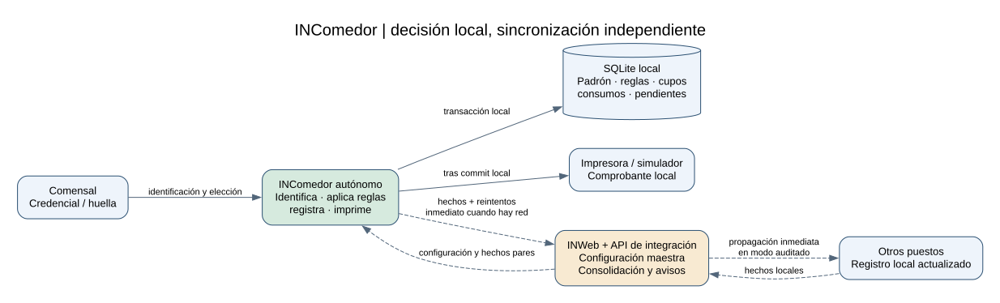

El puesto tiene **autoridad operativa local** sobre identidad, reglas, contador,
consumo y ticket. INWeb administra padrón y políticas y mantiene la vista
consolidada. Se utiliza la última configuración íntegra, respetando sus vigencias
explícitas, sin caducidad arbitraria que obligue a conectarse.

La arquitectura por capas separa dominio, dispositivos y transporte. Favorece
pruebas y autonomía, a costa de mantener dependencias nativas y resolver
consistencia eventual. [Justificación y alternativas](docs/arquitectura.md).

### 2.2. Descripción de componentes principales

| Componente | Tecnología prevista | Responsabilidad |
|---|---|---|
| Kiosco táctil | C#/.NET 11; pantallas Razor en Blazor Hybrid, con WPF sólo como ventana host del BlazorWebView | Pantallas, accesibilidad y sesión. Razor es también la tecnología de vistas del portal INWeb; WPF XAML queda como contingencia, no como segunda tecnología. |
| Aplicación y dominio | Bibliotecas C# | Identidad operativa, habilitación, cupo e idempotencia local. |
| Administración y diagnóstico | UI local + casos de uso con permisos | Configuración de equipo, pruebas aisladas e inventario de versiones. |
| Bitácoras | Archivos UTF-8 mensuales + escritor recuperable | General e interacciones separadas, respaldo durable y reconstrucción. |
| Persistencia local | SQLite + Microsoft.Data.Sqlite directo | Configuración, contador, consumos, impresión y outbox. |
| Adaptadores | Serie, biometría, impresión y simuladores | Entradas y resultados independientes de reglas. |
| Broker BioMini | Proceso local y SDK homologado | Captura y matching 1:N/1:1 sobre padrón protegido. |
| Sincronizador | Worker C# | Configuración y envío de hechos con IDs estables. |
| API central | ASP.NET Core 11 REST/HTTPS | Configuración y recepción idempotente de lotes. |
| Consolidación | Adaptador INWeb, EF Core y SQL Server | Hechos centrales, acuses y conflictos. |

Las operaciones SQLite se ejecutarán en una cola de trabajo fuera de la interfaz;
la aplicación mantendrá la sesión estable mientras persiste la transacción.

### 2.3. Descripción de alto nivel y estructura de ficheros

Documentación de esta entrega:

```text
readme.md                       portada con las secciones de la plantilla
prompts.md                      registro de uso de IA
docs/
  especificacion-sdd.md         requisitos RF, reglas RB, aceptación AT y calidad RNF
  historias-y-tickets.md        épicas, historias de tamaño real y tickets de tarea
  plan-academico.md             prioridad, tallas, hitos y matriz de aceptación
  arquitectura.md               capas, decisiones ADR, protección y despliegue
  modelo-datos.md               diccionario de datos y ER de entidades y claves
  nomenclatura-integracion.md   convención de nombres compartida con INWeb
  nomenclatura-entidades.csv    mapa de entidades a tablas y clases
  nomenclatura-campos-er.csv    mapa de atributos a columnas y propiedades
  administracion-y-bitacoras.md administración local, diagnóstico y bitácoras
  experiencia.md                bocetos de pantallas y mensajes
  pruebas.md                    plan de pruebas por nivel
  decisiones.md                 decisiones del autor y condiciones del diseño
  cobertura-entrega.md          relación entre la consigna y cada artefacto
  aplicacion-del-curso.md       prácticas del curso, su evidencia y la respuesta a la devolución
  guion-video.md                recorrido del video de 2 a 3 minutos
.env.example                    las variables de entorno, vacías y comentadas
api/openapi.yaml                contrato de las tres operaciones de sincronización
diagrams/                       fuentes .dot y .mmd editables y sus SVG
```

Estructura prevista de la solución, la misma en todos los documentos. Existen hoy cinco
proyectos en `src/` (Domain, Contracts, Infrastructure.Sqlite, Kiosk y Sync.Api) y seis
en `tests/`: uno por cada proyecto de `src/` y el E2E. Application, Biometrics.Broker,
Devices e Integration.INWeb siguen previstos y no existen. Marcados con `[existe]` los que están:

```text
src/
  Intelektron.INComedor.Domain/                [existe] reglas, cupos, intención y consumo, sin dependencias externas
  Intelektron.INComedor.Application/           casos de uso y control de permisos locales
  Intelektron.INComedor.Contracts/             [existe] DTO del JSON versionado, con nombres explícitos
  Intelektron.INComedor.Infrastructure.Sqlite/ [existe] migraciones, transacción RB06, outbox y bitácoras
  Intelektron.INComedor.Kiosk/                 [existe] host WPF + Blazor Hybrid: atención, supervisión y administración
  Intelektron.INComedor.Biometrics.Broker/     proceso aparte que aísla el SDK de BioMini
  Intelektron.INComedor.Devices/               adaptadores de serie e impresora y dobles de prueba de dispositivos
  Intelektron.INComedor.Sync.Api/              [existe] receptor ASP.NET Core de configuración y lotes
  Intelektron.INComedor.Integration.INWeb/     adaptador a INWeb y consolidación con EF Core y SQL Server
tests/                                         [existe] un proyecto de pruebas por proyecto de src, más el E2E
```

De ese árbol, hoy el Kiosk implementa la atención con identificación simulada por código o por el lector, el comprobante con impresora simulada, Configuración por pestañas y la pantalla de demostración; `Infrastructure.Sqlite`, el primer corte de la
transacción, la identificación, la impresión, el outbox, la cola de lotes y el escritor de las bitácoras mensuales, y `Sync.Api`
la ingesta idempotente de lotes sobre SQL Server, sin el adaptador INWeb. Contracts hoy contiene los eventos de
outbox, el lote, el acuse y el JSON canónico RFC 8785, no todo el JSON versionado.

### 2.4. Infraestructura y despliegue

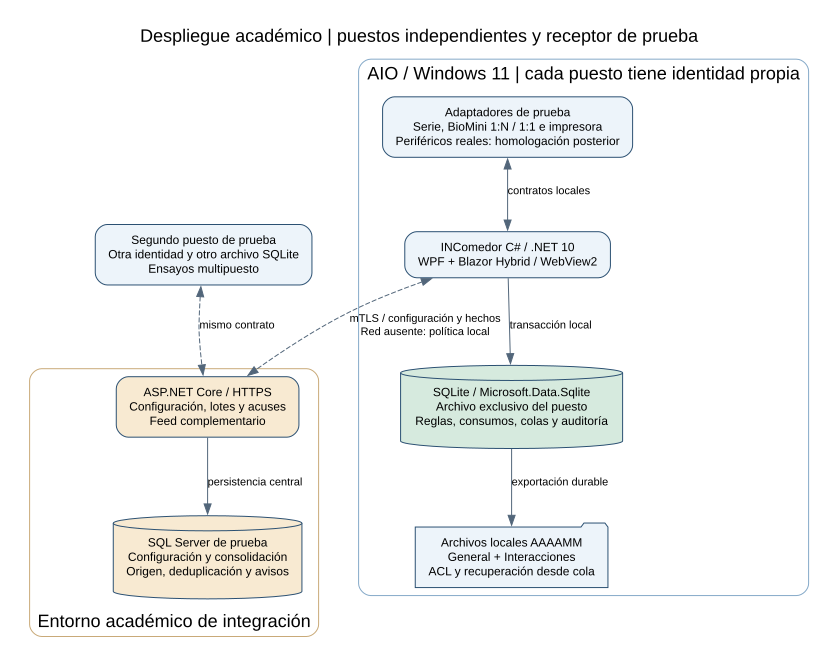

El puesto Windows ejecutará la interfaz, los casos de uso y los adaptadores.
SQLite residirá en disco local, con acceso exclusivo de la aplicación del puesto.
La API académica ASP.NET Core se ejecutará en un entorno de prueba y consolidará
en SQL Server; representará los contratos de integración con INWeb.

La puesta en marcha prevista comprende:

1. Instalar la aplicación, .NET y WebView2 y preparar directorios con permisos.
2. Crear la base y cargar el conjunto sintético y una configuración íntegra.
3. Activar los adaptadores de prueba y verificar diagnóstico, identidad y catálogo.
4. Ejecutar el flujo local con red ausente y comprobar persistencia y comprobante.
5. Habilitar la API de prueba y verificar sincronización, acuses y recuperación.

Cada puesto conserva su archivo SQLite; la sincronización intercambia hechos
por API. Actualizaciones, reinicios y restauración preservan eventos pendientes.
La integración física y el despliegue productivo requieren homologación.

**El proceso que existe hoy.** Dos workflows de GitHub Actions, con sus acciones fijadas por SHA:

- [`ci.yml`](.github/workflows/ci.yml), en cada pull request y en cada push a `feature/**` y a `final-project-*`:
  en `windows-latest`, restore, auditoría de dependencias vulnerables, build con `-warnaserror`, arranque de
  LocalDB y todas las pruebas, con el E2E; en `ubuntu-latest`, `openspec validate --all --strict` y gitleaks sobre
  la historia. La punta de `final-project-dw` anterior al #37 (`7b80d45`) está en verde en la [corrida 43083380317](https://github.com/DaveWalf/AI4Devs-finalproject/actions/runs/43083380317), con 1122 pruebas; la cifra de hoy está en la [§2.6](#26-tests).
- [`release.yml`](.github/workflows/release.yml), sólo con un tag `v*`: un job de sólo lectura compila, publica el
  puesto autocontenido para Windows x64 con [`publicar-puesto.ps1`](.github/scripts/publicar-puesto.ps1), corre el
  E2E contra ese EXE y recién entonces arma el zip y su suma; otro job, el único con escritura, comprueba la suma y
  deja el Release en borrador. Se ensayó con un tag descartable, en verde en la
  [corrida 41141226298](https://github.com/DaveWalf/AI4Devs-finalproject/actions/runs/41141226298), y el tag y su
  borrador se borraron. El primer Release real sale con .NET 11 estable desde `final-project-dw` (D-C28).

El receptor no se despliega: se corre desde el código, como dice «Receptor de lotes y puesto conectados».

La demostración final es la de un puesto, con el primer corte de D-C24. Multipuesto, cuenta local de mantenimiento y diagnóstico quedan en la segunda ola, diseñados y no demostrados. El [plan](docs/plan-academico.md#capacidad-y-reestimación) conserva la capacidad declarada al empezar, 6 h semanales, y el riesgo que se veía entonces de no llegar con el corte; el corte quedó construido y en verde ([§2.6](#26-tests)).

### 2.5. Seguridad

Controles diseñados: identidad de terminal y HTTPS para sincronizar, credenciales
por código con vigencia y revocación, permisos locales por rol para operador y
administrador, separación de secretos y biometría, minimización, auditoría y
protección local. Credenciales y permisos llegan en el snapshot; el operador se
autentica sin red con código y verificación 1:1 o cuenta individual local de mantenimiento, y cada acción privilegiada se
comprueba y se audita ([SDD §7.4](docs/especificacion-sdd.md#74-credenciales-y-control-de-acceso-local)). Un fallo de autenticación con INWeb afecta la sincronización, no sustituye
las reglas de autorización locales.

Se proponen ACL y cifrado de disco más protección específica para templates.
SQLite estándar no se considera cifrada por defecto. No se guardarán imágenes de
huellas ni templates en logs. Retención, acceso, enrolamiento y revocación productivos
se definirán y verificarán antes de una instalación productiva.

**Protección en reposo del primer corte (D-C24):**

- El código de identificación no es un secreto: identifica, no prueba identidad. No se cifra, pero no se escribe en logs, tickets ni eventos.
- Certificado del puesto para el mTLS con el receptor: la demostración usa `puesto.pfx`, sintético y sin contraseña, que el receptor genera en `%LOCALAPPDATA%\INComedor\demo\certificados\` («Receptor de lotes y puesto conectados», más arriba). En una instalación, la clave privada va al almacén de certificados de Windows, marcada como no exportable; esta versión no lo implementa.
- En una instalación, la ACL de la base SQLite se limita a la cuenta que corre el puesto; en la demostración, la base hereda los permisos de `%LOCALAPPDATA%` y esta versión no los cambia.
- El cifrado de disco (BitLocker) es requisito de instalación, no una función del producto.
- Los templates biométricos y el verificador de la cuenta de mantenimiento quedan fuera del corte: no existen en esta versión.

### 2.6. Tests

El [plan de pruebas](docs/pruebas.md) cubre dominio, SQLite real, sincronización,
contratos, E2E y dispositivos. Casos centrales: arranque offline, cupo local,
doble confirmación, caída tras commit, reimpresión, snapshot parcial, acuse perdido
y ambos modos biométricos. Incluye también saltos del reloj, cálculo del día de
negocio y vigencias. Al 11/11/2026 corren 1220 pruebas, todas en verde con `dotnet test INComedor.sln` desde la raíz del repositorio, medidas en local sobre la punta de la rama del #38 (`0e56770`): 91 de Domain, 329 de Infrastructure.Sqlite sobre un archivo SQLite real temporal, 663 del Kiosk, 62 del receptor, 23 de Contracts y 52 del E2E. La CI las corre en cada PR y en cada integración; la punta de `final-project-dw` anterior al #37 dio 1122 en verde en la [corrida 43083380317](https://github.com/DaveWalf/AI4Devs-finalproject/actions/runs/43083380317). Las del receptor, las del envío integrado y el E2E necesitan una instancia de SQL Server:
`(localdb)\MSSQLLocalDB` por defecto, u otra en la variable `INCOMEDOR_SQLSERVER`; cada clase crea su base y la
borra al terminar. Cubren la confirmación atómica (RB06), el replay por `IntentId`, las caídas antes y después
del commit, la concurrencia por el último cupo, la atención y el comprobante, y el envío de lotes: el acuse
perdido, el reenvío idéntico, el TLS mutuo real y la deduplicación en el receptor (AT13, AT27 y AT50).

El E2E (`tests/Intelektron.INComedor.E2E.Tests`) recorre el escenario E2E del plan, monopuesto con el servidor
apagado y luego recuperado (AT01, AT02 y AT27), sobre los EXE compilados del puesto y del receptor. Lo maneja
Playwright por CDP, sin bajar navegadores: el navegador es el WebView2 del equipo. Suma las costuras del puesto
(`INCOMEDOR_DEMO_DIR`, `INCOMEDOR_RECEPTOR_URL` e `INCOMEDOR_CDP_PORT`): el puerto de depuración sólo abre con un
valor válido y sólo en loopback. Con las de los changes que tocan la pantalla, medidas en la ventana real, son 44. Además de SQL Server, necesita el WebView2 Runtime y una sesión con escritorio,
y si falta algo falla con un mensaje que lo nombra, nunca con un salto. Con `INCOMEDOR_E2E_KIOSK_EXE`, corre
contra el EXE del paquete publicado, sin .NET a la vista: es lo que hace el script del Release antes de armar
el zip. El resto de los casos del plan sigue especificado, no ejecutado.

## 3. Modelo de datos

INComedor adopta las convenciones de datos y C# del ecosistema INWeb. El
[mapa lógico/físico/C#](docs/nomenclatura-integracion.md) define tablas
`tbComedor...`, columnas mnemónicas y negocio en español. Los DTO mantienen
el contrato JSON; las claves nativas de INWeb y los UUID del módulo conservan
su tipo y ámbito. Es el diseño completo: el primer corte crea 28 de sus 44 entidades, entre ellas las nueve de la tabla de §3.2, en las migraciones del puesto y del receptor ([cobertura](docs/cobertura-entrega.md)).

### 3.1. Diagrama del modelo de datos

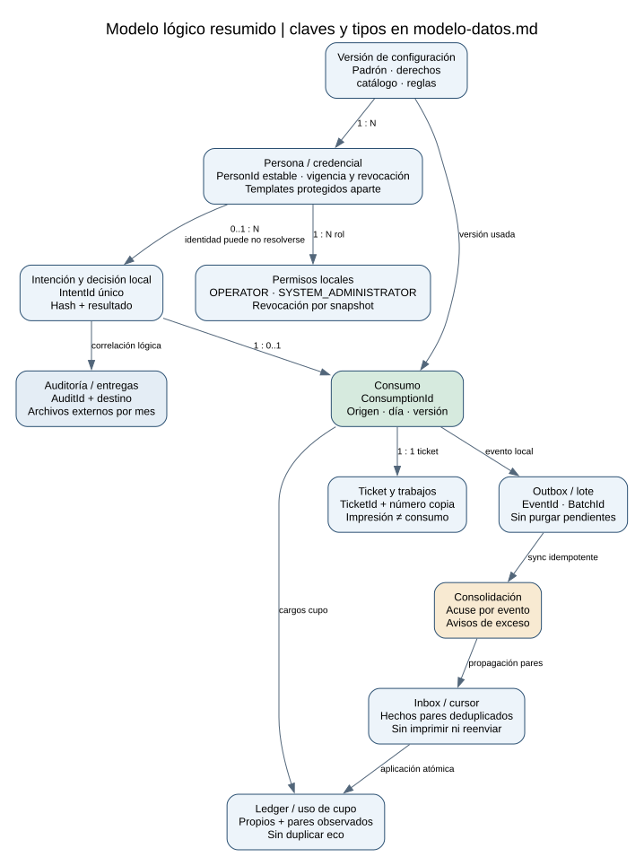

[Diagrama ER de entidades y claves (ampliable)](diagrams/datos-er.svg), [fuente editable](diagrams/datos.mmd) y [diccionario](docs/modelo-datos.md),
con tipos, claves, relaciones y restricciones. SQLite contiene la autoridad local
del consumo; la consolidación deduplica por identidad de origen sin volver a autorizar.

### 3.2. Descripción de entidades principales

El siguiente resumen conserva los nombres y restricciones del
[diccionario completo](docs/modelo-datos.md). UUID identifica entidades y hechos;
PK es clave primaria, FK clave foránea y UQ unicidad. Las referencias a padrón,
menú y reglas incluyen su snapshot para conservar la interpretación histórica.

| Entidad | Atributos esenciales y tipos | Claves y restricciones |
|---|---|---|
| PersonReference | SnapshotId, PersonId: UUID; DisplayName: texto; Active: booleano; IdentityMaterialVersion: entero | PK (SnapshotId, PersonId); FK snapshot; estado activo separado del derecho a consumir. |
| PersonCredential | SnapshotId, CredentialId, PersonId: UUID; Kind: enum; NormalizedValue: texto; ValidFromUtc, ValidToUtc, RevokedAtUtc: fecha-hora UTC opcionales | PK (SnapshotId, CredentialId); FK persona; código único por snapshot incluso revocado; no reasignable entre personas, con historial pendiente de concretar en M0; vencida y revocada tienen motivos propios. |
| ServiceType | SnapshotId, ServiceTypeId: UUID; Label: texto | PK (SnapshotId, ServiceTypeId); FK snapshot; un servicio puede tener distintas variantes de menú. |
| ConsumptionIntent | IntentId: UUID; IdentitySessionId: token opcional; PayloadHash: bytes(32); Status: enum; DecisionId: UUID opcional; ResultPayload: JSON opcional | PK IntentId; FK sesión cuando existe; UQ DecisionId cuando existe. Mismo ID y contenido recuperan el resultado durable. |
| Consumption | ConsumptionId, IntentId, SnapshotId, PersonId, MenuItemId: UUID; BusinessDate: fecha; Quantity, MenuVersion, PolicyVersion, CatalogVersion: enteros; ClientSequence: entero de 64 bits; PriceSnapshot: JSON | PK ConsumptionId; UQ IntentId; FK intención/persona/menú versionados; precio y versiones inmutables. El ticket lo referencia desde Ticket. |
| QuotaUsage | PersonId, QuotaScopeId, QuotaBucketId: UUID; BusinessDate: fecha; Used, Version: enteros | PK persona/ámbito/categoría/fecha, igual que la clave de cupo de RB03; Used no negativo; proyección de consumos propios y de pares ya recibidos. |
| Ticket | TicketId, ConsumptionId: UUID; PrintData: JSON; CreatedAtUtc: fecha-hora UTC | PK TicketId; UQ/FK ConsumptionId: un ticket lógico por consumo. |
| OutboxEvent | EventId: UUID; IntentId y TicketId: UUID opcionales; EventType, State: enum; PayloadVersion: entero; Payload, PayloadHash | PK EventId; referencias de intención/ticket cuando corresponda; mismo ID y contenido en reenvíos. |
| AuditRecord | AuditId, KioskId, GenerationId, BootId; Sequence: entero de 64 bits; OccurredAtUtc, RecordedAtUtc: fecha-hora; Context: JSON | PK AuditId; UQ (KioskId, GenerationId, Sequence); registro inmutable; decisión y auditoría comparten transacción. |

Los consumos observados de pares tienen deduplicación propia antes de afectar
QuotaUsage. Ticket y PrintJob separan el comprobante lógico de cada copia y del
resultado físico. Los templates se mantienen en el almacén protegido del broker,
fuera de consumos, payloads y bitácoras.

## 4. Especificación de la API

El [OpenAPI 3.1](api/openapi.yaml), versión 0.6.0-draft, define tres operaciones. El receptor `Sync.Api`
implementa las dos de lotes desde `recibir-lotes-idempotente`, sobre SQL Server y con TLS mutuo; la de
configuración es de la segunda ola:

| Operación | Propósito |
|---|---|
| `GET /api/incomedor/v1/configuration` | Configuración versionada completa, con credenciales y permisos locales, para activar localmente; 304 si no cambió y 404 si todavía no hay publicación. |
| `POST /api/incomedor/v1/sync-batches` | Lotes de hechos locales con acuses por evento. |
| `GET /api/incomedor/v1/sync-batches/{batchId}` | Recuperar el resultado del lote ante respuesta perdida. |

La autorización del consumo pertenece al puesto. Estas tres operaciones
seleccionadas cubren configuración y consolidación. El diccionario define además
los campos de la distribución biométrica y de la difusión de consumos entre
puestos; su transporte se especificará en M0. Administración y diagnóstico son
casos de uso locales.

## 5. Historias de usuario

Las tres épicas HU01–HU03 cubren F01–F04 y se descomponen en historias de tamaño
real. Estas son las tres historias principales; el
[backlog de historias hijas](docs/historias-y-tickets.md#backlog-de-historias-hijas)
completa los 35 escenarios con persona, talla y prioridad, y el
[plan académico](docs/plan-academico.md) ordena su ejecución.

| Épica | Objetivo | Personas | Historias hijas |
|---|---|---|---|
| HU01 | Identificarse y consumir de forma autónoma | Comensal | HU01.1–HU01.3 |
| HU02 | Recuperar y sincronizar consumos sin perder autonomía | Soporte técnico y Administrador de personal | HU02.1–HU02.6 |
| HU03 | Supervisar el puesto y recuperar un comprobante | Operador y Administrador del Sistema | HU03.1–HU03.5 |

### HU01.1 — Confirmar un servicio sin red y sin duplicarlo

**Épica:** HU01 · **Persona:** Comensal · **Prioridad:** must · **Talla:** M · **Tickets:** TK02.1 (interfaz), TK03.1 (datos) y TK01 (dominio, principal de AT01).

**Como** Comensal, **quiero** elegir un servicio del catálogo y confirmarlo en el puesto aunque no haya red, **para** recibir mi comprobante sin que un toque repetido, una cancelación o un cambio de precio alteren lo que consumí.

**Precondiciones:** base provisionada con el fixture sintético, sesión de identidad abierta por el adaptador de prueba (la identificación es HU01.2) y perfil monopuesto o `CONTINUE_LOCAL`.

| Escenario | Dado | Cuando | Entonces |
|---|---|---|---|
| HU01-A | Persona sintética habilitada, cupo local libre y red ausente | Confirma servicio | Una decisión autorizada, consumo/cupo/evento locales y ticket lógico |
| HU01-B | Catálogo de 15 opciones | Navega y cancela antes de confirmar | Navegación completa y cero consumo |
| HU01-D | Catálogo cambió entre mostrar y confirmar | Confirma valor anterior | Se informa el cambio y se solicita reconfirmación; no cambia el importe silenciosamente |
| HU01-G | Operación confirmándose | Se repite toque o llega otra lectura | Conserva persona/intención; no duplica consumo |

**Terminado:** una persona sintética confirma un servicio con la red desconectada y recibe su comprobante; cancelar no deja consumo, un segundo toque no crea otro y un cambio de precio obliga a reconfirmar.

### HU02.1 — Recuperar el resultado después de una caída

**Épica:** HU02 · **Persona:** Soporte técnico · **Prioridad:** must · **Talla:** S · **Tickets:** TK03.1 (datos) y TK01 (contrato de replay/conflicto, principal de AT25).

**Como** Soporte técnico, **quiero** que el puesto recupere tras un reinicio el resultado de una confirmación ya registrada, **para** resolver la caída sin cobrar dos veces ni perder el comprobante.

**Precondiciones:** base provisionada y una confirmación ya guardada por la transacción local.

| Escenario | Dado | Cuando | Entonces |
|---|---|---|---|
| HU02-B | Consumo confirmado localmente | El proceso cae antes de mostrar el resultado | Recupera mismos IDs y un solo trabajo original; no vuelve a consumir cupo |
| HU02-L | Decisión local durable y posterior vencimiento de sesión, baja o cambio de snapshot | Reintenta misma intención/ámbito/payload | Recupera resultado original sin repetir validación de negocio ni crear consumo/ticket/trabajo; una intención nueva sí usa reglas actuales |

**Terminado:** después de cortar el proceso en cada punto de la confirmación, el puesto vuelve a mostrar el mismo resultado con los mismos identificadores, sin un segundo consumo, y rechaza reutilizar la intención con otro contenido.

### HU02.2 — Reenviar lotes y consolidarlos sin duplicar

**Épica:** HU02 · **Persona:** Soporte técnico · **Prioridad:** must · **Talla:** M · **Tickets:** TK01.1 (receptor, principal de AT27) y TK01/TK03 (cliente sincronizador y cola local de U05).

**Como** Soporte técnico, **quiero** que un lote reenviado después de perder el acuse se reconozca como el mismo, **para** recuperar los pendientes sin duplicar consumos en la consolidación ni ocultar conflictos.

**Precondiciones:** receptor académico con su base de prueba y eventos pendientes en el puesto.

| Escenario | Dado | Cuando | Entonces |
|---|---|---|---|
| HU02-C | Hay eventos pendientes | Vuelve la conexión | Envía lote con IDs estables; el puesto sigue atendiendo durante sincronización |
| HU02-D | El servidor recibió el lote pero se perdió el ACK | Se reenvía o consulta el mismo lote | Deduplicación central; no se crea otro consumo ni se pierde el evento local |
| HU02-F | Servidor detecta discrepancia de cupo entre puestos | Concilia los hechos | Conserva ambos, informa conflicto y pide revisión; no niega retroactivamente una comida |
| HU02-G | Credencial de sincronización vencida | Se intenta enviar lote | Error técnico visible y evento retenido; en monopuesto sigue atención; nueva operación multi puesto aplica CONTINUE_LOCAL o SUSPEND_NEW_CONSUMPTIONS persistido |

**Terminado:** el receptor devuelve el mismo acuse ante reenvío/consulta, detecta contenido incompatible y rechaza hechos ajenos; el cliente mantiene atención según D-A02, retiene eventos ante error y avanza su cola sólo por acuse durable. Se conserva el consumo local.

## 6. Tickets de trabajo

Tres tickets de tamaño tarea, uno por capa, con dependencias disponibles al
iniciarlos, un responsable y sus propios criterios de aceptación. Pertenecen a las
épicas técnicas TK01 (backend), TK02 (interfaz) y TK03 (datos). El
[detalle completo](docs/historias-y-tickets.md#tickets-de-trabajo) incluye trabajo,
archivos previstos y exclusiones; la [matriz de aceptación](docs/plan-academico.md#matriz-de-aceptación)
asigna cada AT a un único responsable.

### TK03.1 — Datos: migración inicial y transacción de confirmación

**Unidad:** U02 · **Hito:** M1 · **Talla:** M · **Historias:** HU01.1, HU01.3 y HU02.1 · **Responsable:** DW

**Objetivo:** crear la primera migración SQLite y la unidad de trabajo que guarda una decisión en una sola transacción (RB06), para que la confirmación sea todo o nada y se recupere sin duplicarse.

**Trabajo incluido:** migración numerada `0001` con las tablas de la transacción y las de configuración que referencian; apertura con claves externas activas y versión de esquema comprobada; búsqueda previa por `IntentId` y hash; unidad de trabajo con `BEGIN IMMEDIATE` que reconsulta intención, snapshot y cupo, invoca al dominio y guarda su decisión dentro de la misma transacción; unicidades del modelo.

**Dependencias disponibles:** [diccionario](docs/modelo-datos.md) y mapa de nombres, fixture sintético del [OpenAPI](api/openapi.yaml) y contrato de intención cerrado en M0 (U01). Para cerrar AT03 se requiere el evaluador de dominio de TK01 integrado; TK03.1 conserva la responsabilidad de su evidencia.

**Aceptación:** AT03 (último cupo con dos confirmaciones simultáneas), AT05 (caída después del commit) y AT35 (repetición de una intención ya decidida).

**Terminado:** la migración crea una base vacía válida y los tres AT pasan contra un archivo SQLite real, con el comando y su salida registrados. El ensayo de caída de proceso no acredita resistencia a la pérdida física del disco.

### TK02.1 — Interfaz: selección y confirmación con sus estados

**Unidad:** U03 · **Hito:** M1 · **Talla:** M · **Historia:** HU01.1 · **Responsable:** DW

**Objetivo:** construir en WPF + Blazor Hybrid las pantallas de catálogo, confirmación y resultado sobre el caso de uso local, con estados que impidan confirmar dos veces o cambiar de persona durante la confirmación.

**Trabajo incluido:** estados reposo, selección, confirmando, resultado y regreso a reposo; catálogo paginado de 15 opciones por toque y teclado; cancelación y timeout de 30 s; un `IntentId` por confirmación; reconfirmación ante cambio de precio; mensajes por resultado.

**Dependencias disponibles:** para construir componentes, caso de uso con doble, fixture y mensajes de M0; para cerrar los AT y la demostración, TK01 y U02/TK03.1 integrados con SQLite real. M0 solo no basta para el cierre integral.

**Aceptación:** AT16 (catálogo y timeout sin consumo), AT26 (doble toque y lectura nueva) y AT47 (reconfirmación ante cambio de precio).

**Terminado:** los tres AT pasan en pruebas de componentes y en una demostración grabada sobre el equipo declarado, con persistencia local real del consumo.

### TK01.1 — Backend: receptor idempotente de lotes

**Unidad:** U05 · **Hito:** M1 · **Talla:** M · **Historia:** HU02.2 · **Responsable:** DW

**Objetivo:** implementar en el receptor académico ASP.NET Core `POST` y `GET` de lotes del [OpenAPI](api/openapi.yaml), sobre SQL Server de prueba, sin duplicar hechos ante reintentos.

**Trabajo incluido:** autenticación del equipo y lotes limitados a su ámbito; `Idempotency-Key` igual a `BatchId` y hash RFC 8785 del cuerpo; recibo del lote y eventos de entrada en una transacción, con un resultado por `EventId`; validación de la fecha de negocio de las cargas; caso de conciliación ante hechos incompatibles; consulta del acuse original.

**Dependencias disponibles:** OpenAPI 0.6.0-draft y certificados sintéticos de M0. El cierre integral de AT13/27 requiere cliente sincronizador y cola SQLite de U05, desarrollados por TK01/TK03; TK01.1 coordina la evidencia del receptor y del recorrido cliente-servidor.

**Aceptación:** AT12 (hechos incompatibles de dos terminales), AT13 (credencial inválida o lote ajeno), AT27 (acuse perdido y reenvío) y AT50 (cargas con otra fecha de negocio).

**Terminado:** pruebas de contrato del receptor contra SQL Server y ejemplos OpenAPI válidos; además AT13 y AT27 integran cliente y cola SQLite: error retiene eventos, ACK perdido permite reenvío y sólo el acuse durable avanza la cola. La prueba aislada del receptor no cierra HU02.2.

## 7. Pull requests

Los PR de changes de OpenSpec llevan la salida de `/openspec-verify-change`, y todos corren
el CI de `windows-latest`. Los tres primeros están apilados: la base de cada uno es la rama del
anterior, así cada diff muestra sólo lo suyo. Las ramas de las entregas 1 y 2 quedaron
congeladas tal como se enviaron, con el ruleset «Entregas congeladas» de GitHub: esos PR siguen
abiertos como evidencia y no se integran. La entrega final vive en `final-project-dw`, que recibe
cada trabajo por su propio PR, desde el cuarto. La entrega 1 documentó el diseño, sin código,
en el [#1](https://github.com/DaveWalf/AI4Devs-finalproject/pull/1).

**Pull Request 1:** [#2 · registrar-consumo-atomico (TK03.1)](https://github.com/DaveWalf/AI4Devs-finalproject/pull/2).
Solución .NET 11, base SQLite con la migración `0001` y confirmación atómica con replay por
`IntentId` (RB06, RB07, RB17); 48 pruebas. Incluye la corrección de fin de línea que destapó
la primera corrida del CI ([roja](https://github.com/DaveWalf/AI4Devs-finalproject/actions/runs/40790002939),
[verde](https://github.com/DaveWalf/AI4Devs-finalproject/actions/runs/40794862257)).

**Pull Request 2:** [#3 · conectar-puesto-y-receptor (TK02.1, TK01.1)](https://github.com/DaveWalf/AI4Devs-finalproject/pull/3).
Puesto Kiosk WPF con la pantalla Razor de demostración sobre SQLite, contrato de eventos en
`Contracts` y receptor `Sync.Api` que responde `501`; 61 pruebas
([CI](https://github.com/DaveWalf/AI4Devs-finalproject/actions/runs/40795276016)).

**Pull Request 3:** [#4 · los seis changes de la final](https://github.com/DaveWalf/AI4Devs-finalproject/pull/4).
De `feature/demostrar-flujo-de-punta-a-punta-dw` hacia `feature/entrega-2-DW`: `mostrar-aplicacion-del-curso`,
`imponer-invariantes-en-codigo`, `evaluar-habilitacion-local`, `atender-seleccion-y-confirmacion` (TK02.1),
`recibir-lotes-idempotente` (TK01.1) y `demostrar-flujo-de-punta-a-punta`, archivados en el mismo PR, con el verify
del último completo; 358 pruebas, con el E2E. Queda abierto y bloqueado a propósito por el ruleset, como evidencia,
porque su base es la rama de la entrega 2; `final-project-dw` se creó desde su punta. Sus checks muestran
`build-test` en rojo sobre esa punta, `de24100`
([41141219430](https://github.com/DaveWalf/AI4Devs-finalproject/actions/runs/41141219430) y
[41141401980](https://github.com/DaveWalf/AI4Devs-finalproject/actions/runs/41141401980)), por dos pruebas
intermitentes que ya estaban: una prueba bUnit de la pantalla de atención que no esperaba cada toque, y el arranque
en frío de LocalDB en el runner. La misma rama había pasado en verde antes
([41130320995](https://github.com/DaveWalf/AI4Devs-finalproject/actions/runs/41130320995)). La corrección no podía
ir en el #4, congelado, y es el PR siguiente.

**Pull Request 4:** [#5 · CI estable](https://github.com/DaveWalf/AI4Devs-finalproject/pull/5).
De `feature/estabilizar-ci-dw` hacia `final-project-dw`, integrado el 30/10 en `22aef1a`. La prueba bUnit espera
cada toque: con una demora plantada, la clase original cayó en 10 de 10 corridas y la corregida en 0 de 20. `ci.yml`
y `release.yml` arrancan LocalDB antes de las pruebas, y `ci.yml` corre también en los push a `final-project-*` y
fija sus acciones por SHA. Sin cambios de producto. CI en verde en el push y en el PR
([41151732885](https://github.com/DaveWalf/AI4Devs-finalproject/actions/runs/41151732885),
[41151877862](https://github.com/DaveWalf/AI4Devs-finalproject/actions/runs/41151877862)) y en la punta de
`final-project-dw`, [41154943372](https://github.com/DaveWalf/AI4Devs-finalproject/actions/runs/41154943372), con
cuatro intentos en verde sobre el mismo commit.

**Pull Request 5:** [#6 · README y evidencia para quien corrige](https://github.com/DaveWalf/AI4Devs-finalproject/pull/6).
De `feature/pulir-entrega-final-dw` hacia `final-project-dw`, integrado el 31/10 en `aa1b4f7`. Sólo documentación:
este §7 con el #4 y el #5, las [capturas del flujo principal](#capturas-del-flujo-principal), el recorrido de
verificación, la ficha, los componentes, el despliegue, la API, la cobertura y `prompts.md`. CI en verde en el push y
en el PR ([41233918601](https://github.com/DaveWalf/AI4Devs-finalproject/actions/runs/41233918601),
[41233922630](https://github.com/DaveWalf/AI4Devs-finalproject/actions/runs/41233922630)) y en su integración
([41234517271](https://github.com/DaveWalf/AI4Devs-finalproject/actions/runs/41234517271)).

**Pull Request 6:** [#7 · cifras con fecha y capacidad en pasado](https://github.com/DaveWalf/AI4Devs-finalproject/pull/7).
De `feature/cerrar-hallazgos-revision-dw` hacia `final-project-dw`, integrado el 01/11 en `e18b726`. Sólo
documentación, de la revisión del #6: la cifra de pruebas con fecha en la [§2.6](#26-tests), la capacidad de la §2.4
como la declarada al empezar y la cobertura al día. CI en verde en el push y en el PR
([41236547866](https://github.com/DaveWalf/AI4Devs-finalproject/actions/runs/41236547866),
[41236552616](https://github.com/DaveWalf/AI4Devs-finalproject/actions/runs/41236552616)).

**Del #8 al #38**, integrados en `final-project-dw` del 01/11 al 12/11, cada uno con su CI en verde en el PR y en su
integración. Los de changes llevan la salida de `/openspec-verify-change`.

- [#8](https://github.com/DaveWalf/AI4Devs-finalproject/pull/8) y [#9](https://github.com/DaveWalf/AI4Devs-finalproject/pull/9): el mapa, el §7 y la cobertura al día, y .NET 11 rc.3 (D-C26).
- Del [#10](https://github.com/DaveWalf/AI4Devs-finalproject/pull/10) al [#14](https://github.com/DaveWalf/AI4Devs-finalproject/pull/14), el 09/11: `presentar-atencion-tactil` con `mover-engranaje-al-pie`,
  `ofrecer-solo-opciones-disponibles`, `escribir-bitacoras-externas`, `administrar-personas-y-opciones` y
  `configurar-puesto-por-pestanas`.
- [#15](https://github.com/DaveWalf/AI4Devs-finalproject/pull/15) y [#19](https://github.com/DaveWalf/AI4Devs-finalproject/pull/19), el 10/11: la rc.3 hasta el MVP (D-C27) y .NET 11 estable (D-C28).
- Del [#16](https://github.com/DaveWalf/AI4Devs-finalproject/pull/16) al [#18](https://github.com/DaveWalf/AI4Devs-finalproject/pull/18), el 10/11: `simular-identificacion-por-lista`, `confirmar-eleccion-en-cartel` y
  `entrar-a-configuracion-con-teclado`.
- Del [#20](https://github.com/DaveWalf/AI4Devs-finalproject/pull/20) al [#32](https://github.com/DaveWalf/AI4Devs-finalproject/pull/32), del 10/11 al 11/11: `ordenar-configuracion`, `buscar-y-exportar-consumos`,
  `puntuar-la-interfaz`, `editar-raciones-en-personas`, `importar-personas-desde-excel`, `personalizar-opciones`,
  `importar-opciones-desde-excel`, `resguardar-configuracion`, `enriquecer-comprobante`,
  `exportar-consumos-automaticamente`, `avisar-por-correo`, `elegir-medio-de-identificacion` y
  `operar-solo-con-la-pantalla`.
- [#33](https://github.com/DaveWalf/AI4Devs-finalproject/pull/33), el 11/11: las 18 capturas, el README y el guion del video.
- [#34](https://github.com/DaveWalf/AI4Devs-finalproject/pull/34), el 11/11: `cubrir-pruebas-de-las-verificaciones`, las pruebas que dejaron pendientes las verificaciones.
- [#35](https://github.com/DaveWalf/AI4Devs-finalproject/pull/35), el 11/11: el escaneo de secretos de la CI cuenta los commits que sólo renombran y cambian líneas.
- [#36](https://github.com/DaveWalf/AI4Devs-finalproject/pull/36), el 11/11: la documentación al día con lo que entró desde el 01/11.
- [#37](https://github.com/DaveWalf/AI4Devs-finalproject/pull/37), el 11/11: `reimprimir-sin-codigo`, reimprimir y recuperar sin pedir un código, con la copia marcada «SIN VALIDEZ» cuando se entra con la clave del día.
- [#38](https://github.com/DaveWalf/AI4Devs-finalproject/pull/38), el 12/11: `ver-consumos-en-un-renglon`, `mostrar-version-del-programa`, `elegir-lineas-del-comprobante`,
  `operador-desde-la-identificacion`, `marcar-operadores-en-personas` y `mover-version-al-pie`, las mejoras pedidas por el autor el 11/11, con la
  documentación al día.

## 8. Uso de IA y cobertura

[Registro de IA](prompts.md), en las cinco partes que pide el curso: herramientas por fase,
modelos y para qué, contexto avanzado, workflows clave y criterio humano. La IA está en el
proceso y no en el producto.

[Aplicación del curso](docs/aplicacion-del-curso.md): cada práctica del curso con su evidencia
en el repo, o lo que falta, o por qué no aplica, y la respuesta a la devolución de la entrega 1.

[Cobertura de la entrega final](docs/cobertura-entrega.md): cada requisito de la final y de la
plantilla, con su evidencia o con lo que falta. [Plan académico](docs/plan-academico.md):
prioridades, secuencia y evidencia prevista para las siguientes entregas.
[Especificación SDD](docs/especificacion-sdd.md): requisitos, reglas y aceptación.
